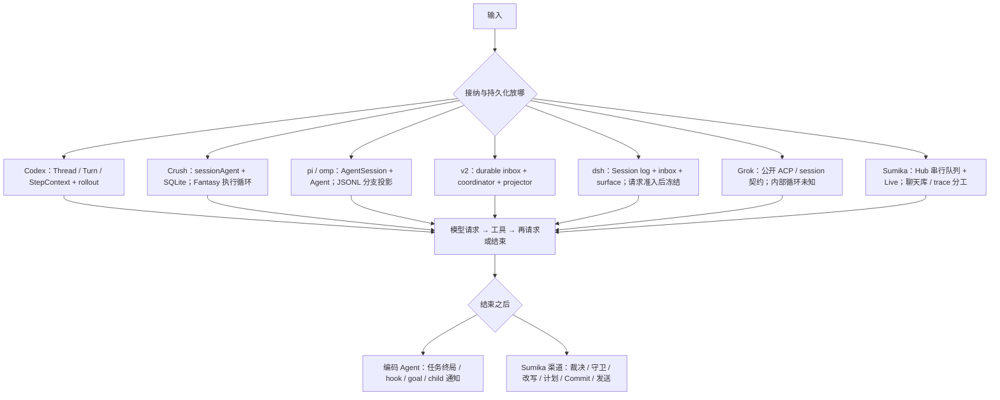

# 成熟 Agent 与 Sumika Go 后台对照（2026-11-03）

**结论：[INFERENCE] Sumika 的三处最强项是面向角色的长期记忆底座、按身份与四种场合划分的工具权限、生成与渠道裁决／发送分离的闭环；这是定位优势，不是性能或效果胜出证明。**
**最大的五个缺口：①工作上下文和结果证据不能完整冷恢复；②输入、运行、后台任务缺统一且可恢复的生命周期；③工具并发缺局部屏障、容量及整轮预算；④skill／MCP／搜索／子任务生态尚未接齐；⑤独立 advisor 与完成核验缺位。**
**建议先补三样：①贯通输入／回合／步骤／尝试／交付身份与停止排空（中，直接影响聊天不丢、不串、不误停）；②工具结果引用＋工作上下文恢复／压缩（大，决定能否连续干活）；③有界工具调度＋整轮预算（中，防长任务拖住聊天并限制累计消耗）。**
缓存已有稳定前缀、会话键、用量记录和提前压缩，应先补归因、未知用量和候选采用条件；没有证据支持先换内核或先加付费保温。生态恢复仍遵循现行待办顺序，本文的建议不替代排期。

## 1. 范围、样本与判定口径

本次先通读七份拆解，再独立读取 `仓库根/native` 的实现：`turn`、`memory`、`memwrite`、`approval`、`policy`、`linkplugin`、`channel`、`app`，并追到 `memplugin`、`history`、`projectcontext`、`tools`、`llm`、`store`、本地聊天 API 和本地群聊服务。没有用各拆解末尾“给 Sumika 的启发”代替查代码。还参考了同日[Agent 内核交叉分析](对照-Agent内核-交叉分析-2026-11-03.md)及[拆解笔记写法](拆解笔记-写法.md)；借前者对运行身份／投影／排空的分解，借后者对出处和证据边界的要求。

只新建本笔记；未运行程序、测试、模型请求、浏览器或 git 命令，未访问真实 `data/`，未修改待办或 ADR。下面的参数是源码或输入笔记里的实现常量，收益、优先级、大小均为 **[INFERENCE]**，没有本次性能实测。Sumika 源码取自主工作区，七份笔记在当前 worktree；两棵树不假定同提交。未冻结主工作区提交号，行号只定位本次读到的版本，复用结论前须按符号复核。

| 对象 | 本次采用的样本 | 证据边界 |
|---|---|---|
| Codex | `079e17a` | 七份输入之一；拆解记录为源码阅读，不把实验功能当默认开放 |
| Crush | `3b1f860`，Fantasy `v0.45.1` | 应用源码已拆；精确并发上限 5 只见旧笔记引用，当前拆解未取得依赖源码 |
| pi | `642e30b`，`1.5.0` | 普通 coding-agent 与独立 pi-durable 分开；示例扩展不算默认安装 |
| omp | `5dc44d3`，`18.16.0` | 与本机安装版不混用；advisor、隔离、保温均须另看开关 |
| opencode v2 | `2e8a861`，`2.2.5` | 只用 v2；Effect／Code Mode／durable inbox 是此树的实现 |
| deepseek-harness（dsh） | `0.2.1-rc.2` | 本体与 `dsh-superagent-prototype@0.1.0` 分开；不把原型当产品默认能力 |
| Grok Build | npm 元数据 `1.0.70` | 仅输入笔记中的官方／配套文档、已执行帮助；没有 Agent 源码，部分指南不绑定安装版 |
| Sumika | 主工作区 Go 代码的本次静态快照 | 以执行体和装配为准；旧 Bun 注释、说明书正文、已有规格不等于当前实现 |

大表使用任务要求的四种标签：**有**＝对应范围有实现或明确公开契约，未必默认开启；**部分**＝只有部分路径、示例／实验能力，或资料只覆盖接口而不能确认内部实现；**无**＝已查内置装配和对应路径未实现，不否认第三方扩展；**不适用**＝该行的产品对象不成立。Grok 的“部分”尤其不能读成“闭源实现必定缺一半”，精确未知项见脚注 7。表不计总分，避免把编码专用能力数量当陪伴产品优劣。

脚注 1～7 指向七份完整拆解及其上游源码定位；脚注 8～20 是本次直接核验的 Sumika 证据。外部机制的事实属“输入拆解所记读码／文档”；Sumika 事实属本次 **[读码]**。没有独立复读七家全部上游源码，也没有把文档升级成运行证明。

## 2. 能力大对照表

### 2.1 内核、工具和注入

| 能力 | Codex | Crush | pi | omp | opencode v2 | dsh | Grok | Sumika |
|---|---|---|---|---|---|---|---|---|
| 循环与 UI 分离／无界面入口 | 有[^1] | 有[^2] | 有[^3] | 有[^4] | 有[^5] | 有[^6] | 有[^7] | 有[^8] |
| 同会话串行、不同会话并发 | 有[^1] | 有[^2] | 有[^3] | 有[^4] | 有[^5] | 有[^6] | 部分[^7] | 有[^8] |
| 每次请求冻结模型／工具／上下文视图 | 有[^1] | 有[^2] | 有[^3] | 有[^4] | 有[^5] | 有[^6] | 部分[^7] | 有[^8] |
| 按身份／角色动态给工具 | 有[^1] | 有[^2] | 有[^3] | 有[^4] | 有[^5] | 有[^6] | 有[^7] | 有[^9] |
| 同响应多个工具并行 | 有[^1] | 有[^2] | 有[^3] | 有[^4] | 有[^5] | 有[^6] | 有[^7] | 有[^10] |
| 混合批次的局部独占屏障 | 有[^1] | 部分[^2] | 无[^3] | 有[^4] | 无[^5] | 有[^6] | 部分[^7] | 无[^10] |
| 普通工具批的明确并发容量 | 部分[^1] | 部分[^2] | 无[^3] | 部分[^4] | 部分[^5] | 有[^6] | 部分[^7] | 无[^10] |
| 完整工具调用到达即随流执行 | 有[^1] | 部分[^2] | 无[^3] | 部分[^4] | 有[^5] | 无[^6] | 部分[^7] | 无[^10] |
| 完成乱序、模型回填按调用序 | 有[^1] | 有[^2] | 有[^3] | 有[^4] | 有[^5] | 有[^6] | 部分[^7] | 有[^10] |
| 共同参数校验入口 | 有[^1] | 部分[^2] | 有[^3] | 有[^4] | 部分[^5] | 有[^6] | 部分[^7] | 部分[^10] |
| 输出截断时拒绝可能残缺的工具调用 | 部分[^1] | 有[^2] | 有[^3] | 有[^4] | 部分[^5] | 有[^6] | 部分[^7] | 有[^10] |
| 模型预览与 UI／程序结果分层 | 有[^1] | 有[^2] | 有[^3] | 有[^4] | 有[^5] | 有[^6] | 部分[^7] | 部分[^14] |
| 大结果截断并给全文续读入口 | 部分[^1] | 有[^2] | 有[^3] | 有[^4] | 有[^5] | 有[^6] | 部分[^7] | 部分[^14] |
| 受限程序组合工具、显式 await 依赖 | 有[^1] | 无[^2] | 有[^3] | 有[^4] | 有[^5] | 有[^6] | 有[^7] | 无[^20] |
| MCP 工具接入 | 有[^1] | 有[^2] | 有[^3] | 有[^4] | 有[^5] | 有[^6] | 有[^7] | 无[^20] |
| schema／工具目录按需披露 | 有[^1] | 无[^2] | 有[^3] | 有[^4] | 有[^5] | 有[^6] | 有[^7] | 无[^9] |
| 项目规则发现与来源记录 | 有[^1] | 有[^2] | 有[^3] | 有[^4] | 有[^5] | 有[^6] | 有[^7] | 有[^15] |
| 规则更新／删除的追加式接纳 | 有[^1] | 部分[^2] | 有[^3] | 有[^4] | 有[^5] | 有[^6] | 部分[^7] | 有[^15] |
| skill 短目录＋正文按需加载 | 有[^1] | 有[^2] | 有[^3] | 有[^4] | 有[^5] | 有[^6] | 有[^7] | 无[^20] |
| 显式／隐式 skill 加载证据与诊断 | 有[^1] | 有[^2] | 部分[^3] | 有[^4] | 部分[^5] | 部分[^6] | 部分[^7] | 无[^20] |

### 2.2 上下文、记忆和缓存

| 能力 | Codex | Crush | pi | omp | opencode v2 | dsh | Grok | Sumika |
|---|---|---|---|---|---|---|---|---|
| 自动／手动上下文压缩 | 有[^1] | 有[^2] | 有[^3] | 有[^4] | 有[^5] | 有[^6] | 有[^7] | 有[^11] |
| 摘要外保留近期完整原文组 | 有[^1] | 无[^2] | 有[^3] | 有[^4] | 有[^5] | 有[^6] | 部分[^7] | 有[^11] |
| 后台提前摘要／候选预计算 | 有[^1] | 无[^2] | 无[^3] | 部分[^4] | 有[^5] | 无[^6] | 部分[^7] | 有[^11] |
| 原生 provider 压缩 | 有[^1] | 无[^2] | 部分[^3] | 有[^4] | 有[^5] | 无[^6] | 部分[^7] | 无[^11] |
| 旧工具结果精简且保持配对 | 有[^1] | 部分[^2] | 有[^3] | 有[^4] | 有[^5] | 有[^6] | 有[^7] | 有[^11] |
| 工作摘要保目标／进度／结果证据 | 有[^1] | 有[^2] | 有[^3] | 有[^4] | 有[^5] | 有[^6] | 部分[^7] | 部分[^11] |
| 请求投影能追溯原始记录 | 有[^1] | 有[^2] | 有[^3] | 有[^4] | 有[^5] | 有[^6] | 部分[^7] | 部分[^12] |
| 冷恢复保留已执行工具上下文 | 有[^1] | 有[^2] | 有[^3] | 有[^4] | 有[^5] | 有[^6] | 有[^7] | 部分[^12] |
| 用实报 usage 锚点校正窗口估算 | 有[^1] | 有[^2] | 有[^3] | 有[^4] | 有[^5] | 有[^6] | 部分[^7] | 有[^11] |
| 固定前缀／动态后缀稳定策略 | 有[^1] | 部分[^2] | 有[^3] | 有[^4] | 有[^5] | 有[^6] | 部分[^7] | 有[^11] |
| provider 缓存读写量记录 | 有[^1] | 有[^2] | 有[^3] | 有[^4] | 有[^5] | 有[^6] | 有[^7] | 有[^17] |
| 缓存损失／经济收益反馈 | 部分[^1] | 部分[^2] | 有[^3] | 有[^4] | 部分[^5] | 部分[^6] | 部分[^7] | 部分[^17] |
| 主动缓存保温 | 部分[^1] | 无[^2] | 有[^3] | 有[^4] | 无[^5] | 无[^6] | 部分[^7] | 无[^20] |
| 原生思考／签名兼容回传 | 有[^1] | 有[^2] | 有[^3] | 有[^4] | 有[^5] | 有[^6] | 部分[^7] | 部分[^17] |
| 类型化多模态进入主模型请求 | 有[^1] | 有[^2] | 有[^3] | 有[^4] | 有[^5] | 有[^6] | 有[^7] | 部分[^17] |
| 内置跨会话长期记忆 | 有[^1] | 无[^2] | 无[^3] | 有[^4] | 无[^5] | 无[^6] | 有[^7] | 有[^16] |
| 记忆按人物／来源／场合建模 | 部分[^1] | 不适用[^2] | 不适用[^3] | 部分[^4] | 不适用[^5] | 不适用[^6] | 部分[^7] | 有[^16] |
| 不触发回复的输入也可驱动记忆整理 | 部分[^1] | 不适用[^2] | 不适用[^3] | 部分[^4] | 不适用[^5] | 不适用[^6] | 部分[^7] | 有[^16] |

### 2.3 输入、任务、advisor 和停止

| 能力 | Codex | Crush | pi | omp | opencode v2 | dsh | Grok | Sumika |
|---|---|---|---|---|---|---|---|---|
| steer：下一安全边界进入当前工作 | 有[^1] | 有[^2] | 有[^3] | 有[^4] | 有[^5] | 有[^6] | 有[^7] | 部分[^13] |
| follow-up：保留成后续独立任务 | 有[^1] | 有[^2] | 有[^3] | 有[^4] | 有[^5] | 有[^6] | 有[^7] | 部分[^13] |
| 待投递输入持久化／重启恢复 | 有[^1] | 无[^2] | 部分[^3] | 部分[^4] | 有[^5] | 有[^6] | 部分[^7] | 无[^13] |
| 待发项编辑／取消／改投递方式 | 有[^1] | 部分[^2] | 有[^3] | 有[^4] | 有[^5] | 有[^6] | 有[^7] | 部分[^13] |
| 停止当前模型／合作式工具 | 有[^1] | 有[^2] | 有[^3] | 有[^4] | 有[^5] | 有[^6] | 有[^7] | 有[^13] |
| 区分中断受理与整个工作已停稳 | 有[^1] | 有[^2] | 有[^3] | 有[^4] | 有[^5] | 有[^6] | 部分[^7] | 部分[^18] |
| 后台 shell／任务编号与完成通知 | 有[^1] | 有[^2] | 部分[^3] | 有[^4] | 有[^5] | 有[^6] | 有[^7] | 无[^20] |
| 子任务独立身份／上下文／父子归属 | 有[^1] | 有[^2] | 部分[^3] | 有[^4] | 有[^5] | 有[^6] | 有[^7] | 无[^20] |
| 子任务容量、深度、关闭责任 | 有[^1] | 有[^2] | 部分[^3] | 有[^4] | 有[^5] | 有[^6] | 有[^7] | 无[^20] |
| 持续独立 advisor 审阅与建议回流 | 部分[^1] | 无[^2] | 部分[^3] | 有[^4] | 部分[^5] | 部分[^6] | 部分[^7] | 无[^20] |
| 完成核验／goal 自动续轮 | 部分[^1] | 部分[^2] | 部分[^3] | 部分[^4] | 有[^5] | 有[^6] | 有[^7] | 无[^20] |
| 持久定时／条件工作 | 部分[^1] | 无[^2] | 部分[^3] | 部分[^4] | 有[^5] | 有[^6] | 有[^7] | 无[^20] |
| 结构化问用户、回答回流 | 有[^1] | 有[^2] | 部分[^3] | 有[^4] | 有[^5] | 有[^6] | 部分[^7] | 部分[^19] |
| 计划清单独立保存／恢复 | 有[^1] | 有[^2] | 部分[^3] | 有[^4] | 有[^5] | 部分[^6] | 有[^7] | 部分[^14] |
| 活动计划／技能材料防清理保护 | 部分[^1] | 有[^2] | 部分[^3] | 有[^4] | 有[^5] | 部分[^6] | 有[^7] | 部分[^11] |
| 角色／用途级多模型选择 | 有[^1] | 有[^2] | 有[^3] | 有[^4] | 有[^5] | 有[^6] | 有[^7] | 有[^17] |
| 通用跨模型失败切换 | 部分[^1] | 无[^2] | 部分[^3] | 有[^4] | 无[^5] | 无[^6] | 部分[^7] | 无[^20] |
| 整轮请求／工具／token／金额预算 | 部分[^1] | 部分[^2] | 部分[^3] | 有[^4] | 部分[^5] | 部分[^6] | 有[^7] | 无[^10] |

### 2.4 文件、安全、持久化和额外通用能力

本组把七份第 9 节的同义项合并：来源与投影合到“请求溯源”，异步结构问答合到上一表；区别很大的能力保留独立行。专有机制的具体边界再见第 4 节。

| 能力 | Codex | Crush | pi | omp | opencode v2 | dsh | Grok | Sumika |
|---|---|---|---|---|---|---|---|---|
| 工作区有界文本读／词法搜／路径搜 | 有[^1] | 有[^2] | 有[^3] | 有[^4] | 有[^5] | 有[^6] | 有[^7] | 有[^14] |
| 代码结构导航／结构摘要／LSP | 部分[^1] | 有[^2] | 部分[^3] | 有[^4] | 部分[^5] | 有[^6] | 有[^7] | 无[^20] |
| 内置代码语义／图检索 | 无[^1] | 部分[^2] | 无[^3] | 有[^4] | 无[^5] | 无[^6] | 部分[^7] | 无[^20] |
| 多执行环境／远程 FS 后端抽象 | 有[^1] | 部分[^2] | 有[^3] | 有[^4] | 有[^5] | 有[^6] | 部分[^7] | 部分[^15] |
| 编辑前观察／过期内容防覆盖 | 部分[^1] | 有[^2] | 部分[^3] | 有[^4] | 部分[^5] | 有[^6] | 部分[^7] | 部分[^14] |
| 工作区文件快照／统一代码撤回 | 无[^1] | 部分[^2] | 部分[^3] | 部分[^4] | 有[^5] | 部分[^6] | 部分[^7] | 无[^20] |
| 工具调用异常、崩溃遗留结算 | 有[^1] | 有[^2] | 有[^3] | 有[^4] | 有[^5] | 有[^6] | 部分[^7] | 有[^12] |
| 对话分支／fork／rewind | 有[^1] | 部分[^2] | 有[^3] | 有[^4] | 有[^5] | 有[^6] | 有[^7] | 部分[^12] |
| 来源信任与执行授权分开 | 有[^1] | 部分[^2] | 有[^3] | 有[^4] | 有[^5] | 有[^6] | 有[^7] | 有[^9] |
| OS 级文件／进程沙箱 | 有[^1] | 无[^2] | 无[^3] | 部分[^4] | 部分[^5] | 有[^6] | 部分[^7] | 无[^20] |
| 用户可配置生命周期 hooks | 有[^1] | 有[^2] | 有[^3] | 有[^4] | 有[^5] | 有[^6] | 有[^7] | 无[^20] |
| 插件撤销／更新与在途身份绑定 | 有[^1] | 部分[^2] | 有[^3] | 有[^4] | 有[^5] | 有[^6] | 部分[^7] | 有[^9] |
| 慢消费者背压／终态快照补齐 | 有[^1] | 部分[^2] | 有[^3] | 部分[^4] | 有[^5] | 部分[^6] | 部分[^7] | 部分[^18] |
| 界面已读状态与模型消费分开 | 有[^1] | 部分[^2] | 部分[^3] | 部分[^4] | 部分[^5] | 有[^6] | 部分[^7] | 有[^18] |
| 工具／模型／压缩用量与过程可观测 | 有[^1] | 有[^2] | 有[^3] | 有[^4] | 有[^5] | 有[^6] | 有[^7] | 部分[^17] |
| 用量完整性与未知费用显式区分 | 部分[^1] | 有[^2] | 有[^3] | 部分[^4] | 部分[^5] | 部分[^6] | 有[^7] | 部分[^17] |
| 宿主编辑器现场／直接 shell 输入 | 部分[^1] | 有[^2] | 有[^3] | 有[^4] | 有[^5] | 部分[^6] | 有[^7] | 部分[^14] |
| 统一可寻址资源／资料续读 | 部分[^1] | 部分[^2] | 部分[^3] | 有[^4] | 部分[^5] | 有[^6] | 部分[^7] | 部分[^14] |
| 预测工具执行、校验后才提交 | 部分[^1] | 无[^2] | 无[^3] | 有[^4] | 无[^5] | 无[^6] | 部分[^7] | 无[^20] |
| 生成中按规则触发纠偏 | 部分[^1] | 无[^2] | 部分[^3] | 有[^4] | 部分[^5] | 部分[^6] | 部分[^7] | 无[^20] |
| 请求出站的秘密变换／混淆层 | 部分[^1] | 部分[^2] | 部分[^3] | 有[^4] | 部分[^5] | 部分[^6] | 部分[^7] | 部分[^18] |
| 实时多人共享 Agent 会话 | 部分[^1] | 部分[^2] | 无[^3] | 有[^4] | 部分[^5] | 部分[^6] | 部分[^7] | 无[^20] |
| 多人渠道收发与原渠道回复 | 部分[^1] | 有[^2] | 部分[^3] | 部分[^4] | 部分[^5] | 部分[^6] | 部分[^7] | 有[^19] |
| 工作事务／授权工单／可靠发件箱 | 部分[^1] | 无[^2] | 部分[^3] | 部分[^4] | 部分[^5] | 部分[^6] | 部分[^7] | 部分[^19] |

### 2.5 证据脚注

[^1]: [Codex 拆解](拆解-codex-2026-11-03.md) §1～9，样本 `079e17a`。上游根 `_external/codex/codex-rs/`：`core/src/session/step_context.rs:22`（请求视图）、`tools/parallel.rs:272`（共享／独占、顺序回填）、`session/turn.rs:3033`（随流执行）、`tools/spec_plan.rs:310`（曝光）、`ext/skills/src/extension.rs:193`、`core/src/session/async_compaction.rs:24`、`core/src/client.rs:646`、`ext/queue/src/service.rs:40`。§9 覆盖异步问答、多环境、背压、revision、来源、skill 统计。表中“部分”保留以下限制：普通工具统一容量、缓存经济反馈、warmer、通用 failover、goal／schedule、生成纠偏、秘密出站变换及工作 outbox 没有充分等价证据；Guardian／Review／子代理不能计成 omp 式持续 advisor。GhostSnapshot 已停生成；文件改动统一撤回不成立。语义索引的“无”限已查 core/ext/file-search，不排除 MCP。
[^2]: [Crush 拆解](拆解-crush-2026-11-03.md) §一～十一，`3b1f860`。`internal/agent/agent.go:633,891,1622`（生命周期、逐步工具、请求投影）、`settle.go:82`、`loop_detection.go:11`、`skills/skills.go:300`、`permission/permission.go:157`、`agent/tools/bash.go:499`、`message/message.go:255`。并发实现依赖 Fantasy，本次拆解只在应用看到并发工具与结果重排；容量 5、精确屏障和随流时机不升格一级证据。§九另含 bang shell、slash、host context、MCP channel、网页取材、pinentry／askpass、Prism 路由、自省与迟到 UI 探测。没有专用长期事实记忆，“不适用”指无此记忆子系统可比较其社交范围。pubsub MustDeliver 仍可超时丢弃；文件历史不等于统一撤回。其他“部分”表示辅助机制或当前拆解不足以确认完整契约。
[^3]: [pi 拆解](拆解-pi-2026-11-03.md) §1～10，`642e30b`。`packages/agent/src/agent-loop.ts:536,605`（整批模式与 Promise.all）、`coding-agent/src/core/session-manager.ts:476`（投影）、`core/compaction/compaction.ts:351`、`core/cache-stats.ts:53`、`core/cache-warmer.ts:285`、`src/extensions/tool-search/tool.ts:295`。§9 另含 settled、动态工具重放、structuredContent、同文件 edits、length 拒执行、连接等待、资源信任、脚本状态和 stdout 背压。subagent／reviewer／todo／plan／checkpoint／permission gate 属示例，均计“部分”；普通 CLI 队列不持久，pi-durable 单列可用包故计“部分”。普通工具无固定容量；任一 sequential 使整批串行。没有默认长期事实记忆／代码向量索引；原生压缩、多人协作、秘密变换等未形成该拆解确认的完整默认能力。
[^4]: [omp 拆解](拆解-omp-2026-11-03.md) §1～9，。`packages/agent/src/agent-loop.ts:3459,3861`（完成与回填、屏障）、`coding-agent/src/advisor/runtime.ts:401`、`session/session-advisors.ts:1736`、`tools/xdev.ts:1`、`session/compaction-methods.ts:44`、`agent/src/append-only-context.ts:94`。§9 七项为 TTSR、投机执行、资源 URI、编辑 provenance、持续 eval、collab、secrets；细节与限制见本文第 4.4 节。普通工具容量不能用 task 默认 32、eval worker 或 provider 局部 cap 替代；投机工具随流先算不等于普通批次全面随流执行。memory 默认 off、advisor 默认 off、secrets 默认 off；task 隔离不是完整 OS 沙箱。rewind 是对话分支并带结论，不统一回滚文件。经济维护有实现，未量收益。
[^5]: [opencode v2 拆解](拆解-opencode-2026-11-03.md) §1～10，`2e8a861`。`packages/core/src/session/inbox.ts:174,561`、`run-coordinator.ts:31`、`runner/step.ts:105,145`、`instructions/index.ts:144`、`compaction.ts:331,953`、`codemode/catalog.ts:44`、`tool-output.ts:68`。§9 七项为 goal、schedule、后台完成唤醒、durable log、目录版本化、多模态治理、持久 PTY。原生 JS Code Mode 本身受限，不替本机 shell 做 OS 隔离；WorkspaceDriver 可注入外部环境，所以沙箱计“部分”。未读到普通工具风险屏障／全局 cap。没有专用 advisor，以 subagent 或同模型 goal judge 计“部分”；没有内置长期事实记忆、代码向量索引或通用模型 failover。raw JSON schema 转换不出 codec 的路径不能称无条件严格验证。
[^6]: [dsh 拆解](拆解-deepseek-harness-2026-11-03.md) §1～10，本体 `0.2.1-rc.2`。`packages/core/agent-loop/src/agent.ts:398,624`、`tool-calls.ts:134`、`inbox.ts:106,209`、`core/tools/src/index.ts:206,1304`、`compaction/compaction-basic/src/index.ts:273`、`fs/fs-observation-policy/src/index.ts:21`。§9 本体七项为 goal、schedule、结构化 child output、多前端投影、reasoning replay、热组合、SSH／E2B provider；本体无专用长期事实记忆。Auto-review 是同路由工具授权审查，不是持续工作 advisor。货币 spend 本层不消费，故完整费用计“部分”。Windows 沙箱明确 partial；不能泛称跨平台等强。表末工作事务／outbox 的“部分”仅指独立 `dsh-superagent-prototype@0.1.0`：`src/app/effects.ts:43`、`outbox.ts:21`；绝非本体默认装配。普通随流提前工具执行、后台预摘要未见该路径。
[^7]: [Grok 拆解](拆解-grok-2026-11-03.md) §0～10。仅文档／既有帮助：U07（MCP）、U08（skill）、U12（规则）、U13（记忆）、U14（输出用量）、U15（协议）、U16（子代理）、U17（会话）、U20（后台）、U22（权限）、U24／25（观测），别名完整路径见原笔记 §0。普通工具并行有公开结果表示；安全分类、屏障、cap、回填次序、随流执行、残缺参数防线、线程模型、cache_control 断点与 TTL、稳定前缀、预摘要、压缩模型／切点、队列持久化均未公开，相关格为证据“部分”，不作存在／不存在判定。图索引有配置说明，不能等同向量检索。advisor 只确认通用 reviewer、goal evidence review、deep-research verifier、授权分类器，固定更强顾问未知。§9 另含 workflow、peer fork、tasks pane、draft、状态 JSON、LSP、Grove clone、管理员收紧；Linux/macOS 与 Windows 沙箱不可混推。文件 rewind 与 restore-code 文档有冲突，未确认完整统一撤回。secret 出站混淆／实时多人协作等未获完整证据。
[^8]: 本次直读 Sumika 根 `S = 仓库根/native/`。`internal/turn/hub.go:89,179,275,307,365,997,1404`：Hub、启动清扫、RespondContext、Send、enqueue、acquire、runTurn；同角色×会话串行，Live 按档与听众隔离。`turn.go:55,103` 的 Config／Built、`app/models.go:21` 的不可变 ModelRuntime、`app/app.go:307` 的装配。`cmd/sumika-go` 入口与 `internal/api`／`app` 提供无 GUI 内核消费；不等价公开稳定 Agent SDK／ACP。
[^9]: `S/internal/policy/policy.go:17,65` 的 Spec、中央 Specs；`approval/approval.go:93,108` 的 manual 默认与 Gate.Check；`turn/plugin.go:94,266,306,344,496,545` 的集中登记、听众筛选、原注册绑定、停用、接纳。注册／提供 schema 不等于授权；没有 deferred 工具目录。项目来源信任见 `projectcontext/plugin.go:120,215`。本地私聊可有文件／执行工具，本地群聊明确不继承私聊许可，QQ 私聊／QQ 群不提供本地执行。
[^10]: `S/internal/turn/loop.go:81,533,549,614,660,719`：解析修复＋对象检查、length 不执行、Gate、整批顺序／纯并行、每项 goroutine、按调用序结算、逐工具超时。`hub.go:1404,1434,1640`：响应收完后才进工具、主循环没有整轮步数终点；`guard.go:13` 只在连续 3／5／8 次重复追加提醒，不强制终止。没有普通批次统一容量，逐工具 timeout 不能当整轮预算或可靠排空。
[^11]: `S/internal/turn/turn.go:243,277` 的 CJK 估算与 ContextLimits（soft 0.7、hard 0.85、reserve 16,384、keep 20,000）；`loop.go:310,325` 请求与明细；`slim.go:12` 请求副本精简并保配对／Controlled；`compact.go:36,123,180,238` 的材料过滤、摘要、自检、epoch；`hub.go:718,753,780,997` 的硬线、等待提前任务、0.8×hard 提前压、下一轮采用。压缩当前模型，同前缀但滤掉参考信息／工具／思考，不是原生 compact API。聊天和工作摘要不是同一验收；QQ 常规策略为 trim。Controlled 保护仅请求精简，不承诺压缩／重建保留工作工件。
[^12]: `S/internal/history/history.go:49,89,122,155`：Cap 2000、按角色成功 epoch、聊天＋摘要重建；`turn/loop.go:31` 的 Msg Kind／Seq／Scope；`store/turns.go:55` 的 SweepInterrupted：活动工具未知、审批取消，不自动重做。`turn/hub.go:471` 附近 RestartIn 是丢 Live 后从聊天重建，不是会话树／文件 undo。热实例保工具往返，冷历史不完整保留其执行上下文，故恢复与溯源计“部分”。
[^13]: `S/internal/turn/steer.go:13,26,42,58`：accepted／delivered／dropped／Requeue、内存 slice、all 模式；`hub.go:307,390,417,1404`：Send 打断、SteerIn、StopIn、批后投递；`channel/respond.go:1,176`：安全路由与 held 批次。`api/localchat.go:29` 及 `app/desktop_chat.go:49,80`：正式桌面 LocalChat 只 Send／Stop，忙时 Busy，没有 Steer／FollowUp API。Hub 排队存在，但不等于用户可选且持久的 follow-up。
[^14]: `S/internal/tools/exec.go:24,40,56,177,244`：Text／Details、执行分支、文本 2000 行／50 KiB、read 图片未接；`tools/search.go` 的 grep／find 执行体（外部 rg／fd）；`shell.go:29,143,225` 与 `output.go:15,163`：前台 PowerShell、超时／杀树、尾输出和系统临时全文；`store/write.go:185,247`：steps 预览 16 KiB、details 64 KiB、full_hash=NULL。`tools/todo.go:16` 只校验／给回执，当前清单通过步骤参数重建；`turn/hub.go:1281` 的 todoReminder。`tools/mutation.go:13` 同真实路径 write／edit 排队，`edit.go:150,351` 当前内容替换与 edits 原文基准；没有 session 观察版本 CAS。read／search 输出有界不代表全文件 I/O 有界；本次不声称有统一多格式解码或代码索引。
[^15]: `S/internal/projectcontext/context.go:19,40,112,201`：单源 1 MiB、总渲染 32 KiB、Present／Absent／Unavailable、身份解析、目录链与 import；`plugin.go:120,175,215`：信任、ContextID 接纳账本、读／列后发现、写前补规则；`turn/workspace.go:39`：冻结工作区、QQ 归零；`app/app.go:324`：须启用且有受信任根才装配。`projectcontext` 的工作区抽象还不是远程 fs／subprocess provider。默认限额中的 Concurrency=8 是配置上限，Resolver 实际正文读取串行，不能当并行扫描性能依据。
[^16]: `S/internal/memory/recall.go:31,118,390`：Query、四种场合预算 1200／800／600或1200／400 字、词法＋向量与门控；`scope.go:60`：当前仍按 AllowedScopes 过滤。`memory/write.go:18,92`：事务、幂等、来源、证据、保护；`memwrite/memwrite.go:1,148`：记住／整理两档默认关、备份与前置检查。`memplugin/plugin.go:176,298,390`：Seen、关闭排空、追加与接纳后去重；`schedule.go:1,23`：无回复也整理、安静 10 分钟／40 条、默认并发 2、启动最多 20 批。存在实现不等于后台整理已启用／完整真实验收；ADR-242 要求与当前过滤差距见第 3 节。
[^17]: `S/internal/llm/llm.go:151,175,198,229` 的 Request、互斥 token buckets、UsageSeen、reasoning details；`turn/turn.go:232` 会话哈希键；`turn/loop.go:486` 逐次回复记录路由／TTFT／sections／context；`compact.go:247` 压缩独立 stage。`app/guarddeps.go:113` memoryGenerator 只交回 Text，辅助调用未全量入同一账；`app/models.go:21` 冻结发布与按用途模型。Msg 仍以 Text 为核心，渠道媒体存储／展示不等于主模型已接原图。热实例思考兼容回传不等于冷重建从日志回灌思考。没有缓存经济归因或命中效果实测。
[^18]: `S/internal/turn/hub.go:217` Idle 仅等提前压缩；`loop.go:719` timeout 可早于底层退出；`app/app.go:477` 分组件停收／取消／Outcome／审批／提前压缩／记忆／出口／关库，仍注释等待 Hub.Drain。`api/localchat.go:13` 与 `app/desktop_chat.go:49` 带身份累计草稿，`approval/subscribe.go`、`desktopread/service.go` 提供快照订阅基础；没有全运行 durable event 统一协议。桌面已读投影与模型消费不同，见 `docs/subsystems/go-tools.md` 的订阅／qq_read 契约。`app/log.go` 脱敏本地日志，不等于出站模型 prompt 的秘密混淆层。
[^19]: `S/internal/channel/gate.go:1` 入轮闸门；`respond.go:1` 回合／裁决屏障；`settle.go:1,214` 生成→守卫→改写→计划落库→Commit→Start；`app/channel.go:28,217,420` 链接双挂点与 QQ 仅主人私聊回复条件；`linkplugin/detail.go:17,35,70` 仅当前角色／会话已见消息详情和分页；`internal/localgroup/service.go:1,24` 真实本地群服务复用 Hub、有关闭等待，不是子代理。结构化交互目前有审批卡，通用 ask_owner／可继续独立工作的问答未接。渠道计划和发件结果存在，工作工单／Mandate／通用任务 outbox 尚未成立。
[^20]: 缺项检索范围：本次主工作区 `native/` 包目录、`go.mod`、生产 Go 中 `advisor|followUp|follow_up|skill|MCP|subagent|子代理` 的定位，继续核对 `turn` 全部相关执行段、`tools.Execute`、`policy.Specs`、`app.Open` 与项目资料装配。命中主要是说明书正文、测试样本、bench 或注释；`internal/skills` 只有内置说明书 Markdown，没有 loader／skill 工具装配。未发现 MCP client、通用搜索／网页工具、独立 child runner／advisor／goal／用户 hook／定时工作／通用 Code Mode、原生 OS sandbox、代码语义索引、全局秘密混淆、投机执行、TTSR、多人协作实现。“无”仅限这棵 Go 树内建路径，不拿底层能力可扩展、规格已写或外部工具能实现当成已交付功能；也不把记忆计时器算定时任务产品。对应现行待办生态条目在第 6 节。

## 3. 多数成熟 Agent 的共同功能：Sumika 已有多少、差在哪里

### 3.1 基础循环和并发已经具备，差在调度粒度与容量

七家都有 model→tools→model 的共同骨架；实现差异不在有没有 while。Sumika `runTurn` 已分模型请求、重试、结果落库、工具、插话；`Hub.enqueue` 串行同角色×会话，不同会话可重叠。它与 pi 普通循环同属“完整响应后执行工具批”，Codex／v2 可在流还没结束时执行已完整的调用。dsh 本体也在 assistant settlement 后运行工具批，不能把“现代”直接等同随流抢跑。[^1][^3][^5][^6][^8][^10]

[读码] Sumika 的 read/read 可并行；一项 write／edit／powershell／todo_write 或非 Parallel 插件出现，整批串行。纯并行批还须全部完成 prepare／审批才开 goroutine，后面的审批会挡住前面已获准的读取；结束入库按调用序，后发快调用的完成显示可能被前置慢调用挡住。现有顺序让 repeatGuard 的提醒位置确定，这是有意选择。局部屏障、执行容量、完成通知、模型回填、重复提醒结算是五件事，不能只改 Parallel 标记来“优化”。[^10]

[INFERENCE] 对陪伴＋干活而言，优先保证后台工具不会无界抢资源，再缩短独立读取等待。直接复制 omp 普通 bash=shared 不合适；Sumika 现有 shell 会产生广泛副作用，应保留独占判断直到有足够效果分类。dsh 的默认独占、明确 true 才并行，以及有界池更接近当前中央 policy 的方向。上限需测，不能抄 10 或把 Crush 二手的 5 当依据。

### 3.2 工具、skill、资料是三个独立的注入对象

七家都能按模式或角色给工具、发现技能后取正文、读取工程规则；六家存在某种按需 schema／程序目录路线，Crush 当前主要全部准入 schema 直接公布。连接延迟、schema 延迟和正文按需展开必须分开。[^1][^2][^3][^4][^5][^6][^7]

[读码] Sumika 的工具贡献已经有中央风险规格、听众过滤、执行前身份复查、撤销和迟到结果丢弃；Context contribution 有 OnAccepted，资料进入实例才记为已给过。项目规则已有真实路径信任、差量接纳、缺失与不可用区分、写前规则门槛。链接已有“短摘要→按消息编号详情”，记忆已有“固定要点＋相关召回→去重追加”。这些足以承接生态，不必另建插件宿主。缺的是 skill loader、MCP client、通用搜索／抓网页和规模化目录，不是“没有工具注入”。[^9][^15][^16][^19][^20]

[INFERENCE] skill 可借短目录＋按需正文＋来源绑定；MCP 仍沿统一 Gate。资料来源许可不能让本地群聊、QQ 私聊、QQ 群获得本地主窗口执行权限；编译内置说明书已有正文也不能据此称 skill 已启用。当前 `OnTool` 要中央 Specs 预登记，不能原样拿来注册任意 MCP 名称后就宣称动态风险契约解决了。

### 3.3 压缩、稳定前缀与缓存观测是共同基础，工作恢复才是关键差距

七家都管理长上下文和缓存用量，但没有共同的固定“80% 压缩算法”；窗口／输出预留、最近 usage、切点和模型路由分别影响策略。Crush 摘要整个有效窗口、不独立留原文尾，不能写成七家都“摘要＋最近 20k”。[^1][^2][^3][^4][^5][^6][^7]

[读码] Sumika 已有 soft 0.7 请求副本精简、hard=min(0.85W,W−reserve)、默认 reserve 16,384、keep 20,000；本地 summary 可在超过 0.8×hard 后后台提前压，失败后上下文未再长 10% 不重试，成功 epoch 下一轮重建采用。QQ 常规走 trim，不等于整套自动摘要覆盖四场合。摘要材料主动排除参考信息、工具调用／结果和思考；工具输出 token 被省掉，却没有可恢复工作交接替代物。[^11]

[读码] 冷重建主要读聊天＋成功 epoch；`history.Cap=2000` 还存在切点后中段读不到的已挂待办问题。steps 有工具记录，但只有 16 KiB 预览，全文统一引用未接。`todo_write` 清单可从步骤参数被提醒回来，不等于目标、失败命令、证据、材料和下一步一起恢复。压缩、回收、重启三条路径都要用同一工作材料解释，单改 compact-chat 提示词不够。[^12][^14]

[INFERENCE] 继续区分聊天事实、工作执行材料、长期记忆。做工作压缩须给材料自己的角色／会话／来源及保留规则；不把本地工作工具输出混进跨场合聊天摘要。聊天关系延续主要靠已有记忆；长工作延续需要可恢复的材料与结果引用，两者不能互相顶替。

### 3.4 输入队列、停止、终局是共同能力，前端可用性不能从 Hub 推导

七家都区分某种中途引导与后续工作；Codex、v2、dsh 有持久输入机制；pi 普通 CLI、Crush 和 Sumika 的主要待投递队列仍在内存。持久输入也不意味着工具副作用可 exactly-once 恢复。[^1][^2][^3][^5][^6][^13]

[读码] Sumika Hub 能 Send 打断、Steer 不取消且在本步连工具完成后送达，Stop 等所认定回合收尾；Steering 有 accepted／delivered／dropped／Requeue。渠道会按 Addressed、OwnerAsked、Scope 变化选择打断重回或插话，裁决／Commit 未结束时新批次挂起。当前正式桌面 API 仅 SendLocal／StopLocal，忙时 Busy；不能用旧 Bun 的 Enter／Alt+Enter 行为描述今日桌面。[^13][^19]

[读码] `Hub.Idle()` 只等提前压缩；app 另追 Outcome、审批、各组件。工具 timeout 可返回而底层尚未退出。记忆插件已有封准入→取消→停 timer→Wait 的完整本地模式，Hub 缺少同等统一排空。重复执行未知操作、旧通知唤醒已停止会话、未排空便关库都是需要在生命周期上解决的问题；本次没有运行重现这些风险，不把它们写成新增已复现 bug。[^18]

### 3.5 多模型、观测、恢复普遍存在；“更强 advisor”不是七家的共同默认

七家都有用途级模型或委派选择；只有 omp 的输入拆解确认了一套持续 advisor 子系统。Codex Guardian／dsh auto-review 是工具授权审查；v2 goal 是同模型完成判断；Grok goal／研究 verifier 是独立核验；通用 reviewer child 又是另一层。不能将它们合称自动更强模型顾问，也不能由“可选 model”推断更强。[^1][^4][^5][^6][^7]

[读码] Sumika 已有角色说话模型、后台模型、场合思考档位和 ModelRuntime 原子发布；回复／重试／压缩记 model_runs，有实际路由、TTFT、sections、context 与缓存量。`memoryGenerator` 只返回 Text，后台整理和守卫尚未统一记账；UsageSeen 在 llm 层存在，落库输入／输出默认零仍不能表达完整未知。没有 child／advisor／goal 运行器。[^17][^20]

[INFERENCE] 独立审阅值得补，但依赖可寻址工作证据、只读审阅输入、回流身份、预算、停止抑制和去重。先有这些，审阅可以按完成检查点运行；持续看每个工具轮会提高费用、积压和重复纠偏风险，暂不建议直接复制 omp 默认每轮审的节奏。

### 3.6 Sumika 应保留的三处定位优势及现实边界

1. **角色记忆不是工程规则文件。** [读码] 词法＋向量召回、候选／有效、证据、来源、幂等、记住／整理分档、Seen 驱动后台调度已形成领域底座；许多编码 Agent 的内置范围只到规则、会话和摘要。**现实边界**：`AllowedScopes` 仍是旧场合过滤；主待办与同日交叉分析已记录 ADR-242 尚待落实。“同角色四场合都能想起、再按场合决定表达”不能作为今天已实现强项。记忆的优势在结构和针对性，召回效果、写入质量与默认启用状态另验。[^16]
2. **听众、来源、工具许可由可信宿主绑定。** [读码] 本地私聊、本地群聊、QQ 私聊、QQ 群可共用循环而保持权限不同；插件名、说明文件、skill、模型理由不产生授权。这个边界比 pi 默认依赖可选 permission extension 更贴近多人陪伴。**现实边界**：它是宿主策略，不能等同 OS sandbox，进程／文件系统隔离仍缺。[^3][^9][^20]
3. **她想说什么与平台实际发出什么有明确屏障。** [读码] 字数保险丝、隐私守卫、渠道改写、拆条、试运行、计划、Commit 和实际发送分层；没发送的候选不当成她已公开说过。**现实边界**：本次静态阅读不证明真实 QQ 群开口验收；也不能把已落库计划或模型 Settled 当实际送达成功。[^19]

## 4. 各家独特设计：好在哪里，Sumika 值不值得借

“独特”指这份样本值得单列，不声称别家绝无。下面的价值判断均为 **[INFERENCE]**。

### 4.1 Codex：一次采样一份能力视图，后台优化有采用条件

[输入拆解读码] `StepContext` 把 settings、环境、MCP、router、AGENTS 放在同一请求版本；WorldState sections 有稳定身份与 Known／Unknown／Absent；后台压缩候选绑定历史版本、model、compaction hash、auth owner，安装时再检查；工具 shared／exclusive 用 RwLock，运行与有序回填分开。`request_user_input_async` 先 accepted，可继续独立工作；app-server 的慢连接处理、通知过滤、读状态 expectedRevision 也是契约。[^1]

**借**：把 Sumika 已有 Built、ModelRuntime、Workspace、ContextID、原注册 binding 收成可记录的一次请求事实；为提前压缩补候选为何可用／何时采用的条件；将异步问答与审批分开。**不直接搬**：多环境 shell schema、庞大 app-server／协作体系、Guardian 自动批准。Sumika 同进程原生 API 已有用途，不需要先拆多进程。沙箱机制可独立调研，不能用第二意见代替确定性 Gate。

### 4.2 Crush：显式受理与终局、流式中间态合并

[输入拆解读码] AcceptedRun 先保留接收身份，RunID 与 RunComplete 绑定本次工作；普通插话和带 RunID 的后续 run 分流。消息更新约 33 ms 合并，结构／终局先 flush，再发布最终文本。请求前将持久消息重排成严格 call/result 投影；大 shell 输出有全文落盘；large／subLarge／small 整体发布。MCP channel、HostContext、AddNote、small 网页取材、pinentry／askpass、自省工具是超出基本 CLI 的补充。[^2]

**借**：受理／运行／终局显式关联、累计正文与终局先落稳定状态、独立网页取材只回必要结论、工具／插件不可用有理由。**保留边界**：不能照抄 RunID 空不空隐式决定输入模式；MustDeliver 50 ms 超时仍可丢；规则 map 拼接存在前缀顺序风险；权限全局等待锁也不值得搬。编辑器光标、LSP 重命名、GPG TUI 不是当前 QQ 角色主线，按工作工具需要后置。

### 4.3 pi：小循环、可重放投影、缓存损失能算账

[输入拆解读码] Agent／AgentSession／provider 分层；会话树 entry 与 context_edit 追加而不改原始记录，投影保留 sourceEntry→messages；工具变更可随历史重放。Tool exposure 区分 direct／model-only／codemode／deferred／hidden，tool_search 激活下一请求 schema。structuredContent 给脚本，模型只看 content；同文件 edits 对原文件匹配。agent_end 与 settled／idle 分开，stdout 背压参与等待。缓存损失有 missedTokens／missedCost，保温按预计收益决定。[^3]

**借**：请求投影与恢复共享解释、材料来源、工具结构化结果与预览分层、缓存分段归因、真正停稳的生命周期。**按需借**：Code Mode 可减少大 JSON 反复进模型，但不是第一阶段依赖。**不照搬**：普通 read 整文件读后切片、无普通批次 cap、默认无内置强制工具审批。pi-durable 可作为状态设计参照，不能写成换上普通 pi JSONL 就获得任务崩溃恢复。

### 4.4 omp：advisor 是状态机，资源与工具可寻址

[输入拆解读码] advisor 独立 transcript、delta cursor、模型／工具，默认关闭；note 有 nit／concern／blocker，分别 aside／steer／可续跑，去重、immuneTurns、backlog、停止抑制和反循环一起设计。资源 URI 将 skill／artifact／agent／proc 接到少量 read/write 入口，xd 运输工具共用规范 registry。prune 会考虑热缓存后缀；计划与 skill 原文受保护；hashline／seen-line 给编辑来源证据。[^4]

**优先借**：advisor 输入范围、证据引用、严重度／回流、停后不自启，以及 artifact 的“短预览＋受限续读”。Sumika 可用角色／会话／已见资料身份做 locator，不能把 URI 本身当权限。缓存维护先看实际缓存量，不机械追求 token 越少越好。

**后置或不借**：TTSR 适合明确可判断的生成规则，现阶段不加到普通陪伴语气；投机执行要求 bounded effects 与 committed 依赖，先稳定任务寿命；snapcompact 有裁剪、vision 和计费代价，不适合长期人物记忆；持续 eval 能力需独立预算与权限；多人 collab 对日常一位主人价值低；IDA／二进制分析、仓库树结构摘要是专用工作能力。默认审批 yolo、child yolo overlay 不符合 Sumika 当前边界。secrets 混淆是可选且默认关闭，不能误称 omp 的凭据绝不出站。

### 4.5 opencode v2：durable inbox 与唤醒分离，先算摘要后选择采用

[输入拆解读码] durable inbox 是事实，coordinator wake 是 doorbell；steer、queue、compaction、move 分开，stopping 期间再来 wake 可开后继运行。Bus 事务投影、durable log 水位、live SSE 与慢订阅者失败分开。规则／skill／catalog 同用 initial／changed／removed 版本输入。预摘要默认关闭，达到条件异步预备，模型／规则／历史锚点不匹配则弃；原热前缀可继续用到真正压缩。后台 shell／child 完成 synthetic 通知可唤醒；Rust PTY 有独立寿命；goal 有 stalled／轮数／重启暂停保护；schedule 用 lease 防多宿主重复触发。[^5]

**借**：输入持久状态与唤醒锁存、目录差量接纳、后台结果归原会话、候选采用校验、活动与终局区分。**谨慎借**：工作恢复可 at-least-once，外部副作用可能重复；Sumika 重启后的未知操作仍不应自动重做，QQ 旧回复不能因恢复自动续发。Git 文件树回退和持久 PTY 不属聊天必需；当前用户对存储体积有顾虑，现有待办还明确文件回退先不做。Effect／HTTP 服务框架本身不搬，保留 Go 和原生进程内接口。

### 4.6 dsh：默认独占、有界并行、事件准入与副作用分层

[输入拆解读码] `isConcurrencySafe(args) === true` 才并行，异常退独占；普通上限 10，审批／prepare 按序，execute 可重叠，commitReady 按调用序。请求从 session surface 派生冻结，header／context／attempt／结果有日志身份；checkpoint-policy 在请求／顶层副作用前 flush，失败不派发。工具 canonical value、模型 render、UI metadata 分开；fs observation 由 session owner 记录，provider 用版本做原子新鲜度检查。next-step／next-turn 持久且 claimed／admitted 分开；child 持久身份与当前 activation／slot／关闭责任分开。[^6]

**借**：调度的默认收紧、有界池、输入准入、结果投影、provider freshness、child 的 owner 和活动期；这些可以逐个落在 Go 包内。**不搬**：Cordis／PTC／profile 全套宿主；Auto-review 的 danger-full-access 组合和卸载后的降级行为；把 summary 中所有工具结果原样当可共享事实。

**原型单列**：Super-agent 的 Trigger→Decision／Mandate→Ticket→Worker→Reply／Outbox 适合日后常驻主动工作。Effects 的 `(kind,key,generation)` 防旧完成删除新 payload，Outbox receipt 与调度事务相连；并未证明外部发送 exactly-once。Sumika 已有渠道计划／回执，先对应边界，再评估工作工单层，不能把整个原型加到每条普通聊天。

### 4.7 Grok：完成用证据核验，研究以 claim 为单位

[输入拆解文档] `/goal` 有验收条件与独立 evidence review；`/deep-research` researcher 产 claims／sources、verifier 独立核验，通过项才进报告，覆盖不足标 Partial。MCP 用稳定 search／use 元工具，结果溢出落盘、大参数可走批准快照。send-now、steer／queue／interject、命令后台化分别定义；tasks pane 显示 Agent idle 但后台仍在工作。记忆 capture→observations→Dream→bounded topic index，flush 等已结束或停止轮次的捕获；用量有 partial／incomplete／未知费用与整数 ticks。[^7]

**借**：任务完成须指向证据，研究答复逐 claim 对来源；停止等候不必杀后台任务；用户看到统一任务状态；用量未知不当免费；记忆捕获和整理分工。**不据此推实施**：普通工具内部并发、缓存前缀、压缩切点与默认更强顾问均未知。Grove 的 NFS／FUSE 按需仓库、共享 leader、clone／worktree 管理、管理员 marketplace 限制偏编码产品，对当前 Windows QQ 角色优先级低。不能据 macOS／Linux 文档宣称 Windows 已有相同 OS 沙箱。

## 5. 架构与实现思路：分歧发生在哪里

### 5.1 核心循环：共同骨架，相异的事实来源

出处：七份 §1、Sumika 脚注 8／19。图中的 Grok 仅为文档契约，不是反推实现。

[INFERENCE] Sumika 的主要债务是热 Live 的工作内容与冷聊天历史不对称，以及受理、执行、交付的身份还未贯通。先形成可恢复执行投影，保留聊天 Events；不要求全量事件溯源，不把所有流式 token 永久记录。右侧栏需要的运行事实也应使用这套契约。

### 5.2 并发模型：会话、工具、后台工作三层分别限

| 对象 | 调度单元与串行约束 | 后台工作边界 |
|---|---|---|
| Codex | Tokio task；turn／step 捕获，工具共享／独占锁 | shell 真实子进程、子代理线程身份、后台 compact TaskTracker |
| Crush | Go goroutine＋context；session dispatch 锁，Fantasy 工具循环 | shell job、task child session、标题、MCP／LSP 各有 owner |
| pi | Promise＋AbortController；一个 Agent active run | 默认子代理是示例子进程，durable 另包；MCP／warmer 另寿命 |
| omp | 普通 task 在进程内 AgentSession；shared／exclusive | AsyncJob、child registry、advisor、模型 worker；各有归属与容量 |
| v2 | Effect fiber＋Scope；coordinator 每 session 一个 execution | Job、后台 child、Rust PTY；停止受理不等于全部 finalizer 完成 |
| dsh | 唯一 driver Promise；durable inbox；工具 rolling pool | ActivationPool、owned children、jobs-local，dispose 等合作式收尾 |
| Grok | 核心执行器／线程模型未知 | 文档确认共享 leader、后台命令、child、loop／monitor；实现细节未知 |
| Sumika | Go goroutine；sendTail／turnTail 同角色×会话串行 | 提前压缩 WaitGroup；记忆独立 sem＋timer；app 分散追 Outcome／关闭 |

出处：七份 §1／7／8、脚注 8／16／18。没有“一代理固定一线程”的共同模式。

[INFERENCE] 不应把记忆整理默认并发 2、实例最多 8 个与工具容量混为一谈。MaxLive 控制热实例回收，还会在无法回收时暂时超出；它不限制同时运行请求。未来 child／advisor 必须算到任务寿命和预算，等待 child 的父请求不能一直占模型派发槽；底层超时仍在跑的工作也不能提前释放实际执行容量。

### 5.3 工具调度：三个时间点和四种常见策略

| 路线 | 执行何时开始 | 混合批 | 结果何时进模型历史 |
|---|---|---|---|
| Codex | 完整调用随流派发 | 并行读锁／独占写锁 | FuturesOrdered 按调用序 drain |
| Crush／Fantasy | 应用层已确认并行；底层精确时机本次证据不足 | 并行属性／容量依赖 Fantasy，屏障待核 | 持久记录可乱序，请求投影按 call 重排 |
| pi | 完整响应后；先 prepare 全批 | 任一 sequential 则整批串行 | Promise.all 收齐后按调用序 |
| omp | 普通工具批在响应完成后；可选投机先算另论 | shared／exclusive 局部屏障 | nextResultIndex 释放连续就绪前缀 |
| v2 | 完整调用随流 fork | 此路径无通用风险屏障／cap 证据 | call ID／ordinal 记录，回放按调用序 |
| dsh | assistant 结算后，prepare 按序，池内 execute 重叠 | 明确 safe 才并行、上限 10、exclusive 屏障 | commitReady 按模型顺序 finalize／记录 |
| Grok | 公开了 parallel result，调度时点未知 | 安全标记、cap、屏障未知 | ID 配对公开，精确重排未知 |
| Sumika | 完整响应后，纯并行要先 prepare 全批 | 任一 sequential 整批串行；否则每项 goroutine | 按原序收 outs，note／StepEnd／Msg 都按序 |

出处：七份 §2、脚注 10。**没有一家在这些普通工具批路径里证明了按参数自动推导任意依赖 DAG。** B 需要 A 的实际结果，就放下一次模型请求，或程序中 `await A` 后调用 B。独占屏障只规定副作用顺序，不会生成尚未知的参数。

Sumika 拟借后的形状（只是建议）：`read A / read B → 等已启动读收尾 → write C → read D`；Gate 先于真正执行，模型历史继续按序。若先来的 prepare／审批阻塞，是否允许后面调用先准入要另定语义，不能因为上了池就默认任意越序。完成状态可先通知 UI，但模型回填、repeatGuard 仍按稳定顺序结算。

### 5.4 上下文与缓存：少 token、可恢复、热前缀是不同目标

| 对象 | 摘要／保留策略 | 稳定与缓存策略 | 核心代价 |
|---|---|---|---|
| Codex | 普通摘要、remote v2、token-budget 不同路线；可异步候选 | WorldState、稳定 item ID、session cache key、可用时增量传输 | 候选失效仍花钱；传输增量不证明 KV 命中 |
| Crush | large 模型总结有效窗口，summary pointer 后继续 | 工具／skill 排序、cache_control、session affinity | 不独立保原文 tail；规则 map 顺序可能变化 |
| pi | 当前模型摘要＋约 20k tail；context_edit／投影可重放 | system／tool delta、provider 分路、missedCost、warmer | 清理会重写模型投影，旧 usage 锚点须失效 |
| omp | remote／snapcompact／handoff／shake／soft 方法链＋tail | StablePrefix、静态头／易变尾、cache-aware prune、warmer | 维护策略与失效面大，图片压缩非无损／免费 |
| v2 | summary／native，约 15k keep，可预计算 | 初始指令＋delta、稳定 schema、affinity、媒体滞回 | 预计算需校验模型／规则／锚点，重启不保其候选 |
| dsh | pressure→先 prune→必要时 summary，tail 按窗口比例 | 稳定 section／tool 排序、能力允许才 in-history updates | surface replacement 仍破缓存；费用 ledger 不在本层 |
| Grok | compact＋pruning 已公开，具体切点／模型未知 | cache buckets 公开；前缀／断点／TTL 未知 | 只能谈公开契约，不报缓存策略优劣 |
| Sumika | 聊天摘要＋原文尾；QQ trim；请求级 slim；提前压 | 固定 sections／工具、只追加参考、会话哈希 key、LongCache | 规则／模型／epoch 变更重建；工具材料不进冷恢复 |

出处：七份 §3、脚注 11／12／17。默认值不能脱离模型与启用条件比较，dsh 大 headroom、omp 的方法链、Codex 的 Remote V2 也不能直接替换 Sumika 当前摘要接口。

缓存观测建议统一为 `ΣCacheRead / Σ(Input + CacheRead + CacheWrite)`，分母为 0 或未报告则无值；Sumika 的 Input 已是未命中输入。Reasoning 是 Output 的子集，不再加一次。要按 provider 原口径归一，Codex 的 input_tokens 若已含 cached 则分母直接用完整 input，不能重复相加。分别记录新实例、改模型／工具／规则、压缩、精简、渠道回填造成的边界变化；本地前缀字节复用、cache key、HTTP／WebSocket 增量、服务端 cached tokens 四者分开。

[INFERENCE] Sumika 先让现有 model_runs 能解释“这次为什么断前缀、哪些用量未知”，再决定 provider 原生断点、保温或延迟采用摘要。长聊里保证正确的听众与已公开内容，可能有合理缓存代价，不能把低于 90% 一概当 bug。主待办已有此取舍说明（第 169 行）。

## 6. 建议清单、落包与现有待办对账

**以下都是建议，[INFERENCE]，未获实施批准。** 大小是改动面：小＝已有边界内补一种能力；中＝共同契约和数个消费者；大＝涉及持久状态、恢复、任务所有权或跨包迁移，不是工时／行数承诺。待办核对的是 `仓库根/docs/待办.md` 本次文本，旧 Bun 进度不作 Go 交付证据；不修改该文件。先做三样按开头顺序，缓存归因可随第一项已有记录改造并做。

| 优先 | 借什么／从哪家借 | Sumika 落在哪些包 | 大小与定位收益 | 已挂主待办吗 |
|---|---|---|---|---|
| 先补 1 | 输入受理→运行→尝试→工具→终局→交付的身份；停收／取消／排空分开。Codex StepContext，Crush AcceptedRun／RunComplete，pi settled，v2 coordinator，dsh admission | `turn`、`api`、`app`、`approval`、`channel`、`store`、`desktopread` | 中；聊天不串会话、不漏终态、停后不误唤醒，为右侧栏和后台任务提供共同基础 | **部分已挂**：第 379 行“装配要的三样内核接口”①Drain③带身份流式事件；第 396 行“她在想什么”第 2／3 步；第 49 行内核交叉分析待决。输入持久化和桌面显式 steer／queue 尚无独立实施条目；第 196 行排队完成是旧 Bun 历史 |
| 先补 2 | 工作材料／来源投影、全文引用、恢复与工作压缩。pi sourceEntry，Crush 工作摘要，v2 blob／投影，dsh canonical result | `turn`、`history`、`store`、`tools`、`prompts`；未来子任务复用 | 大；长工作经压缩、回收、重启仍知道做过什么及证据，避免重新执行未知副作用 | **部分已挂**：第 197 行⑥计划随压缩；第 196 行③大输出限额／落盘／清理为暂缓；第 360 行“快照之后超过 2000 个事件”；第 277 行子代理规格；第 49 行交叉分析“工作材料保留”。不能把第 197 行当完整执行恢复已排期 |
| 先补 3 | 有界 rolling pool、局部 exclusive、完成通知与有序提交分离；整轮请求／工具／token 预算。dsh 调度，Codex／omp 屏障，pi 完成事件 | `turn/loop`、`policy`、`tools`、`app`；记录归 `store` | 中；独立工具可重叠而不无界争用，长任务不会靠无限轮消耗拖住聊天；先依赖排空契约 | **部分已挂**：第 197 行⑤“每轮工具调用次数上限”（60 仅建议）；第 196 行按人／群／全局用量限额；第 49 行预算待决。普通工具容量、局部屏障没有专门条目，不冒称已安排 |
| 随第一项 | 统一所有模型调用记录，保留 UsageSeen／未知费用；按 reset 原因分段解释缓存。pi missedCost，Grok partial／incomplete，Codex usage | `llm`、`turn`、`app`、`memory` Generator 边界、`store` | 中；能定位前台／整理／守卫时延与成本，给预算真输入；先不发保温请求 | **已挂方向**：第 396 行第 2 步；第 302 行“上下文管理”；第 413 行“后台调用的缓存命中”；第 223 行按模型量缓存寿命。原第 169 行 pi 升级前后比较属旧历史，需要按 Go 当前基线重做 |
| 随第二项 | 提前摘要的候选校验与延迟采用。Codex attempt key，v2 precompute 锚点／tail | `turn/compact`、`turn/hub`、`history`／epoch 记录 | 中；利用已有提前压，避免无必要提前换热前缀；新增模型／规则／听众兼容性证据 | **部分已挂**：第 49 行内核交叉分析、其工作压缩建议；第 302 行压缩与缓存。没有单独“重新做后台压缩”必要，当前已有 |
| 依现行生态顺序 | skill 索引＋按需正文＋预算／来源／接纳，含加载证据。Codex／Crush／pi／dsh | 现有 `projectcontext`、`turn`／`policy`、`app`；技能加载新增单一包，包名按既有规格 | 中；复杂工作可按流程做，不每轮灌全部说明；不能改变角色人设与执行许可 | **已挂且暂停处明确**：第 277 行“接入 MCP、更多工具调用、网络搜索、skill”，项目说明第 2 步已合、下一步 skill；顶部第 12 行“停在 eco/skill”。不能因本笔记建议越过暂停 |
| skill 之后 | MCP 目录／连接／注册代次共用权限，工具多时再按需 schema。pi tool_search，Codex router，Grok search/use，v2 catalog | 按已有 MCP 规格建 client；`turn`、`policy`、`approval`、`app` 接入 | 中至大；扩展会干活能力、减少初始 schema；首先解决外部工具风险登记与来源绑定 | **已挂**：第 277 行及《规格-MCP客户端》；第 171 行“不强依赖 Magpie”也有交叉；不采用已作废的 pi-mcp TS 直接接法 |
| 搜索接通后 | 独立取材只回结论／证据，资料按引用续读。Crush agentic_fetch、dsh structured value、Grok claim verifier | 按既有网络搜索／子代理规格；`linkreader`／`linkplugin`、`turn`、`store` | 大；聊天不中断，任务材料不挤爆主上下文；通用网页不得冒充当前受限链接工具已支持 | **已挂**：第 277 行网络搜索和抓网页／子代理；第 123 行“召回命中能顺着追到原文”；第 48 行个人 Agent 能力考核为参考、不急 |
| 基础寿命完成后 | child identity＋activation／owner＋定向完成通知，父权限不扩大。Codex spawn guard、dsh child-first drain、v2 直接 child 校验 | 既有子代理规格对应任务包；`turn`、`approval`、`policy`、`store`、`app` | 大；可以边聊边做搜索／整理／工作，停止和回报可归属 | **已挂**：第 277 行子代理；第 196 行后台命令／子代理；第 124 行 Super-agent 分层估量。当前多角色本地群聊不是此能力 |
| 后置 | 只读、按任务检查点的 advisor／完成核验。omp severity／cursor／反循环，Codex 证据快照，Grok claim review，v2 goal 停滞判定 | 未来任务／审阅包；复用 `llm`、`turn` 观察投影、`policy`、`store`；回流经已定输入入口 | 中至大；复杂工作少“口头完成”，额外时延／费用／可见材料要先定 | **方向已挂、实现未定**：第 196 行“之后…顾问（规格-插件 7.5）”；第 197 行协作通道／顾问细节；第 123 行语义 Watchdog“等真有后台工作再看”。工具授权小模型审查是第 196 行①另一项，不合并 |
| 后置 | 任务工单／授权依据／事务性工作发件箱。仅 dsh prototype Mandate／Effects／Outbox | 新工作领域包与表；复用 `channel` 出口、`approval`、`store`，不吞并聊天入轮 | 大；适合长期主动工作；普通聊天保持现有轻路径 | **已挂估量**：第 124 行“照 Super-agent 的分层做后台工作，先估改动量”。仅答应研究改动面，没定实施 |
| 触及共享编辑时 | session 观察版本＋provider 原子 freshness，全文续读归属。dsh observation、omp seen-line，Crush stale-read | `tools`、`projectcontext`、`turn`、`store` | 中；防基于过期文件盖掉用户／其他任务修改。现有同路径锁只协调本进程工具，不能替代外部 CAS | **未见独立条目**；可随第二项工作材料提出，不因有 mutation queue 就称已完成 |
| 真正多端接入时 | 累计状态快照／revision／慢订阅者恢复。Codex app-server、v2 durable log、Crush flush | `api`、`desktopread`、`approval`、`app`、`store` | 中；断线回到真实累计状态，避免永久逐 token 存储；当前同进程可先覆盖共同契约 | **部分已挂**：第 79 行“多端接入”；第 379 行事件身份；第 396 行实时右侧栏。当前不需要另建 HTTP daemon |

### 6.1 实施时应证明的行为（本次未运行）

这些是建议的验收场景，不是新建测试框架要求，也不是本次通过记录。

- **身份与停止**：同角色两个会话交错、插话到达收尾边界、审批回答与取消竞争、慢订阅者、关闭时仍排队；终态归属不串，取消后的新输入不会被旧清理误删。桌面能明确表达 steer／queue／stop，受理与模型已读不混同。
- **工作恢复**：同一任务连续工作、压缩、回收、重启后都能指出目标、已完成步骤、原结果引用和下一步；已完成副作用不重做，未知继续未知；超过 2000 事件不静默跳中段；聊天记忆不吞工作原文。
- **调度与预算**：read/read/write/read、先完成后回填、审批中取消、插件停用、分类出错、工具 timeout 后迟到退出；真实执行峰值不超选定容量，独占工具不与前后 shared 重叠，结果按调用序。累计预算覆盖失败尝试和辅助请求，达到上限能交出已做／未做／未知的状态。
- **四场合回归**：本地私聊、本地群聊、QQ 私聊、QQ 群分别验证，不因记忆召回、skill 或 child 增加执行能力；后台回报沿原会话可见性与渠道守卫，不将“生成完”算“发出去了”。
- **收益量测**：冻结新旧版本与同负载，交替至少三遍，报告首正文、总耗时、排队、工具峰值、内存、token／缓存读写及失败数。先用临时数据；真实模型／真实渠道验收另遵既有授权与成本规则。

### 6.2 要用户定的事项（只列问题，不在本次请求确认）

| 待定事项 | 本笔记建议 | 关联现有待办 |
|---|---|---|
| 这轮架构改造覆盖到哪里 | 先统一身份／调用记录／Drain，再工作恢复，容量和预算建立在寿命可追踪之后；生态顺序不改 | 第 49 行内核交叉分析的范围问题；第 379／396 行 |
| 工作恢复先服务谁、材料留多久 | 先本地工作与未来 child；未完工作及仍被引用结果不随普通诊断清理；思考日志不因恢复自动回灌 | 第 49 行“可恢复上下文给谁／长期工作材料”；第 277 行子代理规格 |
| 桌面忙时输入的产品动作 | 给 steer／后续独立 queue／停止独立入口；不让普通输入隐式杀长任务；QQ 和本地群聊仍由各自路由决定 | 第 196 行旧排队约定须按今日 Go 界面落实；第 379 行运行契约 |
| 整轮硬预算限什么、额度多少 | 先请求／工具次数＋累计 token；金额先补未知／实报口径，阈值基于固定任务量测；先不照抄 60 | 第 197 行⑤、第 49 行预算问题、第 196 行用量限额 |
| advisor 做检查点审阅还是持续看每轮 | 先任务完成／关键变更检查点，默认只读材料；模型可另选，不强制“越强越好”；停止后不自动续跑 | 第 196／197 行顾问，第 123 行 Watchdog 暂缓 |
| QQ 长聊是否采用 summary | 先量主人 QQ 私聊裁尾损失；QQ 群单独评估；本地群聊按正式入口契约核对，不笼统全开 | 第 126 行裁尾量测、第 49 行 QQ 摘要问题 |
| 后台工单、主动工作、付费保温是否进入本期 | 先完成已有 QQ 稳定／记忆写入；工单仅继续估量，保温需缓存费用证据；不从“对照很有用”推导实施许可 | 顶部现行顺序、第 124 行分层估量、第 223／302／413 行缓存 |

本次交付为静态对照：七家能力出处、Sumika 执行与装配证据、差距、借鉴落包和主待办对应关系齐备。未执行任何建议、未修改权限／配置／待办／ADR，未以未运行的场景声称验收通过。
