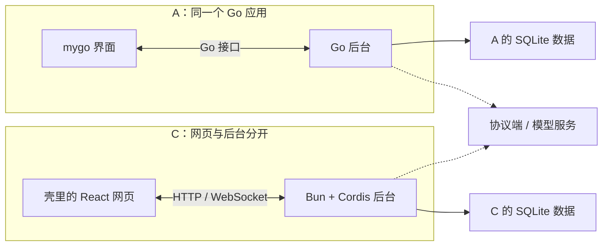

# 对照：架构 A 与 C（2026-11-04 实测）

> 状态：docs/arch-ac 分支上的调查记录，实测完成；未合 main、未推送。A 固定为 main，C 固定为 sumika-bun。本文不改变 ADR-203 的退役决定。

**这轮完整聊天界面里，A 的常驻资源更少；C 的样式迭代更快。** 三遍空闲工作集中位数的中位数为 A 275.50、C 1,273.78 MiB；末次补齐辅助进程的全树快照为 286.45、1,291.77 MiB。帧计时口径不同，不能拿两个 P95 算“快几倍”。

C 保存 CSS 后约 96 ms 显示新字号；A 主动编译到显示约 8.43 秒，需重启；C 生产重建到显示约 17.72 秒。源码插件免重启这次只有 C 的实验加载宿主做到，A 只替换已编译对象。两小时回放均继续落库，但不代表长期无泄漏。下一项需求用得上哪些现成页面、组件和接口，比笼统的语言排名更有用。

参考了 [性能标准](标准-性能与效率-2026-11-03.md)、[上次 Electrobun／mygo 对比](对照-Electrobun与mygo-2026-10-26.md)、十倍数据量测（私有存档）、选型体检（私有存档）、架构笔记核对（私有存档） 和 [LESSONS](../../LESSONS.md)。复用现有生产界面、导入工具和滚动剧本；参考 mygo v0.7.4 的 `ui/doc.go` 与 Cordis 4 的注册、撤销接口，区分“换一份代码”和“重新启用已编译的对象”。

## 先把这些名字放到对应的层

| 名字 | 在这里负责什么 | 想解决哪类需求时看它 |
|---|---|---|
| Go／Bun | Go 把后台和原生界面代码编译成程序；Bun 运行旧版后台的 TypeScript，也提供 HTTP、SQLite 等运行能力 | 存库、任务调度、错误传播、部署和运行时资源 |
| mygo／MewTypeUI | mygo 提供窗口和原生 UI 运行机制；MewTypeUI 提供当前聊天界面的组件、主题与栏位布局 | 原生控件、文字排版、布局、窗口和交互测试 |
| Cordis | 挂载／撤销插件，管理插件作用域和服务之间的联系 | 插件怎样接进来、关掉以后怎样收尾 |
| React | 描述网页组件和状态更新；打包后的 JS 在 WebView2 里执行 | 网页表单、编辑器、图表和状态组织 |
| Vite | 开发时更新页面，交付时生成网页产物 | 改源码以后怎样看效果；开发窗口和日用产物的区别 |
| Electrobun／WebView2 | Electrobun 给旧网页一个桌面窗口；WebView2 负责执行和绘制网页 | 网页怎样进桌面壳，窗口关闭与后台生命周期怎样配合 |

因此，“想换插件系统”和“想让页面更好改”分别要看不同的层。C 本次测的是完整旧后台加独立桌面壳；直接复用已有浏览器是另一种资源范围，本次没有重测。A 的其他功能也可能用嵌入网页或媒体库，不能从本次原生聊天列表推断所有页面都只有同一种渲染成本。

## 已经踩过的坑

表内是历史证据，除特别标“本次”外，数字均为原记录，不是今天复测。换到另一边是否仍会遇到，是依据机制的判断，不是复现实验。

| 对象 | 开发期：现象、根因 | 测试期：如何漏掉 | 运行期：后果 | 换到另一边会不会遇到 | 证据 |
|---|---|---|---|---|---|
| C：页面与后台分开发版 | 新页面直接读取后台新增的 `platforms.length`，后台还没换 | 只验新前端配新后台，没验中间版本 | 设置区整页崩溃 | A 一起编译、一起退出更新，可减少这个特定窗口；读外部协议仍会有版本差异 | LESSONS“后台接口新加字段”，`52a3b516`、`a67ca46f` |
| C：开发页面不等于日用页面 | 在 Vite 端口改好了，后台仍服务旧 `web/dist` | 没从日用入口验收 | 用户仍看到旧样式和旧行为 | A 也会误开旧 exe；C 多了开发服务器、产物、壳三处要分清 | LESSONS“后台自带的页面”，2026-10-15 |
| C：开发模式的额外挂载 | rAF 清理不完整，StrictMode 卸载再挂载留下旧编号 | 只量打包版 | 开发界面刻度不动，日用版却正常 | A 没有 React StrictMode，但有多次 build pass；副作用都不该无条件放在渲染里 | LESSONS“打包版和开发服务器”，`d85e309`、`a80a683` |
| C：拆包不是白赚 | 只量 JS 变小，没量点击和加载失败 | 静态首屏不能验证延迟加载路径 | 首包 2652→2011 KB 后出现白屏、预取失败触发刷新；点击出骨架 310～315 ms | A 没有网页 chunk 失效这个形式；资源与 DLL 缺失仍须处理 | LESSONS“性能优化两头量”，`f7c2d1a`、`875cbd3`、`d8cf034`、`94a6877` |
| C：CSS 叠加规则 | 窄窗规则写在同选择器的基础规则之前，被覆盖 | 看截图没发现规则根本没生效 | 调阴影仍没变化 | A 没有 CSS cascade；布局与主题覆盖仍可能互相打架，需要测实际尺寸和值 | LESSONS“媒体查询”，2026-10-15 |
| C：动画起点没上屏 | `transition` 配一帧的 entering 标记，浏览器跳过起点 | 静止截图看不见动画缺失 | 弹层先亮一帧或直接出现 | A 也必须观察时间序列；具体 React Aria 定位与 opacity 冲突属于 C | LESSONS“React Aria 进出场”，2026-10-14／20；Popover 三遍复测 |
| 两边：虚拟列表遇到晚到的图片尺寸 | 没预留图片宽高，加载后撑开列表 | 只验图片能显示，没验阅读位置 | C 旧记录中滚 120 下有 59 次停手后跳动，最大 360 px，修后 0 | 会；A 也要占位、稳定 ID、前插锚点和迟到结果处理，换绘制器不会消除可变行高 | LESSONS“媒体晚到的高度”，2026-10-15；A `session.go`、`picture.go` |
| 两边：异步任务晚于宿主关闭 | fire-and-forget 没记住在途任务，关插件后继续写库 | C 测试结束，错误落到下一项测试，重跑掩盖竞态 | 关后台时仍发送第二段、访问已关闭服务 | 会；Go 的 goroutine 也需要取消、等待和关库顺序，语言不自动替你收尾 | LESSONS“异步和收尾”，2026-10-15／19；A `app.go` 的关闭路径 |
| C／Windows：进程启动被安全软件拦慢 | Bun 新进程第一次直接起外部程序耗时 5～12 秒，`spawnSync` 同时堵住事件循环 | 只试热进程看不到；体检初判原因未证实 | 搜索等工具卡住整个后台 | A 也受本机安全软件影响，但没有证据说明同样触发；不能写成“Go 永远不会” | 选型体检 2026-10-18；C `daemon/main.ts:52` 注释补记 10-20 查实安全软件内存防护 |
| A：迁移夹具不像真实库 | 手造夹具漏 vec0 虚表和旧迁移版本 | 合成样本通过，真实副本才暴露 | 导入被阻塞，必须补适配 | 会；这是数据库迁移问题，TS 类型也看不见磁盘里真实表结构 | LESSONS“造的数据”，、 |
| A：同机错误码与注入错误不同 | 只认造的 `ECONNREFUSED`，Windows 实际返回 10061 | 没真的连一次已关闭端口 | 判断旧后台是否已停出错 | 会；两边都应以平台实调用覆盖边界 | LESSONS“造的数据”，`2613e122`、`a7e5a2c6` |
| A：显示查询在 UI 线程之外仍能拖慢界面 | 每张图读宽高昂贵，且占用串行查询资源 | 合成 200 张小图只花 216 ms；真实单张 73～87 ms | 一页查询拖到 5 秒超时，已撤回第一版 | 会；C 的同步 SQLite／图片处理也能阻塞请求；“用了后台线程”不保证没有排队 | LESSONS“造的数据”，、 |
| A：弹层退层碰上另一层 | 点转发外退一层，漏掉顶层大图 | 没列“上面还有大图”这一格 | 点大图空白把底下的转发一起关闭 | 会；C 也有全局键盘、点击守门的历史问题 | LESSONS“嵌套弹出层”，`45ce81db`、`bddd77dd`；C“键盘守门”2026-10-21 |
| 迁移：临时适配变成常驻设计 | 为省事让运行程序依赖一次性导入包 | 只验功能，没查依赖方向 | 导入测试变推送慢项，旧约定继续拖累新实现 | 双向重写都会发生；必须明确哪些数据转换只运行一次 | LESSONS“迁移进来的兼容代码”，2026-11-01；ADR-224／225 |

这些表格里的共同问题值得单独学：架构帮你减少某一种错误的机会，无法替你定义什么时候可以关库、怎样保持阅读位置、怎样确认看的是新版本。迁移时照抄代码，还会把这些问题带过去。

## 本次实测的固定条件

共同输入来自已经隔离、去密钥的旧版快照；没有直接复制正在写入的 `.db` 文件。再次用 SQLite `VACUUM INTO` 做快照并 `quick_check`，A 经现有 import-bun 转换成 Go 的平台库。共同输入为 38,138 条事件、7 个会话，其中消息 34,167 条、通知 3,971 条；最大群 20,240 条事件。媒体原件两边都不提供，媒体缺失不能算真实媒体负载通过。

界面数据固定在 `a-ui-data`／`c-ui-data`，后台回放固定在另外两份目录。Go 的 QQ 库 38,010 条加本地库 128 条，与 C 的 38,138 条事件按 `channel、conversation、kind、text、created_at` 排序后计算 SHA-256，一致为 `f8663caef0e80336679b752d40bb3bc0c05f3b20859720f78cf18e760321d70b`。早先让 C 的界面共用回放目录，多了一条合成会话，相关 C 试跑作废；正式表不混用。

C 的头像和远程图片共用 `cachedImage`，仅改 QQ WebSocket 地址挡不住这条 HTTP 路径。本次在临时副本关闭这个函数的取图，并在启动前装 fetch 地址限制。A 的头像入口只读本地媒体，不下载头像。两边都不连接真实协议端、不调用模型网关、不发真实消息。

A 的原始应用名会与日用程序争同一把单实例锁，本次临时改应用名和控制管道名。没有启动、停止或向日用程序发控制命令。以上仅为测量隔离，不作为产品修改提交。

量测机是 Ryzen 5 5600X（6 核 12 线程）、约 64 GiB 内存、Windows 11 26200，高性能电源方案。当前活动主屏是 144 Hz 的虚拟显示器，不是此前记录的 60 Hz；16.7／33 ms 只作为统一预算线，不能直接解释成这块屏的丢帧率。内容目标为 2048×1030 DIP、125% 缩放；Windows 按整数像素取整，1030 DIP 对应 1288 像素。窗口大于当前桌面可见区域，不能把这次结果当作主人实体屏上的呈现验收。

实际版本：A 的冻结二进制为 Go 1.27.3、mygo 0.7.4，带 `-trimpath`，未剥符号；MewTypeUI 通过本机 `replace` 引入，`v0.0.0` 不是可下载的发行版。C 后台与插件实验用 Bun 1.4.4，Electrobun 2.0.4 壳内打包的 Bun 则是 1.4.0；实际 WebView2 为 Edge 156.0.4314.58，Vite 8.3.5。只记一条 `bun --version` 会漏掉壳的运行时；这次保留现有运行栈，没有为比数字换一套新实现。

本次也踩了量测工具自身的坑：A 只传窗口参数，实际客户区仍会受 Windows 默认最大尺寸限制，先前试跑因此作废；改了测量副本的上限后，再用 Win32 读取客户区确认。C 的测量壳临时去掉系统外框，绕开同一尺寸限制，网页内容没有简化；正式两边客户区均为 2560×1288 像素。监督服务显示的 PID 是启动包装进程，资源采样改用可执行路径和监听端口查到的后台本体；错误 PID 的曲线全部作废。后台长跑另用独立副本，不让界面启停中断接收。

“拖栏”包含两种操作：整段历史加载后，用固定种子跳到 50 个滚动位置；再实际按住会话列表的分隔条，输入 50 个向内再返回的指针位置。A 的列表最大宽度是主题规定的 540 DIP，默认已在上限；只往外拖不会改变宽度，不能作为拖动通过的证据。脚本记录中途位置和最终位置；位移为零时单列失败，不把没有发生重排的耗时当成拖动性能。手势结束回到原位，避免下一遍使用不同栏宽。

长跑从共同快照中取 500 条消息文本，每两秒向两边各回放一条；渠道号、群号、参与者号均为合成值。隔离协议端只实现登录、状态、历史读取等本次实际收到的查询；发送等动作明确拒绝并另记日志，模型 POST 也拒绝。它只证明接收和存储这条路径的常驻行为，不能代替模型工作负载。

### 数字该怎么读

“后台”负责收消息、存库、调模型、管插件；“界面”负责把这些状态画出来。A 在一个进程内通过 Go 接口传数据；C 先把数据变成 HTTP／WebSocket 消息，再由网页维护状态。C 多的这道边界有成本，也允许界面和后台分别重启、分别测试。

箭头表示接口边界。本次外部路径只接隔离回放，模型推理没有启用；模型或媒体辅助进程的资源未在这个负载中测量。

“完整界面”在这里指两边各自当前的真实应用，不是之前 mygo 画得更简单的原型，也不表示两边功能完全相同。Go 版的原生下载、本地群和控制接口不能自动算旧版也有；旧网页里的提示词编辑、运行明细等页面也不能自动算原生版已补齐。性能只回答指定聊天剧本，功能覆盖另看需求表。

同一份消息也不等于同一种工作量：同样十行文字，字体、换行、阴影、虚拟列表的预渲染数量不同，消耗就不同。本次保留各自真实设计，不把较复杂的一边改简。媒体两边都缺失，因此不能据此回答“同时播放很多动图时哪个更省”。

最大会话中共同的消息为 17,950 条，另外有 2,290 条通知。C 的 `Outside.tsx` 仍将通知交给通知组件，并据此打断消息分组；A 的 `session.go` 只将 `kind=message` 交给消息列表。共同消息数相同，通知处理和分组工作量仍有差异，这也属于当前产品实现的成本。

帧耗时有两个口径。A 的 `MYGO_FRAME_STATS` 从应用开始构建一帧量到 present 调用结束；C 的 rAF 是两次回调之间的时间，其中包含正常等待下一次刷新。60 Hz 的网页即使空闲也常在约 16.7 ms，原生一帧的工作可能只有几毫秒。两者的 P95 和超阈值帧数分别保留，不能相除得出“快几倍”，也不能当作 ETW 看到的实际错失呈现率。

网页 rAF 记录器只在活动剧本期间运行，开始稳定空闲采样前取消它，并核对十分钟后记录帧数没有增加；否则量测器自己就会不断唤醒网页。忘记停止记录器的 C 试跑也单独保留，没有用它判断空闲预算。A 保留每帧耗时日志，资源数字包含这项观测开销。

内存分别记“当前占着物理内存多少”（工作集）和“程序向系统要了多少私有内存”（私有提交），单位统一为 MiB，1 MiB = 1,048,576 字节。多进程工作集相加可能把共享页算几次；判断长期增长优先看私有提交。CPU 用一个逻辑核跑满等于 100% 的口径，不是任务管理器按整机平均的数字。

启动量的是系统缓存已热的新进程，不冒充重启电脑后的冷启动。A 的首屏标记是目标会话的数据已应用，自动剧本还包含等原会话 ready 的 300 ms 轮询和开目标前的 100 ms 等待；C 是附加 CDP、导航、点击目标后可见消息节点出现。它们是各自剧本到数据可用的时间，不能据此判定严格的启动预算或精确输入到上屏延迟。A 第一遍因末尾 GPU 观察器失败，完整 CPU／帧样本保留，启动原点从重定向文件创建时间恢复，首屏数标为约数。

### 插件的三个“热”要分清

| 操作 | 对用户意味着什么 | A 当前接口 | C 当前接口 |
|---|---|---|---|
| 改配置后立即使用新值 | 例如下一轮换模型，窗口不用重开 | 已有专门的运行快照接口，不等于任意配置都热更 | 设置接口、角色文件监视等各有自己的生效路径 |
| 停掉旧对象，注册新对象 | 例如停掉观察钩子，重新注册另一个版本 | `Hub.StopPlugin`／`Use` 能做；新对象的代码必须已在 exe 内 | Cordis Fiber 的 `dispose`／`ctx.plugin` 能做 |
| 保存一份新源码，运行中的宿主加载它 | 用户不重新编译整个主程序 | 当前 Windows 原生 Go 插件没有这个入口；ADR-238 的 Wasm 是规划 | TS 可运行时 import；旧版主程序仍按固定顺序挂插件，没有现成文件监视式第三方加载器 |

因此，C 这次需要一个小型实验加载宿主来演示“重新导入源码→撤旧挂新”；不能说旧产品已经有完整插件热加载管理页。A 则实测已编译对象的替换，明确记录源码热加载不支持，不为凑一样的结果偷偷换成另一套插件架构。

## 完整聊天界面：三遍交替的数字

正式次序是 A-1、C-1、A-2、C-2、A-3、C-3。每遍都重新启动界面，使用共同的 17,950 条消息；历史加载完后，再从底到顶每六条走一步。C 的界面每遍重开，独立后台沿用同一进程；A 的后台随该次原生程序一起重启。这是现有运行边界，不是统一的后端冷启动实验。系统文件缓存保持自然热态。

### 首屏和整段历史

| 轮次 | 剧本开始到目标会话数据可用（ms） | 向前读完历史的阶段（s） | 连续滚动阶段（s） |
|---|---:|---:|---:|
| A-1 | 约 1,337 | 5.000 | 49.81 |
| C-1 | 1,765 | 12.587 | 79.83 |
| A-2 | 1,338 | 5.000 | 49.77 |
| C-2 | 1,811 | 11.926 | 78.84 |
| A-3 | 1,355 | 5.000 | 49.65 |
| C-3 | 1,819 | 11.942 | 79.43 |

A 的 5 秒包含现有自动剧本的固定等待和轮询，不是数据库查询恰好每次都用 5 秒。C 逐批取旧历史，保留通知和分组逻辑；表中是实际剧本阶段，不是同一个 SQL 的基准。滚动也不是“限定 50 秒后比谁看得多”：两边走完同一批消息位置，C 的回调与布局工作使整个序列拖长。

### 活动期间的帧

下表单位为 ms。A 记帧内工作，C 记 rAF 间隔；阈值计数仅解释各自原始记录。连续滚动是共同的一段操作，样本数不同，因为两种计时器触发方式和完成时间不同。

| 轮次 | 连续滚动样本数 | P95 | 最大 | >16.7 ms | >33 ms |
|---|---:|---:|---:|---:|---:|
| A-1 | 6,792 | 6.0 | 34.6 | 8 | 1 |
| C-1 | 6,164 | 27.9 | 83.5 | 1,138 | 254 |
| A-2 | 6,761 | 5.8 | 33.8 | 3 | 1 |
| C-2 | 6,181 | 27.8 | 97.3 | 1,105 | 224 |
| A-3 | 6,755 | 5.7 | 33.6 | 2 | 1 |
| C-3 | 6,122 | 27.9 | 97.2 | 1,136 | 230 |

| 轮次 | 读取旧历史的帧样本数 | P95 | 最大 | >16.7 ms | >33 ms |
|---|---:|---:|---:|---:|---:|
| A-1 | 38 | 1.7 | 2.1 | 0 | 0 |
| C-1 | 454 | 131.5 | 166.7 | 121 | 105 |
| A-2 | 37 | 2.1 | 3.4 | 0 | 0 |
| C-2 | 447 | 118.2 | 173.6 | 113 | 105 |
| A-3 | 35 | 2.1 | 2.5 | 0 | 0 |
| C-3 | 434 | 124.9 | 165.6 | 117 | 106 |

C 读历史时三遍都出现超过 100 ms 的回调间隔，这是这份真实页面需要继续定位的现象；A 的低帧内耗时不能证明输入到上屏一定达标。本次没有两边统一的 ETW 呈现追踪，也没有把 JS／Go／GPU 的成本逐项剖析，因此不把原因分摊成百分比。[推测] 通知分组、字号与换行、列表缓存和页面状态都可能影响结果，不能把差距全部归给语言。

固定种子跳转 50 次，另测实际分栏拖动。分栏位移统一换算成逻辑尺寸 DIP；A-1 没拖动成功，保留为失败，不用它算拖动中位数。后两遍 A 都实际向内 80 DIP 再回原位，C 三遍均向内 60 DIP 再回原位，位移幅度并不相同。

| 轮次 | 跳转 P95／最大（ms） | 跳转 >16.7／>33 | 分栏最大位移（DIP） | 分栏 P95／最大（ms） | 分栏 >16.7／>33 |
|---|---:|---:|---:|---:|---:|
| A-1 | 7.4／14.3 | 0／0 | 0，失败 | 未发生有效拖动 | 不计 |
| C-1 | 20.8／49.0 | 50／18 | 60 | 41.7／69.4 | 28／26 |
| A-2 | 7.0／15.0 | 0／0 | 80 | 4.1／4.2 | 0／0 |
| C-2 | 21.2／48.7 | 53／16 | 60 | 34.7／48.9 | 34／18 |
| A-3 | 7.5／12.2 | 0／0 | 80 | 3.8／4.2 | 0／0 |
| C-3 | 27.6／55.6 | 62／30 | 60 | 42.0／69.5 | 29／24 |

跳转走列表的定位入口，相当于快速换滚动位置，没有证明滚动条拖柄的鼠标命中和捕获。实际分栏拖动则走指针事件，并核对中途和结束的几何位置。两项不能互相冒充。

### 滚动和空闲的进程资源

内存两列都写“样本中位／采样峰值”，不是操作系统曾经出现过的绝对峰值。空闲段先停操作 30 秒，再观察十分钟；C 的 rAF 记录器在此之前已停。CPU 按实际采样时间与累计 CPU 差计算，六遍均没有累计计数倒退。

| 轮次 | 滚动工作集，中位／峰值（MiB） | 滚动私有提交，中位／峰值（MiB） | 滚动平均 CPU，单核 100% |
|---|---:|---:|---:|
| A-1 | 375.06／409.31 | 451.15／476.82 | 146.56% |
| C-1 | 1,530.91／1,613.04 | 2,412.46／2,561.21 | 275.04% |
| A-2 | 383.09／431.63 | 456.68／507.03 | 142.47% |
| C-2 | 1,500.21／1,607.23 | 2,409.71／2,642.65 | 271.18% |
| A-3 | 380.50／413.62 | 455.39／481.19 | 141.98% |
| C-3 | 1,506.76／1,620.50 | 2,391.82／2,691.46 | 270.33% |

| 轮次 | 空闲工作集，中位／峰值（MiB） | 空闲私有提交，中位／峰值（MiB） | 空闲平均 CPU，单核 100% |
|---|---:|---:|---:|
| A-1 | 257.28／258.39 | 321.24／323.00 | 0.82% |
| C-1 | 1,273.78／1,286.70 | 1,599.39／1,657.87 | 0.40% |
| A-2 | 277.04／277.65 | 345.10／346.38 | 0.35% |
| C-2 | 1,273.10／1,313.52 | 1,629.97／1,722.34 | 0.30% |
| A-3 | 275.50／275.87 | 331.08／332.10 | 0.07% |
| C-3 | 1,293.01／1,316.91 | 1,647.66／1,720.60 | 0.32% |

三遍中位数再取中位数：滚动 CPU 为 A 142.47%、C 271.18%，约占 1.42、2.71 个逻辑核；不是整机超过 100%。空闲 CPU 为 0.35%、0.32%，没有显示 C 空闲更耗 CPU。常驻内存和空闲 CPU 是两个问题。

A 的连续时序采业务主进程；C 采实验壳、WebView2 和独立后台的完整范围，含一个实验控制台宿主。为补齐 A 的辅助进程，末次空闲结束另取全树快照如下。它与十分钟中位数是不同统计，不混为一列。

| 末次快照的组成 | 进程数 | 工作集（MiB） | 私有提交（MiB） |
|---|---:|---:|---:|
| A 原生主程序，含后台 | 1 | 275.52 | 331.04 |
| A 实验 conhost | 1 | 10.93 | 1.49 |
| A 全树 | 2 | 286.45 | 332.53 |
| C 启动器 | 1 | 9.35 | 1.99 |
| C 壳内 Bun | 1 | 66.95 | 148.07 |
| C WebView2 | 6 | 1,047.61 | 1,086.25 |
| C 独立 Bun 后台 | 1 | 159.90 | 392.64 |
| C 实验 conhost | 1 | 7.96 | 1.28 |
| C 全树 | 10 | 1,291.77 | 1,630.24 |

这解释了为什么“后台长跑只有一百多 MiB”与“完整网页一千多 MiB”能同时成立：后者还包括壳和浏览器。也不能把 WebView2 的全部提交当成 React 自己的活对象堆；这里没有做堆归因。

GPU 另取活动结束后的进程范围计数快照，不混进上述进程工作集；不是滚动期间的 GPU 峰值。

| 轮次 | A 专用／共享显存（MiB） | C 专用／共享显存（MiB） |
|---|---:|---:|
| 1 | 观察器失败，未取得 | 229.36／7.91 |
| 2 | 100.92／0.49 | 233.91／8.36 |
| 3 | 94.55／0.49 | 238.30／7.73 |

## 改一个界面细节：源码保存到看见

两边都将真实消息正文改为 18：A 的既有正文为 13 DIP，C 继承的正文为 16 CSS px。改的是同类控件和同一个目标值，原设计字号不同；没有把主题面板调参说成源码热更新。A 改 `native/inline.go` 的正文布局字号，C 改 `web/src/ui/chat.css` 的气泡字号，实测后均撤掉实验改动。

| 环节 | A：Go／mygo | C：Bun／React 网页 |
|---|---|---|
| 基线编译／显示 | 编译 7,420.471 ms；新进程到目标消息渲染后的完成帧 1,814 ms | 先确认真实消息气泡为 16 px，再接现有 Vite 开发入口 |
| 改后主动构建／显示 | 编译 7,252.393 ms；启动到完成帧 1,173 ms；主动编译开始到显示 8,426 ms | Vite 保存 CSS 到新字号出现在后续帧 96.414 ms |
| 本次实际从源码保存起计 | 25,798.584 ms，含 17,372.584 ms 等待构建调度 | 开发热更新 96.414 ms；生产重建这遍 54,450.414 ms，含等待调度 |
| 去掉调度等待的生产路径 | 上述主动编译到显示 8.426 s | 构建 17,172.785 ms；重载到新字号帧 550 ms；合计 17,722 ms |
| 要不要重启 | 源码改动需换 exe 并重开，PID 变化 | CSS 热更新保留同一 document；后台 PID 仍为 41348；生产包重建后刷新网页 |

等待调度是这次串行重活锁和量测驱动的时间，不能归到框架编译器上；实际保存到显示的整段时间仍保留，避免只报好看的子区间。Go 改后不是只看日志里打印了“18”：在实际消息数据进入布局、记录新字号后，继续等到该次及后续帧完成。网页则读取实际气泡的 computed style，并跨后续动画帧确认，同时核对 document 身份没变。

对日常使用的含义：只试 CSS，C 的反馈最快；C 的开发热更新不能代替生产构建时间。只想调整产品已经提供的字号／颜色，两边都有设置或主题入口，不必改源码。这里测的是开发者新增或改写样式的路径。

测试方式也不同。本次 A 运行既有 `TestAppearanceEditorAndFiles`：用 `ui.NewTester` 实际点击色值、字号、圆角，检查像素色样、焦点、主题切换与临时文件导入导出；测试本体 0.14 s，包报告 0.970 s，整条命令 9,561.631 ms。`go vet .` 为 10,660.698 ms，均退出 0。命令只跑原生根包，没有全仓测试。

C 用已打开的真实生产页面作一次临时 DOM 断言：正文 computed font 为 18 px，并检查实际布局；页面内断言 0.100 ms，CDP 往返 0.680 ms，不含启动、导航和构建。两项测试覆盖范围不同，不能据此说网页测试比原生快多少倍。本次没有新增永久测试；源码字号回退后，临时脚本与实验宿主仅留在原始证据目录。

## 小插件：本次实际加载了什么

实验插件只观察一个编号事件，输出“版本:编号”；没有工具、文件、模型或发送能力。A 使用现有 `turn.Hub`／`Registry.OnSeen`，C 使用 Cordis 4 的 Context／Fiber。宿主驱动另外计数，不拿它当插件本身。

| 项目 | A：Go 现有接口 | C：Cordis 现有接口 |
|---|---|---|
| 插件源码，含初始化失败分支 | 28 行、去空白 446 字符 | 6 行、去空白 301 字符；压在一行的表达式较多，行数不可直接比效率 |
| 实验宿主／驱动 | 57 行、1,291 字符 | 加载宿主 14 行、1,190 字符；调用驱动另 391 字符 |
| 第一次启用 | 已编译对象输出 `v1:1` | 首次导入及挂载 6.898 ms，输出 `v1:101` |
| 换成第二版 | 停旧挂新后输出 `v2:2`；计时读数 0 ms，低于本次计时分辨率，不代表零成本 | 新源码导入及替换 4.418 ms，输出 `v2:102`；前后 PID 均为 57112 |
| 初始化中途报错 | 返回“插件没启用”；已登记的失败钩子撤销，原 v2 仍输出 `v2:3` | 返回 `Error: arch-ac setup failure`；宿主同一 PID 仍响应，之后事件没有触发失败插件登记的钩子 |
| 失败时旧版是否还在 | 本次失败的是另一个插件 ID，现有 v2 保留 | 实验加载器先撤旧再装新，因此新版本失败后该插件暂时没有可用版本 |

C 的第一种加载方法也失败过：同一文件只换 `?revision=`，保存了 v2 后仍输出 `v1:22`。改为每版使用独立的物理文件身份，才得到 `v2:102`。这是本机 Bun 1.4.4 的实际现象；不能因为 JavaScript 支持动态 import，就认为保存源码会自动换掉旧模块。实验导入后删除了版本文件，不等于运行时模块缓存已卸载，长期反复换版的内存还没有验证。

对日常开发的含义：C 可以接着写一个受控的源码加载器；A 当前的“热替换”只覆盖已经编译进去的对象。A 若要接收任意新源码，需要另做宿主，ADR-238 的 Wasm 方案尚未落地。两边都还要处理在途任务、状态交接和取消；本次观察者很小，没有把这些额外能力算成已实现。

## 两小时后台回放：增长和日志

冻结窗口是本地 16:17:13.577～18:17:13.577，每边 240 个约 30 秒样本，首尾各取十分钟中位数。采样器实际保留了 7,296.65／7,296.63 秒，覆盖窗口两端的余量；窗口内最早到最晚样本相隔 7,176.52 秒，CPU 用这些实际时间点做差。两边 PID／进程启动时间在采样期间均未变化，没有强制 GC。

| 后台指标 | A：Go receive | C：旧 Bun／Cordis |
|---|---:|---:|
| 工作集中位，首→尾（MiB） | 46.12 → 46.75 | 131.28 → 129.59 |
| 私有提交中位，首→尾（MiB） | 68.98 → 71.19 | 371.37 → 389.88 |
| 私有提交增长 | +3.21% | +4.99% |
| 窗口内私有提交采样峰值（MiB） | 71.71 | 440.13 |
| 句柄中位，首→尾 | 373 → 373 | 280 → 287 |
| 句柄范围 | 373～373 | 280～297 |
| 线程范围 | 16～17 | 21～31 |
| 平均 CPU，单核 100% 口径 | 0.09% | 0.86% |

A 的句柄持平；C 净增 7 个，期间也有线程数量变化。本次没有按句柄类型留首尾快照，原因尚未确定，不能据此宣称 C 没有泄漏。两小时私有提交增幅也不能当作 72 小时稳定性验收通过。C 在窗口前半段还承接过界面历史查询，所以这里的 CPU 是回放期间的实际占用，不是纯空闲或纯接收路径的语言基准。

18:20:52 核对落库时，自冻结窗口起点以来两边各存了 3,708 条合成群消息，首末消息时间一致。核对的是实际事件表，不只是假协议端的发送计数。冻结窗口之后两边模型调用表没有新记录，假协议端的“禁止模型 POST／禁止发送动作”审计文件也未产生；本次只覆盖低频接收、存储与现有后台维护，不覆盖真实模型调用。

文件统计另从 15:41:51 到 18:20:52，历时 9,540.819 秒，约两小时三十九分；它比资源窗口长，单列如下。

| 数据目录 | 文件数，前→后 | 总量，前→后（MiB） | 净增（MiB） | 主数据库，前→后（MiB） | WAL，前→后（MiB） |
|---|---:|---:|---:|---:|---:|
| A 的回放副本 | 39 → 39 | 166.36 → 169.64 | 3.28 | 158.07 → 161.33 | 8.09 → 8.10 |
| C 的回放副本 | 27 → 27 | 99.67 → 103.20 | 3.52 | 91.61 → 95.10 | 7.89 → 7.92 |

A 的副本保留了旧输入库，同时有导入后的 Go 库，因此不能用目录总量说 Go 每条消息更占磁盘。增长集中在已有数据库，文件数没有增加；SQLite 按页扩展、复用 WAL，净增也不是每条消息的固定字节数。表内不含壳的 WebView2 用户缓存，也没有拿这个纯文本、无模型负载去判定包含识图和模型判断的日负载预算。

日志实际查了两件事：16:16 左右更换假回放端时，A 输出带时间的断开原因、退避拨号失败和恢复连接；C 输出 connecting／offline／online 及面向用户的失败原因。两边随后在同一后台进程继续落库。A 更容易把具体错误与采样时间对齐，C 本次标准输出没有逐行时间，单凭这份输出较难对齐；没有把未验证的网页日志面板算作通过。

A 还有一个小坑：一次恢复会出现两行“QQ 连上了”。源码一处在 WebSocket 建立后报告 connected（`internal/channel/snowluma/connect.go:227`），另一处把 OneBot lifecycle/connect 翻译成同一状态（`snowluma.go:548`）。它不能被当成重连两次。正常成功回放两边都没有逐条刷屏，本次用数据库计数核对接收，不能从“没出现新模型日志”判断没有收到消息。

## 下一个需求放在哪里更快

先看需求会经过哪些现成部件，再看需要自己补什么。下面是依据当前源码和本次小实验的判断；没有实际实现的新需求标为推测。

| 具体需求 | A 现在能借什么 | C 现在能借什么 | 选择依据 |
|---|---|---|---|
| 连续试字号、间距、表单布局 | 已有 MewTypeUI 组件和主题编辑器；源码改动走编译、重开 | CSS、Vite、浏览器样式检查器；已有页面可继续改 | 大量外观试验优先看 C 的热更新实测；主题里已经暴露的参数，两边都可以走设置立即改，不必重写源码 |
| 提示词／Markdown 编辑、图表等复杂页面 | 要核对原生库已有的编辑和图表能力，缺的交互需补 | 旧版已带 CodeMirror、Recharts、React Aria 等依赖 | [推测] 能直接复用旧页面时 C 更短；组件不存在时，应先做一个真实交互样例，不能只按按钮数量估工期 |
| Windows 托盘、启动接收、下载和本机控制 | 已有同进程宿主、托盘与控制管道 | 本次旧壳入口只创建网页窗口；新增原生交互还需壳与网页／后台协调 | [推测] 沿现 A 的调用路径更短；需逐项确认壳 API，不能把任意网页能力算成桌面能力 |
| 一份新观察插件保存后生效 | 当前只支持预编译对象替换 | 已实测可在同宿主导入新 TS 版本，但产品加载器仍需做 | 需求若明确要求新源码免重启，C 的现有运行时路径更接近；A 需要额外的模块宿主 |
| 接收消息、存库、记忆和工具规则 | 已有 Go 内核、平台库与相应测试 | 已有 Cordis 服务和 TS 实现，但停在退役快照 | 哪边保留目标功能、测试和数据契约，哪边改动通常更少；换语言不会自动修复取消、可见性和迁移问题 |
| 关网页后后台仍继续工作 | 需区分隐藏主窗口与退出程序；现有托盘已有这种区别 | 前后端天然可分开运行，本次关闭壳后独立后台仍在回放 | 看的是“关窗口以后要发生什么”；进程少和可分别重启各有用途 |

对你最有用的下一步比较单位，是一个可以亲手试的需求。例如“在已有模型设置里加一项，保存后下一轮就用新值，失败能看见原因”，它同时暴露控件、配置归属、生效时机和错误处理。只改一个气泡，主要回答视觉迭代；它回答不了新增完整业务功能的总成本。让 AI 先指出现成组件、要跨的接口和本次验收动作，再实现这一小条，才知道阻力来自哪里。

## 回迁／重写的成本量级

下面全部是 [推测]，不是这次量出来的工时，也不是交付承诺。按一名能持续推进的开发者加 AI 协助、一个有效工作日约八小时、沿用现有角色文本和模型网关估计；并行会话数量、需求变化和实体屏／输入法问题都会改变日历时间。

| 方向与目标 | 工作量估计 | 主要要重做／会暂时失去什么 | 可以带走什么 |
|---|---|---|---|
| A→C：恢复退役版历史浏览 | 0.5～2 个有效工作日；本次已验证隔离启动与完整旧界面 | 这只恢复旧快照，不包含后来 Go 新增能力；还要处理外部资源安装和后台头像联网路径 | 原有网页、Cordis 插件、旧格式数据 |
| A→C：把现 A 的新增能力和数据也迁回 | 功能迁移 10～30 日，回归与日用验证 5～10 日，约 3～8 周 | Go 专有接口、原生交互、控制命令和新的平台库要逐项移植；迁完前不能只因旧页面能打开就切换真实数据 | 角色文本、提示词设计、验收样例、事件语义和可导出的历史；Go 实现与测试需要翻译 |
| C→A：在现 A 上补齐旧网页专属功能 | 页面／交互 10～25 日；若还要求源码插件免重启，另约 5～15 日；回归 5～10 日，约 4～10 周 | React 专属组件和 CSS 布局要改写；浏览器开发工具、TS 动态导入的便利不会自动带来；复杂编辑器往往比普通表单贵 | 业务流程、卡片与提示词、事件数据和验收意图；现有 Go 内核与原生页面继续使用 |

最大的风险是没列完功能就报一个总工期。上述范围的用途是判断“几天恢复旧版”和“数周搬齐当前能力”属于不同任务；真正开迁移前，应以要保留的页面、命令、插件、数据库和权限行为清单重估。旧代码行数只能用来找模块，不能按行数换算工期。

## 产物、落点和复核入口

收尾另量了磁盘占用，字节除以 1,048,576，目录递归时不沿符号链接／目录联接重复计算。

| 本次保留的产物 | 文件数 | 大小（MiB） | 范围 |
|---|---:|---:|---|
| A 正式量测 exe | 1 | 63.88 | 66,987,520 字节，带符号；不含输入数据库 |
| C 实验桌面壳载荷 | 15 | 93.21 | 含壳内运行时；不含共享 WebView2 安装 |
| C 临时源码和素材副本 | 8,689 | 155.09 | 含源码、构建产物和字体等；跳过一个 node_modules 联接 |
| C 借用的 node_modules | 44,429 | 452.81 | 含开发依赖，原目录只借用；不是裁剪后的发行依赖 |
| C 独立 WebView2 用户缓存 | 804 | 158.68 | 实验身份自己的缓存；结束后移回 scratchpad 保存 |

这些分类不能简单相加冒充“最小安装包”：C 的源码副本同时保留开发素材和生产产物，WebView2 还依赖系统安装；A 这里只量一个冻结二进制。没有为两边制作、签名和验证新的发行安装器。这轮回答的是现有应用的运行、开发和测试成本。

原始证据根目录：`%USERPROFILE%\AppData\Local\Temp\claude\D--Projects-Code-sumika\803f2373-85a7-4ff3-8de4-f96b25e070f3\scratchpad\arch-ac\`。以下均相对此目录：

| 要复核什么 | 文件／目录 |
|---|---|
| 六遍正式 UI 汇总 | `ui-final-summary.json`；A-1 的原始文件在 `ui-measured/`，其余正式轮次在 `ui-final-paired/` |
| 帧、资源、跳转与拖动 | 各轮的 `*-metrics.json`、原始帧／资源记录与几何结果；不要混入早先废弃试跑 |
| 末次进程组成／GPU | `process-components.json`；`ui-final-paired/A-3-gpu.json`、`C-3-gpu.json` 及其余成功轮次 |
| Go 改字号的两次结果 | `dev-a-baseline-1793790930008-result.json`、`dev-a-changed-1793790998038-result.json` |
| C 开发热更新／生产重建 | `dev-c-hmr-result.json`、`dev-c-production-result.json`、`web-font-assertion.json` |
| 根包测试／vet | `go-ui-1793790848480.json` 及 `.log`、`go-vet-1793790834236.json` |
| 两小时资源窗口 | `soak-two-hour-metrics.json`、`soak-correct.csv`；`summarize-soak.ts` 写明冻结窗口和首尾统计 |
| 插件替换与代码量 | `native-plugin-result.json`、`cordis-plugin-results.jsonl`、`plugin-code-size.json`；Go 宿主源码在 `source-examples/native/cmd/arch-ac-plugin/` |
| 实验源码和脚本 | `source-examples/native/` 保存撤回前的量测改动与插件宿主；其余驱动脚本在本目录 |
| 产物大小 | `artifact-size-metrics.json`；独立浏览器缓存归档为 `shell-user-cache/` |

原始目录保留隔离输入和运行记录，不进入 git；文档不写真实群名、昵称或号码。主仓库不接受临时代码改动。本次自有窗口和后台、Vite、插件宿主、假回放端均已停止，未停止日用 Sumika 或真实协议端。
