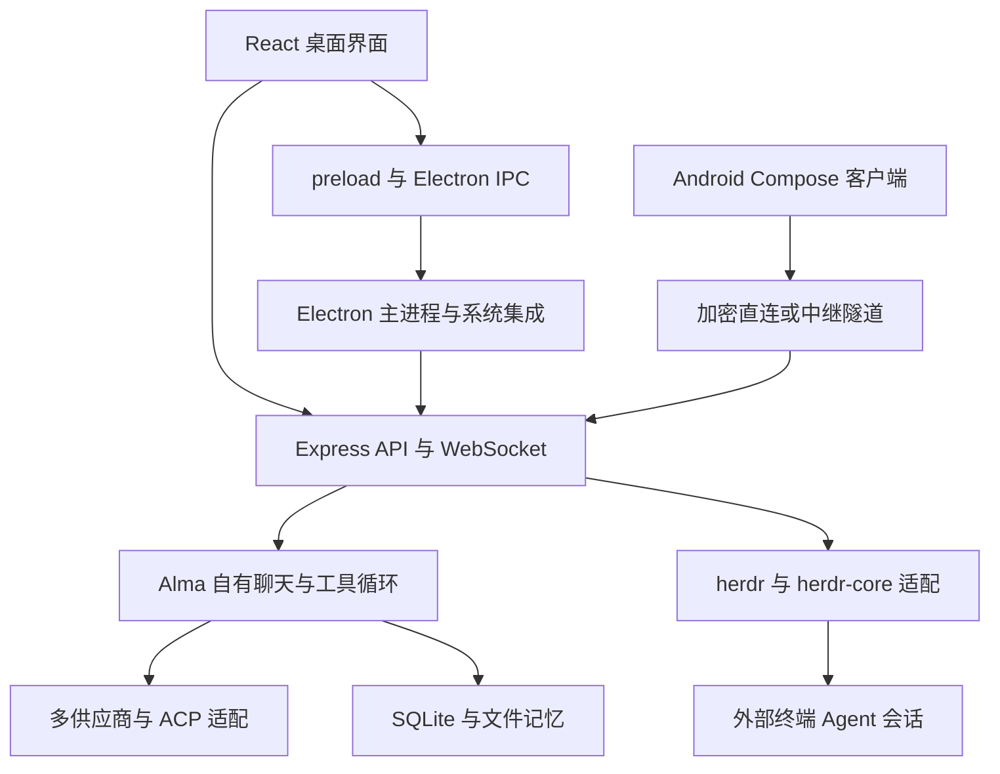

# 拆解 Alma：桌面、安卓与 Agent 后台（2026-11-04）

> 对象：Windows 0.4.439、Android 1.93；静态拆包、反编译和公开资料核对。按[拆解笔记的写法](拆解笔记-写法.md)，先写 Alma 本身，Sumika 对照只放第七节。由已有的Alma 对照笔记（私有存档）链接到这里。
> 本文没有启动 Alma、安装 APK、连接真实账号、调用它的模型或执行包内程序；没有界面截图、耗时、帧率、内存或联网成功率实测。下文的“实现了”表示读到对应代码路径，不表示运行验收通过。iOS 只有文档和桌面包里的遗留依赖证据，没有 IPA。

## 零、材料、可信度与复查方法

### 0.1 看了什么

| 材料 | 身份与范围 | 证据等级 |
|---|---|---|
| 官方 Windows 安装包 | `yetone/alma-releases` 的 `v0.4.439`，448,375,936 字节；本地 SHA-256 与发布 API 的 digest 相同 | [实测·文件校验] |
| `resources/app.asar` | 595,568,740 字节，索引有 59,129 个文件项；静态取出文本，没有加载 native module | [实测·包结构] |
| 桌面主入口 | `out/main/index.js`，3,523,213 字节；格式化副本约八万行 | [读码] |
| 桌面主界面 | `out/renderer/assets/App-Cu3euCex.js`，4,472,043 字节；另读设置、主题、Markdown、preload 和 server chunks | [读码] |
| Android APK | `Alma-1.93.apk`，62,070,411 字节；jadx 解 `classes.dex` 与资源；manifest 为 `me.yetone.alma`、versionCode 28 | [读码／实测·包结构] |
| 官网与发布日志 | [官网](https://alma.now/)、[herdr 功能页](https://alma.now/docs/features/herdr)、[发布 API](https://api.github.com/repos/yetone/alma-releases/releases?per_page=30)、[herdr 官网](https://herdr.dev/) | [文档] |
| 指定第三方逆向文章 | `https://xnu.app/2026/01/04/alma-analyze` 本次两次读取均为 HTTP 404；没有引用正文 | [没读到] |

版本是固定样本。抓取时官网 Android 下载入口已指向 1.94，本文不能把 1.93 的实现当作最新版所有行为。桌面依赖表里的 `^` 版本是声明范围，不能当作安装锁文件中的精确版本。[读码：APK manifest；桌面 `package.json`；文档：官网]

### 0.2 下面的出处怎么找

桌面源码路径均相对 `app.asar` 根；本机文本在 `_external/alma/win/asar-out/`。Android 路径均相对 jadx 输出的 `sources/` 或 `resources/`；`p083l6`、`r6` 等是反编译后的名字，不能还原为作者源文件名。jadx 明示部分协程方法反编译失败；涉及这些方法时只采用可读分支或桌面对应实现，不把伪代码当完整源码。[读码]

| 缩写 | 包内文件／资源 | 用于定位的方式 |
|---|---|---|
| M | `out/main/index.js` | 唯一方法名或日志字符串；下表另给关键字节偏移 |
| R | `out/renderer/assets/App-Cu3euCex.js` | 保留的组件名、常量名 |
| S | `out/renderer/assets/PluginNotificationListener-LUOrPW53.js` | `MemorySettings`、`MemorySleepCard`、设置关键词表等 |
| P | `out/preload/index.js` | `contextBridge`、`ipcRenderer`、暴露的 bridge 方法 |
| SK | 安装资源 `resources/bundled-skills/<技能>/SKILL.md` | 技能名与标题；属于包外资源目录，不能误写成 asar 成员 |
| A | jadx `sources/` | 文件名＋行号；对应本次 1.93 反编译结果 |
| AM | jadx `resources/AndroidManifest.xml` | 行号与 Android 组件名 |
| AV | APK `assets/mascot/` | `index.html`、`rig.json`、`base.png` |

M 原文件为压缩 JS。以下是从 UTF-8 原文件算出的 **0 起始字节偏移**，不是格式化副本的字符序号；偏移只对本次包有效。其他引用使用“包内路径＋附近标识符”，便于重新拆包后检索。

| M 中的定位串 | 字节偏移 |
|---|---:|
| `chat_threads.db` | 96004 |
| `ALMA_TOOL_APPROVAL` | 688643 |
| `function Hv(`，herdr socket 解析 | 755800 |
| `async buildCloakedRequest(` | 952301 |
| `async getAuthorizationUrl(` | 953445 |
| `async runSleepCycle(` | 994240 |
| `async loadSkills(` | 1108677 |
| `async function VD(`，子代理运行器 | 1225294 |
| `async getAIModel(` | 2792551 |
| `async compactThread(` | 2843222 |
| `async fetchTurnIceServers(` | 2878592 |
| `async retrieveMemoriesForContext(` | 2927518 |
| `async summarizeAndStoreMemories(` | 2944187 |
| `async generateChatResponse(` | 2959673 |

本次只在自有应用入口范围核对 sourcemap：主进程、preload、renderer 入口没有找到可用应用源码映射；没有据此声称所有第三方依赖都没有 `.map`。`package.json` 虽写了 `license: MIT` 和私有仓库地址，本文不据此认定闭源应用全部源码可以复制或再发布；这里只转述设计，不移植代码。[实测·包索引；读码：`package.json`]

## 一、整体架构：一个应用里有两条 Agent 路径

### 1.1 产品结构与进程

[读码] 桌面是 Electron，界面是 React。主进程同时承担窗口与系统集成、Express API、SQLite、模型请求、工具执行、MCP、消息平台桥接、定时任务、移动中继和 herdr 适配。preload 用 IPC 暴露桌面能力；聊天和后台状态大量通过 HTTP／WebSocket 通信。它不是“renderer 经一个 IPC 函数把所有业务直接交给模型”的小聊天壳。[M：`API server started on http://localhost:`、`setupWebSocket`、`generateChatResponse`；P：`contextBridge`／`ipcRenderer`]

[读码] 普通 API 绑定 `127.0.0.1`，端口会找可用值。移动 LAN 入口另开监听，优先端口 23019、冲突则选系统端口，并绑定 `0.0.0.0`；Team host 又有自己的网络监听。因此“所有后台只监听回环地址”不成立，必须逐个入口看。[M：`API server started`；移动 listener 的 `listen(e, 23019)`、`/__alma_e2e__`；Team 的 `[Team] host listening`]

### 1.2 herdr 到底是什么

[文档] [herdr](https://herdr.dev/) 是终端工作区与编码 Agent 运行环境：Claude Code、Codex、pi 等运行在它的 pane 中，workspace／tab／pane 管理工作现场，Agent 可派其他 Agent 并接回结果；有本地与 SSH 工作方式。官网明确说关闭窗口后 Agent 继续运行，但机器重启或 herdr 停止后进程会停，恢复的是工作现场，不能把它理解成自动恢复所有执行状态。[herdr 官网 FAQ]

[读码] Alma 的 herdr 适配器读取 socket 上的快照和事件。`Hv` 先看 `HERDR_SOCKET_PATH`／`HERDR_SOCKET`，再选配置目录下的 `herdr.sock` 或 `sessions/<name>/herdr.sock`；Windows 转换 named pipe。还会发现 `herdr-core` socket，用 `HC_SOCKET` 等信息接第二套后端；聚合 `workspaces/tabs/panes/layouts`，保留各后端在线状态，正常轮询间隔 2 秒。事件包括 workspace、tab、pane、worktree 的增删、移动、焦点等。[M：`function Hv`、`HC_SOCKET`、`backendsOnline`、`version: "herdr-core"`]

[读码＋文档] “Alma 是 herdr 的 GUI 客户端”描述了现在的重要入口，但包里仍有 Alma 自己的 `generateChatResponse`、模型适配、工具、记忆和频道桥接。herdr pane 中的 Claude Code 会话与 Alma 自有聊天线程不能合成一个循环来讲。官网所谓“手机看到同一批 Agent”，主要通过桌面 herdr 适配及远程协议达成，不是把 Claude Code 进程复制到手机。[M：上述 herdr 适配与 `generateChatResponse`；官网 herdr 页]

### 1.3 alma-server 是什么

[读码] 主进程有大量 `ALMA_HEADLESS` 分支：同一套 API、聊天、记忆、插件逻辑可进入无 Electron 窗口模式；设置 `ALMA_WEB_DIR` 后提供 Web 静态页面。登录插件时，headless 路径把授权链接和回调地址交给用户浏览器处理。浏览器工具明确抛出“requires Electron desktop mode”，WebSearch 也明确要求浏览器引擎，WebFetch 则另有普通网络请求分支。[M：`ALMA_HEADLESS`、`ALMA_WEB_DIR`、`[alma-server] Sign-in`、`Browser tools require Electron desktop mode`、`WebSearch requires Electron desktop mode`]

[文档＋推断] v0.4.439 发布附件确有 x64／arm64 Linux `alma-server` 压缩包。结合以上分支，可以把它解释成 Alma 后台的独立部署形态；本次没有下载和逐字比对 server tar 包，不能保证它与桌面 bundle 完全相同，也不能声称浏览器自动化在服务器上等价可用。[发布 API；M 的 headless 分支]

### 1.4 技术栈与组织方式

| 层 | 读到的选型 | 能确认到什么程度 |
|---|---|---|
| UI | React、Jotai 风格 atom／`useAtom`、SWR、Tailwind utility classes、Radix、Lucide、Framer Motion | [读码] R 的 imports 与组件；存在多种状态机制，不能归纳成全部统一一种 store |
| 聊天渲染 | React Markdown／GFM、流式消息组件、Shiki 高亮、Mermaid、PDF／Office 预览 | [读码] R 的 `MarkdownPreview`、`ShikiHighlighter`、动态资源块；依赖表辅助 |
| 编辑器与终端 | CodeMirror 6、xterm 相关包、node-pty | [读码] manifest 与 renderer chunks；不据依赖表证明每页均使用 |
| 模型 | AI SDK `ai ^7.0.30`、Anthropic／OpenAI／Google／DeepSeek／OpenRouter 等 provider、ACP provider | [读码] manifest 与 M `getAIModel` |
| 数据 | better-sqlite3 `^12.2.0`、Drizzle `^0.44.4`、sqlite-vec `0.1.7-alpha.2`、FTS 查询 | [读码] manifest 与 M 的建表、查询 |
| 扩展 | MCP SDK `^1.24.3`、文件 Skills、插件 API、CLI | [读码] M 的 SDK imports、Skills loader、插件宿主 |
| 语音／媒体 | transformers、Whisper、sherpa-onnx、Playwright、图像与文档处理库 | [读码] manifest；具体可用平台要看对应路径 |
| 分发 | electron-updater `^6.6.2`、GitHub releases、NSIS 安装资源 | [读码／文档] 更新配置与发布附件 |

[读码] `package.json` 同时保留 Capacitor iOS 相关依赖；本次 APK 的 manifest、入口和业务界面却是 Kotlin／Compose 反编译代码。依赖表跨平台混杂，不能用“有 Capacitor”推出安卓版是 WebView 全站套壳，也不能用安卓版推出 iOS 必定相同。[`package.json`；AM；A：`me/yetone/alma/app/MainActivity.java`、`p083l6/H3.java`]

### 1.5 存储布局与更新

[读码] 结构化数据主库在 Electron `userData/chat_threads.db`。线程／消息／工作区／供应商／设置／频道映射等在后台数据库层管理；消息含结构化 `parts` 与 metadata，支持 active path 和压缩标记。记忆还有内容表、embedding 表、archive 和 sleep run 记录；本文不把所有这些表未经核对地画成同一个数据库文件。[M：`chat_threads.db`、`getActivePathMessages`、`memory_embeddings`、`archiveMemory`、`createSleepRun`]

[读码] 用户可读文件集中在 `~/.config/alma/` 一带：`SOUL.md`、`USER.md`、`SECURITY.md`、`MEMORY.md`、`memory/<日期>.md`、`people/`、`skills/`；这是代码拼接的路径，不是保证所有平台遵循系统 XDG／AppData 约定。供应商授权另有 `userData` 下 token 文件。外部工具、附件和缓存还使用各自目录，不能把 `~/.config/alma/` 当唯一数据根。[M：`FILE-BASED MEMORY`、`SECURITY.md`、Skills constructor、`.copilot_accounts`、`.claude_subscription_device_id`；SK：memory-management]

[读码＋文档] Windows 包有 `app-update.yml`，依赖 electron-updater，发布附件有 `latest.yml` 和 `.blockmap`。`self-management` Skill 用 CLI 暴露检查、下载、安装更新；这是一条“模型调用产品管理命令”的入口。没有运行更新器，不能证明断电回滚、签名校验或各平台更新成功。[安装资源 `app-update.yml`；manifest；SK：self-management 的 Update & Version；v0.4.439 发布附件]

## 二、Agent：循环、工具、Skills、MCP、供应商与压缩

### 2.1 一次 Alma 自有聊天怎样走完

[读码] 主路径可按下面复查：取得线程和 active path → 解析所选模型／供应商 → 拼装系统规则、项目配置、技能与可用工具 → 检索记忆 → 估算上下文及必要时压缩 → AI SDK 流式多步生成 → 执行工具并继续 → 保存消息、用量与线程状态 → 广播同步事件 → 后续标题和记忆抽取。取消、失败、恢复另有分支。[M：`generateChatResponse`、`getAIModel`、`retrieveMemoriesForContext`、`context_compaction_started`、`summarizeAndStoreMemories`]

[读码] 工具不是纯文本里找一个 JSON 就执行。主包导入 SDK 的 `streamText`、`tool`、`stepCountIs`、`readUIMessageStream`、`convertToModelMessages`，并有工具调用修复和 step 级 `prepareStep`。消息 parts 包含文本、推理、工具状态等；UI 能在同一 assistant turn 内展示多步工具活动。[M 的 SDK imports、`repairToolCall`、`prepareStep`；R 工具卡片]

[读码] 流式同步有 `part_add` 等增量、messageId／threadId／seq、周期性快照；默认每 20 个序号提供同步机会。消费端会处理乱序或缺口，结束时重新落最终状态。主循环还按时间节流数据库写入，而不是每个 token 同步写完整消息。取消时尽量保存已产生的 parts 并标记 stopped。[M：`computeDeltas`、`shouldSync`、`lastSeq`、`lastDbWriteMs`、`failed to persist aborted turn snapshot`]

[读码] 主生成看门狗上限写为 14,400,000ms（4 小时），并有活动计时器和 abort。启动恢复会检查中断任务，追加说明提醒模型检查可能部分完成的工具，而后向本机聊天 API 继续发起。这个恢复协议承认副作用可能已经发生；它不是对 shell／网络操作的事务回滚。[M：`max_generation_time`、`[StartupRecovery] Resuming interrupted task`]

### 2.2 工具和权限边界

[读码] 工具集合含 Read／Write／Edit、Bash／BashOutput／KillShell、Task／TaskOutput、Skill、浏览器、搜索和产品管理等；项目配置可用 allow-list 限制 tools／MCP servers／models／agents／skills，子代理继承项目限制。包内说明也明确：能力列表不是文件系统沙箱，shell 仍可能离开目录。[M：工具说明表；`PROJECT BOUNDARY (enforced)`；`restricted.tools` 的项目说明]

[读码] 审批实现有几条直接自动通过路径：headless 默认 `ALMA_TOOL_APPROVAL=auto`，设置项 `security.autoApproveToolRequests`，`isSubagent`，以及 Telegram／Discord／飞书／cron／heartbeat／dispatch 等 source。其余再进入对话框。仅凭有审批 UI，不能推断所有入口都逐次审批。[M：`async function lb`，`ALMA_TOOL_APPROVAL` 附近；对应格式化副本 16174–16200]

[推断] 这是产品信任模型上的重要取舍：把许多后台／频道操作视为已授权，交互流畅，但若上层身份或路由错了，不能指望这个通用审批函数再次拦住。本文只指出明确分支，没有做漏洞利用或确认外部可达性。[同上]

### 2.3 Skills：提示知识与实际能力分开

[读码] loader 读取 Alma 个人技能，以及 `~/.claude/skills`、`~/.codex/skills`、`~/.agents/skills`、Claude plugins；项目目录还有 `.claude/skills`、`.agents/skills`、`.alma/skills`，并有 SSH 远程扫描。缓存按工作区、禁用文件夹状态等失效，不是每轮无差别重新解析全目录。[M：Skills constructor、`getProjectSkillsReadPaths`、`scanRemoteProjectSkills`、`loadSkills`]

[读码] bundled Skills 将一大批“如何做事”写成说明：memory-management、self-management、self-reflection、scheduler、thread-management、browser、web-search、voice 等。很多技能最终通过 Bash 调 `alma` CLI，CLI 再调用产品后台。因此需要分清三层：技能描述给模型发现用途；Skill 正文给做法；真正能力和权限仍由工具／CLI／后台执行。[SK 的 frontmatter、Commands；M：Skill 与 CLI handlers]

[读码] `self-management` 要求改设置前先列当前配置、不要猜字段；`self-reflection` 定义日期文件、日记结构和补写时先读已有内容。它们是模型操作手册，不能把 Skill 中的“必须”误当作程序已经强制执行的所有不变量。[SK：self-management 11–16 行；self-reflection 13–25 行]

### 2.4 MCP 与插件

[读码] MCP 使用官方 SDK，明确导入 stdio、Streamable HTTP、SSE 三种 transport；有 OAuth callback、本地 token 持久化、resource list changed／resource updated 通知。它兼顾本地进程和远程服务，不是只把 MCP server 地址拼到模型请求里。[M：`StdioClientTransport`、`StreamableHTTPClientTransport`、`SSEClientTransport`、`ResourceListChangedNotificationSchema`、`/mcp/oauth/callback`]

[读码] MCP 授权 token 在系统加密可用时走 Electron safeStorage；不可用时存在编码保存分支，编码不等于加密。Claude 订阅授权也有明文 fallback，见下一节。插件宿主另外暴露模型、工具、主题与登录等产品 API；MCP、插件、Skills 是不同层，不能统称一个“插件系统”。[M：`function FF`、插件宿主 OAuth／theme register、Claude `saveTokens`]

### 2.5 多供应商与 Claude 订阅

[读码] `getAIModel` 负责把供应商配置转换为 SDK model，同时处理 OpenAI Responses／兼容 Chat Completions、Anthropic、Google、DeepSeek、OpenRouter、Copilot 和 ACP 等分支。模型能力、thinking／reasoning、工具支持、上下文大小、usage 统计各有适配。接入 ACP 的外部 Agent 与直接 API 模型不是同一传输语义。[M：`getAIModel`、`providerOptions`、`acp`、`reasoning.encrypted_content`；manifest 的 provider 列表]

[读码] 工具／标题／记忆抽取／摘要可另选模型，不必每项都走主聊天模型；模型解析仍落到 `providerId:modelId`。这里能确认的是分工和配置解析，不能据此给出实际成本节省比例。[M：`generateThreadTitle`、`summarizeAndStoreMemories`、`compactThread`]

[读码] Claude 订阅的授权链：生成 32 字节随机 verifier → SHA-256 PKCE challenge → 打开外部授权页 → 用户交回授权 code → token exchange → 保存 access／refresh token → 过期前 300,000ms 刷新。授权 scope 包含 profile／inference 等。代码接受 `code#state` 形式，并有缓存与 logout 错误路径。[M：`getAuthorizationUrl`、`startAuthorization`、`completeAuthorization`、`exchangeCodeForTokens`、`getAccessToken`]

[读码] 请求还走 `buildCloakedRequest`，维护所声称的 Claude CLI 版本、设备标识和相应请求包装。这比普通“填 Anthropic API key”多一整层身份与协议兼容负担。token 持久化优先 safeStorage；`isEncryptionAvailable()` 为假时直接写 JSON。[M：`buildCloakedRequest`、`refreshClaimedCliVersion`、`saveTokens`]

[没验证] 没有登录订阅、兑换 code、请求真实模型；这里只说明包中的实现，不评价服务商是否认可、是否长期稳定，也不把它写成 Sumika 应采用的接入方案。

### 2.6 上下文压缩与子代理

[读码] 压缩分手动、请求前自动检查、同一长回合内 step 级检查，以及特定供应商的原生 context management。保留最近消息默认取 4，但会调整到合法的工具／回合边界；不是按字符串硬切最后四段。预算包含系统和工具定义开销、输出预留，且用真实 usage 校正估算比例。[M：`compactThread`、`fixedOverheadFor`、`wireRatioFor`、`prepareStep`、`Enabled Anthropic context management`]

[读码] 摘要后检查有没有实际减少 token；无效摘要不能当成功。持续超过阈值会暂停反复触发，回落到阈值下方再恢复；异常时也有截断 fallback。活动 turn 的压缩有 live-only 阶段，到回合结束再按工具调用／step anchor 持久化，避免把正在生成的工具边界切坏。源消息保留压缩 metadata 和指示消息。[M：`Ignoring ineffective compaction`、`compactionThrashState`、`Active-turn compaction is live-only`、`persistCompactionResult`、`persistLiveCompaction` 附近日志]

[读码] 子代理运行器 `VD` 接收 prompt、model、工具／技能限制、父 thread／message／toolCallId、abortSignal 和流式进度，使用自己的多步生成；Task／TaskOutput 管理任务结果。内置 coder 有特殊模型选择，项目约束继续传入。可借的是任务归属与取消关系，不应仅理解为“几个不同 system prompt”。[M：`async function VD`、`parentToolCallId`、`TaskOutput`、`Subagents inherit this boundary`]

## 三、Memory-First：至少三种持久知识，不能混成一种

### 3.1 结构化记忆、文件记忆、人物档案

| 类型 | 保存内容与入口 | 召回／展示 |
|---|---|---|
| 结构化记忆 | content、metadata、来源 thread／message、可选 userId；向量、访问次数、最后访问时间；可手工或自动抽取 | embedding 检索，MemorySettings 管理与 archive／sleep；CLI 搜索／列表／增删 |
| 文件记忆 | `MEMORY.md` 和 `memory/<日期>.md`；SOUL／USER／SECURITY 是另有职责的文件 | 部分文件直接拼入上下文；每日笔记读今天与昨天，并做长度裁切 |
| 人物档案 | `people/<人物>.md`、身份／关系／偏好等；自动抽取里 `PERSON:` 项单独路由 | 群聊人物上下文及按需读取；Skills 引导人物事实优先写档案 |

[读码：M 的 memory service、`FILE-BASED MEMORY`、`PERSON:`、`people/`；S：MemorySettings；SK：memory-management]

[读码] “Memory-First”并不意味着每轮只做向量搜索，也不意味着向量库就是全部人格。SOUL／USER／安全规则／长期文件／今日昨日笔记、人物档案和检索条目都有不同注入入口；删掉一个向量记忆，不等于其他文件中的同一事实也消失。[M：`retrieveMemoriesForContext`、`SOUL.md`、`SECURITY.md`、`FILE-BASED MEMORY`]

### 3.2 自动写入

[读码] `summarizeAndStoreMemories` 先检查 incognito、总开关、autoSummarize、该消息是否 `memoryExtracted`、embedding provider 与工具模型。默认取最近 4 条消息，少于 2 条则跳过；抽取结果支持 add／delete、permanent／temporary，并允许 `NO_MEMORY`。[M：该方法入口至结果解析]

[读码] userId namespace 尝试从 `channel_mappings` 得到 `platform:external_user_id`，再可由用户消息中的 `[id:数字]` 覆盖，缺平台时该分支默认 Telegram；群聊会追加“主人事实与其他人物事实分开”的抽取指示。这个实现仍包含平台假设和文本身份线索，不能把提示词隔离当作安全授权证明。[M：`Using userId namespace`、`GROUP CHAT CONTEXT`、`PERSON:`]

### 3.3 自动召回与真实默认值

[读码] 本包 `getMemorySettings` 的默认值是：enabled=true、autoSummarize=true、autoRetrieve=true、最多 **5 条**、相似度阈值 **0.1**、queryRewriting=true。以前笔记引用的官网“10 条、0.7”不能代表 0.4.439；底层 `searchMemories` 本身还有默认 10／0，调用层覆盖它，需区分层级。[M：`getMemorySettings`；memory service 的 `searchMemories`]

[读码] 召回顺序：可选工具模型改写查询 → embedding → `1 - vec_distance_cosine` 按 score 取候选 → 加载内容 → 过滤 linked userIds／thread／tags → 更新访问记录 → 返回用于上下文的条目及 id。incognito 同时跳过自动召回和自动抽取。[M：`retrieveMemoriesForContext`、memory service `searchMemories`]

[读码] namespace 过滤发生在全局向量 top-K **之后**；无 userId 的全局记忆仍可通过过滤。因此它不是 SQL 层先按可见人群裁候选的实现；其他人的近邻占掉名额时，实际返回可能少于配置条数。这里只根据查询和过滤顺序指出召回语义，没有测真实数据损失比例。[M：`memory_embeddings` 查询后 `userIds` filter，格式化副本 1197–1226]

### 3.4 “记忆睡眠”具体做什么

[读码] 默认每天本地时间 03:00，temporary TTL 30 天、archive 保留 30 天、直接相似合并阈值 0.95、LLM 候选低阈值 0.75、batchSize 20、LLM 开启、跨 namespace 精确去重开启。流程：精确去重 → 临时记忆过期归档 → 按 namespace 做相似与 LLM 层处理 → 清理过期 archive。不是“每晚把整天聊天浓缩成一篇日记”这一件事。[M：`const kx`／`DEFAULT_SLEEP_SETTINGS`、`runSleepCycle`]

[读码] 运行记录保存 trigger、status、开始／结束、examined、各层 archived 数和 token 用量；广播 started／progress／completed，支持取消、dry-run 报告与 archive restore。`archiveMemory` 先保存原内容和来源、reason、mergedInto 再移出活跃记忆；restore 会重新加入并移走 archive 行。日记是 self-reflection Skill 的另一条路径。[M：`createSleepRun`、`runSleepCycle`、`archiveMemory`、`restoreFromArchive`、`dryRunReport`；SK：self-reflection]

### 3.5 管理界面与可解释性

[读码] `MemorySettings` 提供条目查看、编辑／增删、搜索、分页及 embedding 配置入口；`MemorySleepCard` 展示运行状态与整理控制。聊天检索进度会报告 retrieving／ready，以及 retrievedMemories 的 id／content；不是完全不可见地把记忆塞进 prompt。[S：`MemorySettings`、`MemoryPagination`、`MemorySleepCard`；M：`retrieveMemoriesForContext`]

[没验证] 没有在真实库中操作管理页，没有证明编辑后向量重建、restore、跨人物合并和所有失败提示的端到端一致性；上述为静态路径。

## 四、手机端：原生界面、远程后台、多种传输各司其职

### 4.1 Android 不是 React Native

[读码] APK 的 `MainActivity`、业务状态对象、Compose 生成代码与 Kotlin 协程构成主界面；最低 Android API 28、target 36。manifest 声明摄像头、麦克风、通知、前台 dataSync、网络及 Wi-Fi 等权限，Firebase messaging service 处理推送，`ReplyKeepAlive` 是前台 service。包内 termux、sherpa-onnx、WebRTC 与 ML Kit 条码组件各有原生用途。[AM 3–28、47–78；A：MainActivity、`p069j6/D.java`、`p083l6/H3.java`；APK lib／assets]

[读码] mascot 用局部 WebView。这个 WebView 的存在不改变聊天／导航等业务界面的原生实现；同样不能因桌面 manifest 有 Capacitor，就把此 APK 判成 Capacitor 应用。[A：`p076k6/P0.java`、`C0950y0.java`；R 与桌面 manifest 对照]

### 4.2 配对与连接分层

[读码] 安卓保存多个 pairing 并选 `pairings.active`；切换电脑会重置连接相关状态。扫码组件与 `alma` deep link 都存在，桌面提供 mobile relay／pairing 状态和配置接口。没有实际扫码，因此不写具体 QR 的每个字段都是本版公开稳定契约。[AM 58–63；A：`p069j6/D.java` 的 pairing 初始化与切换；M：`getMobileRelayPublicStatus`、mobile relay routes]

[读码] **普通 API／WebSocket 与远程屏幕的视频传输要分开。** 安卓 `r6/K.java` 把 HTTP 请求编码为 `hreq/hres/hchunk/hend/herr/hcancel`，把 WebSocket 编码为 `wopened/wmsg/wclose/werr` 等帧，交给加密隧道；桌面解帧后转发本机 API。这一条不是看到 `libjingle_peerconnection` 就能归纳成 WebRTC DataChannel。[A：`r6/K.java:938` 起、1433–1444；M：`hreq`、`localPort` 转发与 `werr`]

[读码] LAN 候选构造 `ws://<host>:<port>/__alma_e2e__`，IPv6 加方括号；Wi-Fi／Ethernet 可尝试直连，失败后走 relay。同一网络直连失败有 180,000ms 记忆，避免每次重试；已有 relay 连接还能在空闲条件下升级到 direct，忙时先留在 relay。UI 明示 Local network／Via relay。[A：`r6/C1829a.java:22–29`、`r6/K.java:330–411`、1742 附近；`p069j6/Z.java:39–46`]

[读码] 加密隧道有握手、会话状态及 AES-GCM 帧加解密；安卓加密用 128-bit GCM tag，12-byte nonce。底层 LAN 可以是 `ws://`，manifest 也允许 cleartext；应看上层加密握手，不能单凭 `ws://` 判定业务明文，也不能把“看见 AES”当作已做密码学审计。[A：`r6/K.java:1450–1478`、`B6/a.java:246–249`；M：隧道握手 `role !== "initiator"` 附近；AM 42–43]

[读码] WebRTC 是另一组明确实现：安卓 `p076k6/M.java` 创建 PeerConnection；桌面有 remote screen／browser video bridge、ICE／TURN 获取、编码参数与本地 bridge。它主要解释屏幕／浏览器／模拟器等实时画面能力，不能推断所有消息都走相同媒体通道。TURN 获取有实现，未测 NAT 穿透和 relay 供应设施。[A：`p076k6/M.java:272`；M：`fetchTurnIceServers`、`Alma browser stream`、`iab-rtc-bridge`]

### 4.3 同步什么、离线能做什么

[读码] 手机经远端 API 取线程／消息并订阅生成状态，使用 `generate_response`／`steer_generation` 等命令；请求带模型、工具／MCP 设置、文件 parts 等。它也能消费 herdr 相关工作现场和远程交互能力。这里的同步本质是连到电脑上的同一服务和事件流，不是已证明有两份可独立写入的主数据库。[A：`p104o6/d0.java:158–198`；`p083l6/H3.java`；M：herdr routes、thread sync]

[读码] 安卓有 `chat.outbox` 持久记录，按 thread 留本地发送数据，重新对照消息 id 处理未确认消息；恢复会看最近 604,800 秒（7 天）的记录。发送等待、成功／失败和重连恢复在 `H3` 中处理。它提供断网期间的本地待发送状态基础；不等于手机离线运行桌面工具或主模型。[A：`p083l6/P.java:3532` 起、4662–4677；`p083l6/H3.java:832` 起、1150–1174]

[没验证] 没有模拟手机杀进程、断网、重复提交、电脑休眠；不能确认端到端 exactly-once、所有附件的离线缓存、所有历史列表离线可读，或电脑关机后云端继续执行。已读的是 outbox 和连接状态代码，不是运行保证。

### 4.4 mascot 的实现与语音

[读码] `assets/mascot/` 用 HTML／JS、`base.png`、`rig.png`、独立眼部贴图和 `rig.json` 组织素材；rig 画布 1254×1254，定义左右眼区域、虹膜、睫毛和嘴中心／宽度。Android 用 WebView 载入资源，通过 `evaluateJavascript` 调 `window.alma.setMood(...)` 和 `pulse()`。`pulse` 随流式内容驱动短暂张嘴，不是已经验证的按音素对嘴。[AV：index.html 63–69、414–421 行，rig.json；A：`p076k6/P0.java:104–113`、`C0950y0.java:175–182`]

[读码] 表情先在 2D canvas 局部合成，再上传 WebGL2 纹理；120×120 网格的 vertex shader 从 rig RGB 取深度／头部权重／头发权重，叠加转头、呼吸、倾斜与发丝摆动，形成 2.5D。参数用阻尼弹簧过渡，积分拆到最多 1/480 秒子步；渲染用 requestAnimationFrame，devicePixelRatio 上限 3。每帧还有 getImageData、局部 texSubImage2D 和 mipmap 生成，所以不能因素材简单就断言省电或零 CPU 成本。可借的是独立表现协议与分层贴图，不必先引入大型角色引擎。[AV：index.html 73–102、308–386、727–759 行；未运行]

[读码] 语音输入有系统 SpeechRecognizer 分支，也有自己录 PCM 的路径；录音器用 16kHz、单声道、16-bit，缓冲至少 8192 字节，先检查麦克风权限和系统识别可用性。本地识别不是只带了库：`O.m0` 构造 sherpa-onnx SenseVoice OfflineRecognizer，读取 `model.int8.onnx`／`tokens.txt`；`V2.a` 对采样执行 acceptWaveform → decode → getResult → release。模型管理代码包含下载路径，所以“有离线识别实现”与“首次安装就能断网使用”仍是两回事。[A：`p076k6/C0836b0.java:156–168`、`.java:55–62`、`O.java:9340` 起、`V2.java:28–38`、`R2.java` 的 SenseVoice 下载串]

[读码／没验证] 桌面 TTS 后台有 generate、test 和 speech split／synthesize／prewarm／ensure-model 等路由；test 的 local 分支调用 Python TTS CLI，缺环境时提示约 2.2GB 模型下载，openai 分支调用 audio/speech。没有把这些桌面路径冒充手机本地合成：本次未追到 Android 完整朗读播放链，也未验证识别准确率、首字延迟、语音中断和音画同步。[M：`/api/tts/generate`、`/api/tts/test`、`/api/tts/speech/synthesize`；A：已读上述录音／识别与 mascot bridge，未完成合成播放链的归属确认]

[推断] Android 原生路线与相机扫码、FCM、前台连接、音频、WebRTC Surface／解码等系统能力匹配；作者究竟为何选择 Compose，本次未找到明确原话。它证明“原生＋局部 WebView”能组合，不能证明原生在这个产品上比 RN 快多少。

## 五、界面与交互：工作现场、渐进展开、流式性能

### 5.1 主要页面与组件组织

[读码] 导航与组件不是只有消息列表：聊天／线程与工作区，herdr 工作区／pane／终端会话，文件／文档与 artifact 预览，工具／子代理进度，人物与频道，记忆管理，模型／供应商／MCP／Skills，远程连接及主题设置。R 保留 `ChatView`、`VirtualizedMessageList`、`CodeRenderer`、`MarkdownPreview` 等边界；设置被打到 S，主题和大型预览另有 chunks。[R 的组件；S 的 `SETTINGS_SEARCH_KEYWORDS`、`MemorySettings`；包内 PDF／Excel／ThemeContext chunks]

[读码] 设置关键词表覆盖 remote-access、user-interface、color-scheme、network、keybindings、data、personal、permissions、usage、about，说明搜索可以跨设置页定位。设置本地编辑态含 `localSettings`、`hasUnsavedChanges`、`isSaving`，并对关闭前未保存状态做处理；不是任意滑杆变化都无说明地立即改后台。[S：42707 附近关键词表；`hasUnsavedChanges`、`handleBeforeUnload`]

### 5.2 视觉语言与动效的具体参数

| 实现细节 | 静态读到的参数 | 出处 |
|---|---|---|
| 用户消息／提交预览 | 一角较小的 24/4/24/24px 圆角、横向 16px／纵向 12px padding、聊天专属背景／前景变量 | [读码] R：`rounded-[24px_4px_24px_24px]`；这是该预览组件，不能外推全产品消息 |
| 子代理浮层 | 22px 圆角、半透明 background、边框、模糊、最大内容高度 236px | [读码] R：`max-h-[236px]` 附近 |
| 可折叠进度 | height／opacity，0.2s，曲线 `[0.33,1,0.68,1]` | [读码] R：todo／task progress 的 motion |
| Skills 发现状态 | 完成图标 spring stiffness 350、damping 18；结果淡入 0.25s | [读码] R：skillExtraction 组件 |
| 某组弹出项 | enter 0.22s、leave 0.14s、spring 0.35s／bounce 0 | [读码] R：`const SPRING`、`ENTER`、`LEAVE` |
| 主题 | 语义 CSS token、明暗、可扩展主题，同时保留 Win98 等特殊主题分支 | [读码] ThemeContext chunk、R：`useIsWin98Theme`；不能当成只有一套固定视觉 |

[推断] 值得学习的视觉组织是：把工具和子代理作为可展开的“过程”，文件／图表／代码作为可查看的“产物”，让普通回复保持阅读节奏；再用主题 token 统一表面。没有实际截图，本文不声称某套配色必定好看、所有平台均有同样玻璃效果，或已经通过无障碍／减少动态效果验收。[R 工具折叠／artifact／motion；主题组件]

### 5.3 长列表和流式显示

[读码] 聊天列表用 react-virtuoso，`VirtualizedMessageList` memo 化，提供高度估算、稳定消息 key、滚动状态恢复、底部跟随和可见范围通知；正文之外的模型选择、代码行和工具输出等场景还用 TanStack virtualizer。两种虚拟化按场景共存，不能从依赖表猜只有一种。[R：`VirtualizedMessageList`；S：`useVirtualizer`；manifest]

| 热路径 | 本包常量／策略 | 约束含义 |
|---|---|---|
| 跟随底部 | 距底 120px 算贴底；额外渲染区 1800px | 用户向上翻时与新内容追底分开 |
| 滚动修正 | corrector 250ms；进入 pin 窗口 1500ms；活动切换 settle 700ms | 对动态高度和展开收起做显式修正 |
| 可见消息通知 | 96ms 间隔 | 不在每个滚动事件全量通知 |
| 代码高亮 | 流式节流 300ms；代码／diff 行虚拟化 | 高亮成本与文本显示拆开 |
| 流式文件预览 | 50ms 或新增 30 字符即可刷新，完成状态强制刷新 | 不是“必须同时满足 50ms 且 30 字符” |
| 代码行 overscan | diff 场景 5 行、另一高亮视图 10 行 | 不同视图参数不同 |

[读码：R 的 `AT_BOTTOM_THRESHOLD_PX`、`OVERSCAN_PX`、`PIN_CORRECTOR_INTERVAL_MS`、`VISIBLE_MESSAGE_NOTIFY_INTERVAL_MS`、`HIGHLIGHT_THROTTLE_MS`、`STREAMING_UPDATE_THROTTLE_MS`／`MIN_CHARS`、`rowVirtualizer`]

[读码] R 的 `useFrameCoalescedStrings` 把显示更新合到 frame，Shiki 流式节流和 message delta 又在不同层减少工作。压缩主包本身仍大：App 4,472,043 字节、设置块 2,198,407 字节、ThemeContext 2,135,696 字节、最大 Mermaid 块 5,723,659 字节。它有拆包和局部优化，但这些静态尺寸不能换算成首屏耗时／常驻内存；未量运行效率。[R；包索引文件大小]

## 六、“Claude 在 Alma 里迭代自身”：证据能走到哪

### 6.1 四件不同的事

| 说法 | 本次证据 | 判定 |
|---|---|---|
| AI 修改 Alma 的设置 | self-management Skill 与 CLI 配置／更新入口；作者[演示帖](https://x.com/yetone/status/2007509646312108207)在旧笔记已有引用 | [读码] 能力存在；该帖本轮没有重新取原文，不复述视频细节 |
| 角色自我反思和演化 | self-reflection Skill、日记文件；系统提示允许 SOUL 的 Evolved Traits，每天最多 1 条、总计少于 15 条，核心部分要求不改 | [读码] 提示与操作入口存在；不等于所有约束均由代码硬拦 |
| 在 Alma 中运行编码 Agent 来改应用仓库 | herdr／ACP、Bash、文件工具、项目、子代理和更新管理组成可行开发工作台 | [读码＋推断] 有所需基础能力，不能证明某次发布实际由它完成 |
| “Alma 的代码由 Claude 写，Claude 在 Alma 里迭代 Alma” | 用户 2026-11-04 转述作者说法；本轮没有取得直接匹配的作者原帖／开发会话／提交归属 | [未独立核实] 不当作已证明事实 |

[读码] 所谓自我演化常量来自 SOUL 注入提示，限定 Evolved Traits 区域、一天一条、少于 15 条；这是人格文件编辑策略，不能偷换成 AI 自动修改程序、自动测试、自动签名发布的证据。[M：`PERSONALITY EVOLUTION`、`alma soul append-trait`]

### 6.2 发布频率与开发痕迹

[文档·计数] 本次从官方 API 抓取最近 30 个 release，其中 UTC 2026-11-04 桌面 release 有 **18 条**，最早 `00:44:04Z`、最晚 `13:55:44Z`；这是该 API 窗口内的计数，不是完整日统计或长期日均。v0.4.439 修 running tasks 中的 herdr chats 与 iOS session chip；v0.4.438 修屏幕采集卡住留下后台连接、Hyprland monitor 唤醒。[发布 API；[439](https://github.com/yetone/alma-releases/releases/tag/v0.4.439)；[438](https://github.com/yetone/alma-releases/releases/tag/v0.4.438)]

[推断] 密集小版本和围绕真实使用的连接／状态修复，符合快速迭代产品的样子；它不能证明提交作者是哪个模型，更不能证明无人审查。发布日志看不到未发布分支、测试结果和回归率，不能据版本数评价代码质量。[同上]

[读码] 包内存在开发服务器加载、devTools 开关、`ALMA_USER_DATA_DIR`、`ALMA_DEV_LOCAL_HANDOFF`、插件宿主和产品 CLI 等开发／调试入口；它们让开发与运行环境可被管理，但属于常见开发能力。已经检查应用入口、bundled Skills、版本 manifest 与本轮 release，未取得能把“某个 Claude 会话 → 某次源码改动 → 某个 release”串起来的证据。用户原话仍单独保留。[M 上述环境变量；SK]

### 6.3 质量上的收获与代价

[读码＋推断] 可见优点是产品状态细节成熟：增量＋快照、活动消息压缩锚点、断线 outbox、跨网络路由、整理归档与可恢复；代价是主包聚合大量服务、平台特例和兼容分支，状态流不容易从单一入口看全。审批自动通过、明文 token fallback、namespace 后过滤等是具体设计约束，不能被“AI 写的”一句话盖过。本文没有源码仓库、测试套件或运行剖析，不给整体质量打分。[前述对应实现]

## 七、对 Sumika 有什么用

本节才引入 Sumika。以下“现在做不做”全部是**我的建议**，不是用户已批准的规格或排期；不新增功能、不替换既有 ADR。Sumika 现状以本次读取的[运行与架构参考](../subsystems/runtime.md)、[记忆参考](../subsystems/memory.md)、[Go 工具参考](../subsystems/go-tools.md)、[Agent 控制台参考](../subsystems/agent-and-console.md)和[唯一待办](../待办.md)为底；参考页包含退役 Bun 的历史段，不能据历史段宣称 Go 已完整具备能力。

### 7.1 可转换的设计

| Alma 的优势 | 整体思路 | 转成 Sumika 的什么 | 现有底子与缺口 | 现在做不做（我的建议） |
|---|---|---|---|---|
| 桌面与手机接同一工作现场 | 后台拥有任务／消息，UI 订阅状态 | Go 后台拥有对话、工具任务和审批；桌面／手机只是不同视图 | 已有 Go 后台与任务／工具方向；移动协议与配对尚未在本任务验收 | 手机立项时优先定这个边界；现在不重写界面 |
| 复杂执行仍可恢复 | delta 序号＋snapshot＋最终持久化 | 流式消息与工具状态的恢复契约 | 已有消息／工具记录和控制台相关设计；要核对现有事件契约 | 做长回合／手机前核对契约，避免平行再造一套 |
| 上下文压缩不破坏进行中的工具 | 按合法回合边界与活动 step anchor 压缩 | 长对话摘要和工具输出裁切的验收条件 | 已有上下文与工具链方向；不能照抄 Alma 的模型适配大包 | 有实际超窗样本时按此查边界；不先加所有 fallback |
| 记忆处理可查看和撤销 | 活跃条目／archive／run 分开，保存来源与原因 | 记忆维护页显示“为什么合并／删除、影响哪条来源、能否恢复” | 有事实、候选、历史／superseded、可视化待办；语义要按现有规格复用 | 记忆可视化时借；不另建重复 archive 概念 |
| 人物档案与日记可读 | 稳定事实、人物、每日经历职责分开 | 角色日记／人物视图／来源跳转 | 记忆和角色资料已有底子，日记在待办 | 可先做只读展示；不授权模型任改核心人设 |
| 多模型分工明确 | 主模型、工具／摘要模型各司其职 | 继续从统一模型接口选择能力，产品页解释用途 | 已有 Magpie 与 Go 模型方向 | 用现有底座；不移植 Claude 订阅伪装与供应商特例 |
| Skills 复用生态 | 文件发现与执行能力分层，CLI 做产品操作面 | 项目说明／Skill 只提供知识，实际动作落现有工具与授权 | 已有[项目说明与 Skill 规格](../规格-项目说明文件与skill.md) | 对照既有规格补缺口；不新造 Skills 框架 |
| 原生页面能容纳轻角色表现 | 系统交互原生，独立 2D 组件由小协议驱动 | mascot／表情组件，输入 mood／pulse／speaking 等状态 | 已有原生界面方向；素材与表现协议未在本任务验证 | 排在聊天和状态稳定之后；不为眨眼先引大型引擎 |
| 性能优化落在昂贵步骤 | 虚拟化、frame 合并、高亮节流分别处理 | mygo 的历史窗口、流式布局与文档预览各自量预算 | 已有性能标准与界面基线；Web 参数不能直接套原生 | 借分层测量法，不照抄 120px／1800px 等常量 |

### 7.2 手机路线：原生／React Native 与“配对电脑”是两个维度

[推断／建议] UI 技术回答“手机怎么画、怎么调用系统能力”，配对回答“任务、工具和数据在哪里”。React Native 也能配对电脑，原生也能连云端；不能把它们当三选一。

| 路线 | 优势 | 代价／适用边界 | 与 Sumika 的关系 |
|---|---|---|---|
| Android Compose＋连接 Go 后台 | 通知、音频、后台连接、WebRTC 等有直接原生入口；与 Alma APK 路线接近 | iOS 需另一套 UI；需独立维护两端状态与协议 | 若先做 Android、系统集成重，这是我的优先建议；不因桌面 Go 就尝试让手机复制桌面 UI |
| React Native＋连接 Go 后台 | Android／iOS 可共享大部分业务 UI 与协议客户端；有 React 经验可用 | 音频、后台驻留、推送、画面仍需 native modules；React 网页组件不能自动原样搬过去 | 若同时交付两平台且页面以聊天／设置为主，值得做一条真实原生模块验证后再定 |
| 移动 Web／PWA＋连接 Go 后台 | 先验协议和信息架构，共享面最宽 | 平台推送、后台／音频与系统权限边界不同；不能许诺等价原生 | 可作为只读／聊天入口验证，不把它写成完整移动能力已解决 |
| 手机自己跑完整后台 | 电脑离线时仍可独立工作 | 本地工具不可照搬，模型／文件／密钥／多端数据所有权都要重定 | 本次没证据说明有必要；不建议作为手机第一步 |

[推断／建议] 对 Sumika，我建议先选“电脑／常驻主机上的 Go 后台为权威数据与任务拥有者，手机配对访问”，再根据首发平台选 UI。先用只读状态、发一条消息、接回流式回复、恢复断线、处理一次审批这条小闭环验协议；若要同时做 iOS，再比 RN 与两套原生的实际维护成本。Alma 已展示主机配对的可行结构；它没有替我们证明 Compose／RN 的性能结论。

[推断／建议] 手机端的权限应明确区分本地私聊、本地群聊、QQ 私聊、QQ 群和新的远程主人入口。不要照抄 Alma 的 source 自动审批，不能把“已配对的手机”直接等价为“所有来源都可信”。当前 Sumika 规定执行能力只在主人主窗口审批，这个默认值本任务不改；手机审批若要扩展，需要另立需求与决定。[Sumika 项目安全边界；M：`async function lb`]

### 7.3 不直接搬的三件事

1. [建议] 不搬 Alma 的供应商兼容总包和 Claude 订阅请求伪装；Sumika 保持已有统一模型边界，先用真实失败证明需要哪条适配。
2. [建议] 不把“日记／人格演化”变成任意自改 SOUL／权限；可借可读文件与回看入口，核心角色设定仍按现有主人授权管理。
3. [建议] 不先复制 herdr／远程屏幕／Team 的整个工作台；先满足陪伴、记忆、QQ 与手机对话本身，再根据真实需求选择工具。

### 7.4 本次交付的证据边界

[实测·静态] 完成包索引、入口阅读、反编译、关键路径引用、安装包 digest 比对与发布窗口计数；未运行发行物，没有新增 Sumika 功能或测试。文档检查与提交钩子的实际结果写在交回，不把“静态分析完成”写成应用行为全部通过。
