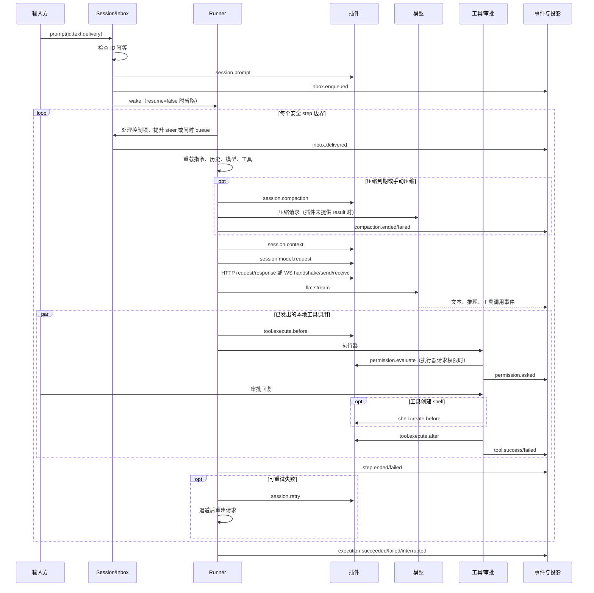

# 拆解：OpenCode v2（beta 分支）的插件接口，以及它怎么测试、评测对话循环（2026-10-26）

> 用途：同上（ADR-177）。读的是 `_external\opencode-beta`（anomalyco/opencode 的 beta 分支，2026-10-26 浅克隆；本机装的 OpenCode 是 0.0.0-beta-19271）。
> 写法：Sol（只读）读码写成；主会话抽查了两处：`packages/core/src/plugin/hooks.ts:88-95`（按注册顺序串行、共用一个可变事件、callback 出错不吞）、`packages/core/test/session-runner.test.ts` 里 steer / queue 的测试，都对得上。
> 网上的插件文档、第三方镜像站写的还是旧版"返回 hooks 对象"那套（chat.params、字符串的 tool.execute.before），这个检出里已经没有了——以源码为准。

测试体系已分清：`simulation` 提供外部驱动的 UI／模型／工具控制面；`http-recorder` 录制和回放 HTTP、WebSocket；核心循环测试用可控模型流和虚拟时钟断言持久化状态。另有跨提供方黄金场景与实验性评分 API，但未找到把它们接成对话任务成功率或 `pass^k` 的循环评测流水线。报告会区分已有断言和建议给 Sumika 新增的量法。
**这份 beta 的插件接口已经不是旧版“返回 hooks 对象”的设计。**它采用 **插件定义 + 域服务注册 + 可重放状态变换 + 操作钩子**。对 Sumika 最值得借的是注册清理、持久化收件箱、单步重载历史和可控模型流测试；你需要的“批次被拦截即消费”和“回复发送前统一检查”没有直接对应的语义接口。依据：`packages/plugin/src/effect/plugin.ts:26`、`packages/core/src/plugin/hooks.ts:66`、`packages/core/src/session/inbox.ts:505`。

以下仅依据本地源码；未联网、未运行程序或测试、未修改文件。测试部分的“覆盖”指已存在相应测试和断言，不代表本次执行通过。链接标注均为 `文件:行号`。

## 1. 插件接口

### 1.1 包与职责

| 包 | 源码中的职责 | 出处 |
|---|---|---|
| `packages/plugin` | Promise／Effect 两套插件接口、宿主入口解析、源码加载支持 | package.json:15（私有存档）、effect/plugin.ts:26（私有存档） |
| `packages/plugins` | 当前看到 `figma` 插件；通过 MCP、Skill 注册扩展能力 | figma/index.ts:7（私有存档） |
| `packages/core` | 插件监督器、注册表、会话准入、收件箱、循环、工具、审批、压缩 | plugin/supervisor.ts:127（私有存档）、session/runner/llm.ts:56（私有存档） |
| `packages/ai` | 模型请求、协议、流事件、可控测试模型、提供方录制回归 | session/runner/step.ts:110（私有存档）、recorded-test.ts:79（私有存档） |
| `packages/simulation` | 外部驱动 UI、模型响应和工具执行的控制设施 | backend/index.ts:24（私有存档） |
| `packages/http-recorder` | HTTP／WebSocket cassette 录制、匹配、回放 | index.ts:10（私有存档） |

### 1.2 定义、发现、加载与上下文

**插件默认导出一个定义，不是默认导出旧版工厂函数。**

```ts
// Promise 版；@opencode/plugin 默认入口
{
  id: string,
  setup(context): void | Cleanup | Promise<void | Cleanup>
}

// Effect 版；@opencode/plugin/effect
{
  id: string,
  effect(context): Effect<void, never, Scope>
}
```

`Cleanup` 是返回 `void | Promise<void>` 的函数；Effect 版通过 Scope 注册 finalizer。加载器校验默认导出必须包含 `id` 和 `effect` 或 `setup`。出处：promise/plugin.ts:60（私有存档）、effect/plugin.ts:58（私有存档）、core/plugin/module.ts:86（私有存档）。

| 项目 | 实际规则 | 出处 |
|---|---|---|
| 自动发现 | 配置目录下的 `plugin`、`plugins`；直接子项中的 `.ts`、`.js` 文件及目录；目标按路径排序 | source-directory.ts:7（私有存档） |
| 显式配置 | `plugins` 数组接受字符串或 `{package, options}`；`-目标` 表示移除；相对路径基于配置文件目录解析 | config/plugin/source.ts:112（私有存档） |
| 配置优先级 | 自动发现先应用，显式配置后应用，因此配置可以关闭自动发现的插件 | config/plugin/source.ts:165（私有存档） |
| 本地路径约束 | 显式配置的本地插件必须是目录；自动发现保留独立服务端源文件兼容路径 | config/plugin/source.ts:155（私有存档）、plugin/module.ts:119（私有存档） |
| 包入口 | 服务端依次尝试 `server`、包根；另解析 `tui`、`rpc` 子入口 | plugin/src/host.ts:17（私有存档） |
| npm 加载 | 先尝试本地已安装解析，缺少时再安装；本地源使用可监视的源码加载器 | plugin/module.ts:106（私有存档）、plugin/supervisor.ts:170（私有存档） |
| 启用／关闭 | 支持精确 ID、`*`、前缀 `.*`；受保护内置插件不能这样关闭；重复 ID 保留启动顺序中的第一个并报告后续冲突 | plugin/supervisor.ts:28（私有存档）、plugin/supervisor.ts:103（私有存档） |

`context` 提供 `app`、`location`、配置 `options`，以及 `session`、`tool`、`permission`、`event`、`agent`、`command`、`provider`、`model`、`aisdk`、`integration`、`mcp`、`reference`、`skill`、`storage`、`rpc`、`shell`、`vcs`、`websearch`、`worktree` 等域。服务端插件宿主是 **Location 作用域**，不是每个 Session 单独实例化。存储按插件 ID 添加命名空间。出处：effect/plugin.ts:26（私有存档）、core/plugin.ts:306（私有存档）、plugin/host.ts:720（私有存档）。

### 1.3 全部服务端操作钩子

下面覆盖服务端 Agent 执行相关的全部操作钩子；`tui` 是独立 UI 扩展入口。表中名称写成“域.钩子”，实际注册形式是 `ctx.session.hook("context", callback)` 等。域清单依据：plugin/hooks.ts:13（私有存档）。

| 钩子 | 何时调用、输入 | 可修改内容／能否拦下 | 类型出处 |
|---|---|---|---|
| `session.prompt` | 用户输入准备阶段，持久化准入之前；Session ID、Message ID、prompt、metadata、delivery | 改文字、附件、agent／skill 引用、metadata、`steer/queue`；**没有 consumed／cancel 返回值** | session.ts:14（私有存档） |
| `session.context` | 主循环模型请求成形时；Session、agent、model、system、messages、options、tools | 改系统片段、历史、生成／提供方参数、工具描述／schema／可见集合；无正常短路结果 | session.ts:25（私有存档） |
| `session.compaction` | 压缩请求准备时；输入同 context | 除请求改写外，可设 `result={summary,native?,metadata?,tokens?}`，跳过模型压缩 | session.ts:41（私有存档） |
| `session.generate` | Session 辅助生成请求准备时 | 改请求，同 context；没有 `result` 覆盖字段 | session.ts:54（私有存档） |
| `session.title` | 标题生成请求准备时 | 改 system／messages／options；设 `result` 可直接提供标题 | session.ts:56（私有存档） |
| `session.model.request` | 模型请求准备时；含 `kind=primary/compaction/title/generate` | 改 `baseURL`、headers；Session／agent／model／kind 为只读身份 | session.ts:65（私有存档） |
| `session.http.request` | HTTP 发送前 | 替换 `Request`；没有语义级“停止本批输入”协议 | session.ts:74（私有存档） |
| `session.http.response` | HTTP 响应取得后、交给后续协议处理前 | 替换 `Response`；这是传输层响应，不是最终回复对象 | session.ts:82（私有存档） |
| `session.experimental.ws.handshake` | 每次模型调用选定／复用 socket 前 | 改 URL、headers；变化会重开 socket | session.ts:94（私有存档） |
| `session.experimental.ws.send` | 提供方构造出站帧后、发送前 | 替换原始字符串帧；协议语义一致性由插件承担 | session.ts:107（私有存档） |
| `session.experimental.ws.receive` | 入站帧交给提供方驱动前 | 替换原始字符串帧 | session.ts:119（私有存档） |
| `session.retry` | 核心重试策略还有额度时 | 输入 error、attempt、身份；改 `decision` 为不重试，或重试及 delay；不能突破已耗尽的核心额度 | session.ts:129（私有存档）、runner/retry.ts:31（私有存档） |
| `tool.execute.before` | 工具选择／执行前；工具名、输入、Session／agent／message／call ID | 改工具名和输入；**唯一声明允许以 `Tool.Error` 失败的操作钩子**，拒绝该次工具调用 | tool.ts:20（私有存档） |
| `tool.execute.after` | 工具成功或 `Tool.Error` 后 | 成功分支改 `result`；失败分支改 `error`；不提供成功／失败分支切换协议 | tool.ts:30（私有存档） |
| `permission.evaluate` | 配置规则未直接 deny 时，规则与保存授权算出结果之后 | 输入 action、resources、metadata、source 等；改 `effect=allow/ask/deny`、message | permission.ts:10（私有存档） |
| `shell.create.before` | Shell invocation 构建后、实际创建进程前 | 改 command、cwd、timeout、shell、env | shell.ts:3（私有存档） |
| `aisdk.sdk` | AI SDK 实例解析阶段 | 输入 model、package、options；提供／替换 `sdk` | aisdk.ts:5（私有存档） |
| `aisdk.language` | SDK language model 解析阶段 | 输入 model、sdk、options；提供／替换 `LanguageModelV3` | aisdk.ts:12（私有存档） |

重要限制：`session.context.tools` 不能凭空创建执行器。请求准备代码只接受能对应已有工具定义的条目；可改名、改描述／schema、移除，但无对应执行器的新条目被丢弃。真正加工具要走 `tool.transform`。出处：model-request.ts:242（私有存档）。

源码搜索未发现旧版 `chat.params`、`chat.message`、`tool.execute.before` 字符串式全局钩子名、`permission.ask` 或旧式 `experimental.chat/session` 钩子；不要把旧版接口清单套到这个检出上。当前注册机制见：plugin/hooks.ts:66（私有存档）。

### 1.4 顺序、合并与错误

- **操作钩子按注册顺序串行调用，共用同一个可变事件对象。**后一个看到前一个的修改；没有优先级字段，没有“第一个接管就停”的协议，也没有返回对象自动 merge。带 model 的钩子可按 `providerID` 过滤。出处：plugin/hooks.ts:68（私有存档）、registration.ts:7（私有存档）。
- **插件总体顺序：内置 pre → SDK 插件 → instance 插件 → 配置／发现的包插件 → 内置 post。**注册顺序再决定钩子顺序。出处：plugin/supervisor.ts:149（私有存档）、plugin/supervisor.ts:98（私有存档）。
- **状态变换按注册顺序从初始状态重建。**最终覆盖规则由各域 editor 决定，例如工具同有效名 `Map.set` 后写覆盖；不是全域统一的深合并。出处：state.ts:185（私有存档）、tool.ts:176（私有存档）。
- **setup／导入失败**：记录失败状态和日志；新版本失败时尽量保留或恢复先前健康版本。失败 revision 不因无关重排反复重试。出处：plugin/module.ts:139（私有存档）、plugin.ts:145（私有存档）。
- **transform 抛异常**：同步摘掉该插件整组状态注册，重新构建状态，随后报告并关闭插件 Scope，清理 hooks／RPC 等资源。出处：state.ts:57（私有存档）、state.ts:197（私有存档）、plugin.ts:186（私有存档）。
- **普通操作钩子异常没有统一“忽略并继续”保护。**触发器直接 `yield` callback，失败停止后续钩子，进入所属操作的错误路径；不能把 transform 的自动禁用语义推广给所有 hooks。Promise 版普通 hook rejection 也是 defect；仅工具前钩子的 rejection 转为 `Tool.Error`。出处：plugin/hooks.ts:91（私有存档）、promise/adapter.ts:593（私有存档）、promise/adapter.ts:650（私有存档）。

### 1.5 加工具、命令、提示词和提供方

| 能力 | 接法及边界 | 出处 |
|---|---|---|
| 工具 | `tool.transform(editor => editor.add(...))`；提供 name、description、input／output schema、execute；执行上下文含 Session、agent、message、call ID、progress | effect/tool.ts:8（私有存档）、schema/tool.ts:14（私有存档）、schema/tool.ts:100（私有存档） |
| 工具暴露方式 | 默认可进入 CodeMode 工具目录；需要直接作为模型工具暴露时使用 `options.codemode:false` | schema/tool.ts:32（私有存档）、core/tool.ts:238（私有存档） |
| 命令 | `command.transform(editor.add({name,description,execute}))`；execute 收到 Session、prompt、delivery | effect/command.ts:8（私有存档） |
| 当次提示片段 | `session.context` 改 system／messages；仅影响请求，不等同写入持久历史 | model-request.ts:249（私有存档） |
| 会话持久提示状态 | `session.instructions.entry.put/remove/list`；由指令状态机制在后续请求表达新增／变化／移除 | plugin/host.ts:611（私有存档）、session-runner.test.ts:2041（私有存档） |
| Skill／Reference | `skill.transform` 加技能；`reference.transform` 加本地／Git 参考源。Figma 插件实际加载 Skill 文件并注册 | plugin/host.ts:470（私有存档）、effect/reference.ts:7（私有存档）、figma/index.ts:18（私有存档） |
| 提供方 | `provider.transform` 加提供方信息与模型定义；`model.transform` 调整模型；AI SDK 路径还可接 sdk／language 钩子 | effect/provider.ts:15（私有存档）、plugin/host.ts:173（私有存档） |
| 认证／连接 | `integration.transform` 注册 OAuth、key、env、command、external 等认证方式；它不是聊天平台消息中间件 | effect/integration.ts:11（私有存档） |

其他状态变换域还有 `agent`、`mcp`、`vcs`、`websearch`、`worktree`。它们是各域的同步 editor 回调，外部数据应先加载，再注册或 `reload`；不是模型执行阶段的异步拦截器。出处：state.ts:5（私有存档）、plugin/host.ts:131（私有存档）。

### 1.6 事件总线：事件有哪些，会不会丢

插件的 `event.subscribe()` 订阅 **当前 Location 可见的公开服务器事件及 `rpc.*` 事件**；不是直接获得所有内部事件或历史日志 API。出处：plugin/host.ts:256（私有存档）、effect/event.ts:1（私有存档）。

与循环有关的事件清单如下；省略版本后缀：

| 事件组 | 名称 | 出处 |
|---|---|---|
| Session 状态 | `created`、`agent.selected`、`model.selected`、`moved`、`renamed`、`metadata.updated`、`permissions`、`viewed`、`archived`、`unarchived`、`deleted`、`forked` | session-event.ts:39（私有存档） |
| 收件箱 | `session.inbox.enqueued/delivered/cancelled/delivery.changed` | session-event.ts:213（私有存档） |
| 执行生命周期 | `session.execution.started/succeeded/failed/interrupted` | session-event.ts:244（私有存档） |
| 指令与辅助输入 | `session.instructions.updated`、`session.synthetic`、`session.skill.activated`、`session.shell.started/ended` | session-event.ts:266（私有存档） |
| 单步 | `session.step.started/streamed/ended/failed` | session-event.ts:333（私有存档） |
| 文本／推理 | `session.text.started/delta/ended`、`session.reasoning.started/delta/ended` | session-event.ts:396（私有存档） |
| 工具 | `session.tool.input.started/delta/ended`、`session.tool.called/progress/success/failed` | session-event.ts:480（私有存档） |
| 重试／压缩 | `session.retry.scheduled`、`session.compaction.started/delta/ended/failed` | session-event.ts:574（私有存档） |
| 其他 | usage recorded／updated、revert staged／cleared／committed；保留旧事件定义用于重放 | session-event.ts:148（私有存档）、session-event.ts:640（私有存档） |

公开清单还包含 Location、模型目录、credential／integration、provider／model／agent、filesystem、reference、permission、plugin、project、worktree、command、config、skill、PTY、shell、form、websearch，以及公开状态／TUI／安装／VCS／MCP 事件。精确集合由代码组合，且只向插件放行公开 server 集合与 RPC 事件。出处：event-manifest.ts:42（私有存档）、event-manifest.ts:71（私有存档）。

**可靠性必须分三层：**

1. **在线订阅**用 unbounded PubSub，没有固定容量满了丢旧消息的策略；但只有订阅后的事件，插件停用／进程退出期间不补发，也没有消费确认。出处：bus.ts:198（私有存档）、bus.ts:754（私有存档）。
2. **持久事件与投影**在事务中处理；提交后再通知监听者。文本 delta、推理 delta、工具输入 delta／progress、压缩 delta 明确是 ephemeral；结束事件保存完整内容。出处：bus.ts:322（私有存档）、bus.ts:456（私有存档）、session-event.ts:409（私有存档）。
3. **历史事件 payload 保留不是无条件开启。**`Bus.configured()` 默认 `persist:false`；Server 从 `options.events.persist` 注入，workerd 明确开启。核心另有按 aggregate 游标回放并跟随实时的 `Bus.log`，但插件 Context 未直接暴露它。因此不能宣称插件事件订阅“可靠、不丢、自动重放”。出处：bus.ts:207（私有存档）、server/routes.ts:121（私有存档）、server/workerd.ts:69（私有存档）、bus.ts:859（私有存档）。

### 1.7 生命周期与热重载

每个激活版本有独立 Scope。注册返回 `dispose`，关闭 Scope 自动移除注册；Promise setup 返回的 cleanup 也会执行，异步事件订阅另有作用域关闭处理。出处：plugin.ts:54（私有存档）、plugin/hooks.ts:72（私有存档）、promise/adapter.ts:50（私有存档）、promise/adapter.ts:636（私有存档）。

热重载监视配置、插件源及加载依赖；初次立即激活，后续触发合并并 debounce 100ms。只保留定义序列中未变化的前缀，从变化点开始逆序卸载旧项、顺序加载新项，以保持注册顺序。没有任意插件级的 `onEnable/onDisable/onUnload` 钩子表，生命周期主要由 setup／Scope／cleanup 表达。出处：plugin/module.ts:26（私有存档）、plugin/supervisor.ts:208（私有存档）、plugin.ts:114（私有存档）。

## 2. 对话循环与钩子位置

**一次用户输入可能驱动多个 step；每个 step 是一次显式模型流调用，再从持久历史重载继续。**工具在流中被调用时即可并行启动，下一 step 等模型流和工具收尾完成。出处：runner/llm.ts:186（私有存档）、runner/step.ts:110（私有存档）。



图中各段调用依据：

- **准入与 wake**：session/session.ts:169（私有存档）、session/prompt.ts:38（私有存档）。
- **边界处理、指令及历史准备、自动压缩**：runner/llm.ts:74（私有存档）、runner/llm.ts:207（私有存档）。
- **请求与传输 hooks**：model-request.ts:249（私有存档）、model-request.ts:298（私有存档）、model-request.ts:321（私有存档）。
- **工具、审批及 shell**：tool.ts:270（私有存档）、permission.ts:159（私有存档）、shell.ts:284（私有存档）。
- **流输出和结束**：publish-llm-event.ts:232（私有存档）、runner/step.ts:246（私有存档）、execution.ts:119（私有存档）。

这里的“发出”已经发生在文本 delta／ended 广播时，**没有统一等待完整答案、审查后再发布的阶段**；订阅 `step.ended` 再检查，无法收回此前已展示的流内容。出处：publish-llm-event.ts:236（私有存档）、publish-llm-event.ts:246（私有存档）。

**打断。**进程全局 coordinator 按 Session ID 管理活跃执行；同 Session resume 合流，不同 Session 可并行。interrupt 取消活跃执行链，返回“已接受”，清理异步结束；需要完全结束应再 wait。已启动工具会被取消并持久化为 aborted，待处理 inbox 不因此删除。用户中断释放恢复 claim，服务关闭中断保留 claim 供重启恢复。出处：execution.ts:16（私有存档）、execution.ts:136（私有存档）、runner/step.ts:150（私有存档）。

**排队／回复途中追加消息。**默认 `steer`，不是立即取消当前模型流：下一安全边界批量提升 steering 输入；`queue` 在当前 continuation 结束后逐条 FIFO 提升。steer 优先于 queue；steered 压缩可在 move 边界前优先处理，不能越过 move。提升输入重置 agent step 额度；多个 steer 同批只触发一次重置。出处：session/prompt.ts:50（私有存档）、inbox.ts:505（私有存档）、inbox.ts:546（私有存档）、runner/llm.ts:176（私有存档）。

**压缩。**手动压缩也是 inbox 控制项，在安全边界执行；自动压缩在主请求之前检查。摘要模式保留近期消息引用，native 模式保存提供方替换窗口；hook 可直接提供结果。默认自动压缩开启、保留预算 15,000、背景预计算关闭。请求在尚未产生持久输出时发生 context overflow，可尝试一次压缩恢复；已经输出之后不走这种透明恢复。出处：session/session.ts:254（私有存档）、compaction.ts:253（私有存档）、compaction.ts:578（私有存档）、runner/step.ts:162（私有存档）、runner/llm.ts:332（私有存档）。

**审批不是工具循环前统一的一道门。**先按权限快照过滤完全禁止的工具，实际执行器在副作用前调用 `permission.assert`；配置明确 deny 时直接拒绝，不运行 evaluate hook。ask 发布请求并等待回复。无反馈拒绝终止当前 step；带反馈拒绝成为模型可见工具错误，让模型继续。出处：tool.ts:229（私有存档）、permission.ts:159（私有存档）、permission.ts:223（私有存档）、permission.ts:267（私有存档）。

## 3. 对 Sumika 四项需求的映射

以下“建议”是根据接口边界作出的设计判断，不是 OpenCode 已有实现。

| 已知需求 | 在 OpenCode 中怎么接 | 顺畅程度与缺口 |
|---|---|---|
| **记忆：请求前召回并注入** | `session.context` 异步召回，改 system／messages；持久会话提示可用 instructions entry | 接入顺。注意它按**模型请求／step**运行，不等于每个用户回合只一次；工具 continuation、重试需要明确召回缓存或幂等。出处：model-request.ts:403（私有存档）、runner/llm.ts:216（私有存档） |
| **记忆：结束后判断总结** | 订阅 step 或 execution 终态，再读 context；需要模型辅助时调用 generate | 可实现，但 step 结束不等于整轮结束；execution 终态覆盖一次合并后的 busy period。建议 Sumika 明确定义自己的回合完成点和总结幂等键。出处：execution.ts:119（私有存档）、effect/session.ts:139（私有存档） |
| **记忆：三个工具** | 一次 `tool.transform` 注册三个执行器；涉及私有数据或副作用时执行器主动 `permission.assert` | 接入顺。工具注册与请求级工具改写分开，值得借。出处：effect/tool.ts:8（私有存档）、effect/permission.ts:25（私有存档） |
| **记忆：发出前泄漏检查** | 无完整语义对应；HTTP／WS response hooks 只能改协议数据，event 是事后观察 | **缺发送前检查点。**建议 Sumika 在平台发送路径增加完整回复审查；若支持流式发送，另定义缓冲和分段放行规则。出处：effect/session.ts:82（私有存档）、publish-llm-event.ts:246（私有存档） |
| **渠道中间件：统一会话、消息、人；群聊发言决策；发出前处理** | 插件可持有外部连接，用 session create／prompt／metadata 建映射，订阅结果后发送 | 只能自己搭桥。Context 没有统一 person／channel／群事件模型、发言决策链或 channel send hook。建议把平台归一化与发言决策放在 Session 准入之前。出处：effect/plugin.ts:26（私有存档）、plugin/host.ts:560（私有存档） |
| **复读、戳一戳等拦截：按优先级，第一个接了就停；整批不交模型** | `session.prompt` 能改一条用户输入，不能返回“已处理”；`session.context` 能看请求历史，但也无 consumed 结果 | **直接接口不满足。**不要用抛异常、清空文字或伪造模型响应表达正常消费。建议 Sumika 单独定义批次拦截链，返回 continue／handled，显式优先级和短路。出处：effect/session.ts:14（私有存档）、plugin/hooks.ts:91（私有存档） |
| **QQ 平台适配器** | setup 建连接，cleanup 关连接；session API 接输入、event 接输出，storage 保存映射 | 生命周期可借；QQ 协议、消息类型、收发确认、平台事件均需自己实现。`integration` 当前主要处理认证连接，不能直接视为 QQ adapter 接口。出处：promise/plugin.ts:60（私有存档）、effect/integration.ts:45（私有存档） |

## 4. 它怎么测试、评测循环

### 4.1 `simulation`：可外部操控的真实执行路径

它不是自动生成用户对话的 agent，也不是 HTTP 录制回放库。

- **模型控制面**：模型请求成为 pending invocation，外部 Drive 通过 `llm.attach/pending/chunk/finish/disconnect` 注入响应和断连。晚接入控制器可拿到尚未完成的请求。出处：simulated-provider.ts:43（私有存档）、simulated-provider.ts:208（私有存档）、protocol/simulation.ts:680（私有存档）。
- **工具控制面**：通过 scoped SDK overlay 注册任意模拟工具，再以 `tool.update/finish/fail` 控制进度和终态。出处：simulated-provider.test.ts:215（私有存档）、protocol/simulation.ts:687（私有存档）。
- **UI 控制面**：输入文字、键盘、鼠标、焦点、resize；读取交互元素、语义快照、屏幕匹配、帧截图。因而能模拟“用户在模型流／工具阻塞时继续输入或按中断”。出处：frontend/actions.ts:66（私有存档）、protocol/simulation.ts:663（私有存档）。
- **网络替换**：替换 Effect HttpClient，按路由表应答；未知目的地失败。这个保证针对被替换的 HttpClient 路径，不能扩张成任意插件原生网络 API 的沙箱保证。出处：backend/index.ts:24（私有存档）、backend/network.ts:52（私有存档）。
- **录屏**：`recording.ts` 写带时间戳的终端 output／resize JSONL，鼠标另写 sidecar；它记录 UI 时间线，不是模型 HTTP cassette。出处：recording.ts:8（私有存档）、recording.ts:140（私有存档）。

使用入口由 `OPENCODE_DRIVE` 和 manifest 指定 UI／backend loopback WebSocket endpoint；值 `"1"` 使用默认 endpoint。**外部 Drive 的自动化场景编排与评分实现待核实**：这里读到的是 OpenCode 侧控制协议和服务端。出处：manifest.ts:28（私有存档）、manifest.ts:67（私有存档）。

### 4.2 `http-recorder`：真实协议录制回放

公开入口提供 `layer/layerFetch`、`layerSocket/layerWebSocketConstructor`。默认 auto 模式：CI 强制 replay；本地已有 cassette 则 replay，否则 record。出处：index.ts:10（私有存档）、replay/state.ts:10（私有存档）。

| 行为 | 源码语义 | 出处 |
|---|---|---|
| HTTP 录制 | 请求快照、响应状态／headers／完整 body；写前脱敏 | http/recorder.ts:89（私有存档） |
| HTTP 匹配 | method、URL、脱敏后 headers、body；JSON 规范化后比较 | http/matching.ts:8（私有存档） |
| 回放顺序 | 从未使用记录中找第一个匹配项；不同请求可乱序，同请求依记录顺序消费；原子 claim 防并发重复消费 | http/matching.ts:64（私有存档）、replay/state.ts:42（私有存档） |
| 回归失败 | 请求不匹配、记录耗尽、成功结束时尚有未消费记录均可报错 | http/recorder.ts:139（私有存档）、replay/state.ts:48（私有存档） |
| WebSocket | 记录双向帧；回放验证客户端写入并维持因果帧顺序，覆盖 close、二进制帧、重连 | websocket.test.ts:230（私有存档）、websocket.test.ts:448（私有存档）、websocket.test.ts:711（私有存档） |
| 安全写入 | 检查可能的秘密，临时文件写入后 rename | cassette/store.ts:131（私有存档） |

**限制：HTTP 回放保存的是完整响应 body，不保留原始网络 chunk 时序和延迟。**它适合协议编码／解析与请求回归；中途打断、背压、交错控制要靠 TestLLM 或 simulation。依据：http/recorder.ts:45（私有存档）、http/recorder.ts:112（私有存档）。

核心已有端到端示例：通过 cassette 驱动真实 SessionRunner，断言用户消息、`Hello!` 助手内容及数据库事件序列。源码内用 `RECORD=true` 删除旧 cassette 后重新录制，并拒绝 CI 下录制。出处：session-runner-recorded.test.ts:50（私有存档）、session-runner-recorded.test.ts:186（私有存档）。

### 4.3 核心循环测试覆盖与可借用“过线表”

测试框架组合真实数据库、Bus、投影、Inbox、Runner、Session，用 TestLLM 注入流，用 Deferred 精确阻塞模型／工具，用 TestClock 推进退避。断言模型请求、可见历史和持久事件，不只断言函数返回。出处：session-runner.test.ts:477（私有存档）、session-runner.test.ts:530（私有存档）、session-runner.test.ts:593（私有存档）。

下表“量法”是建议迁移为 Sumika 验收项的形式；相应行为已有源码测试支撑。

| 过线项 | 可借的断言／量法 | 已有测试出处 |
|---|---|---|
| 工具闭环 | 一次工具调用实际执行一次；第二次请求含 user／assistant／tool；工具结果先持久化再 continuation | session-runner.test.ts:3824（私有存档） |
| 并行工具 | 阻塞 5 个工具，观察 `maxActive=5`；全部释放前模型请求数仍为 1 | session-runner.test.ts:4148（私有存档） |
| 同会话去重执行 | 两个并发 resume 只发一次模型请求，等待者共享完成结果 | session-runner.test.ts:4221（私有存档） |
| 跨会话并行 | 阻塞一个 Session，另一个仍可开始模型请求 | session-runner.test.ts:4901（私有存档） |
| Steering | 活跃 step 收到新输入；本请求不变，下一请求包含 steer | session-runner.test.ts:4244（私有存档） |
| Queue | queue 在工具 continuation 中不可见，结束后进入；多个 queue 每次一条 FIFO | session-runner.test.ts:4260（私有存档）、session-runner.test.ts:4391（私有存档） |
| 中断 | 阻塞模型／工具后中断；无下一请求，工具和 step 有唯一失败终态；重放后状态相同 | session-runner.test.ts:5287（私有存档）、session-runner.test.ts:5333（私有存档） |
| 中断不丢输入 | 中断后 queue／steer 保留，后续 wake／resume 可交付 | session-runner.test.ts:4337（私有存档）、session-runner.test.ts:4364（私有存档） |
| 错误与有限重试 | 可重试错误请求次数有界；退避在 jitter 区间；退避中断后不发新请求 | session-runner.test.ts:6202（私有存档）、session-runner.test.ts:5632（私有存档） |
| 部分输出后断流 | 已输出内容保留，生成 continuation；不把部分输出当完全未发生重放 | session-runner.test.ts:5836（私有存档） |
| 权限分流 | 配置 deny 成模型可见工具错误；用户无反馈拒绝停止；有反馈拒绝允许下一模型请求 | session-runner.test.ts:5092（私有存档）、session-runner.test.ts:5153（私有存档）、session-runner.test.ts:5187（私有存档） |
| 压缩 | 摘要＋近期尾部进入后续请求；hook 给 result 时模型调用为 0；失败／取消保留先前有效上下文 | session-runner.test.ts:3229（私有存档）、session-compaction.test.ts:773（私有存档）、session-native-compaction.test.ts:248（私有存档） |
| 压缩与排队交错 | 活跃工具收尾后先压缩再提升 steer；中断压缩不丢 steer；不能跨 move | session-runner.test.ts:2277（私有存档）、session-runner.test.ts:2356（私有存档）、session-runner.test.ts:2380（私有存档） |
| 崩溃恢复 | 恢复遗留工具／压缩的终态；用户取消不复活；恢复次数耗尽终止 | session-runner.test.ts:4555（私有存档）、session-runner.test.ts:4627（私有存档）、session-execution.test.ts:122（私有存档）、session-execution.test.ts:291（私有存档） |
| 插件故障隔离 | transform 坏掉后，该插件 hooks／RPC 消失，健康插件继续可用 | plugin-failure.test.ts:13（私有存档） |
| 协议回归 | cassette 请求精确匹配、每条消费一次、无剩余；跨提供方统一工具场景 | http-recorder/http.test.ts:71（私有存档）、ai/recorded-scenarios.ts:95（私有存档） |

### 4.4 有没有成功率、`pass^k` 或量化评测

**有固定回归集和跨提供方黄金场景；未找到对话任务成功率／`pass^k` 的循环评测流水线。**这个“未找到”限定于本次检索的 core、ai、simulation、http-recorder 源码和测试，不能推断仓库外的 Drive 或内部系统也没有。

已有黄金场景把模型、协议、transport、tags、cassette 绑定起来；天气工具闭环断言工具调用一次、参数 Paris、正确结果、最终 stop 和固定回答。它测试提供方能力及协议行为，不是长任务 benchmark。出处：recorded-golden.ts:36（私有存档）、recorded-scenarios.ts:130（私有存档）。

另有 **实验性 Evaluation API**：提交 state 和 choice／score／boolean 问题，返回选择、分数、概率／置信度；客户端验证回答是否符合题目结构。已有真实提供方录制测试，但本次没有发现它被接到 SessionRunner 的任务验收上。出处：experimental/evaluation.ts:11（私有存档）、experimental/evaluation-client.ts:44（私有存档）、provider/evaluation.recorded.test.ts:76（私有存档）。

有一个容易影响“过线率”的细节：AI 录制测试包装器在非录制模式下 **缺 cassette 会 skip**；录制时缺所需凭据也 skip。因此 Sumika 应把通过、失败、跳过分别统计，关键集要求 skip 为 0，不能只看测试命令退出码。出处：recorded-runner.ts:68（私有存档）。

**建议给 Sumika 分两张表：**

- **内核确定性过线表**：采用上表的场景与事件／请求次数断言，关键项全部通过、零跳过；用可控模型流测试并发、取消、审批和队列。方法来源：session-runner.test.ts:530（私有存档）。
- **真实模型行为表**：固定记忆、群聊、拦截、工具任务集；每题独立重复 k 次，记录单次成功率与“k 次全部成功”的 `pass^k`，另记模型调用数、工具副作用次数、费用、耗时。**这些统计是建议新增，不是 OpenCode 已有量法**；可借其黄金场景组织和 Evaluation 问题结构。来源：recorded-golden.ts:36（私有存档）、experimental/evaluation.ts:11（私有存档）。

对你新增的两个缺口，还应明确验收：**被拦截批次模型请求数为 0，且只由最高优先级命中者产生动作；泄漏检查失败时平台实际发送数为 0。**这是 Sumika 的新增要求，OpenCode 现有 `SessionHooks` 没有对应消费／发送结果契约。接口边界依据：effect/session.ts:139（私有存档）。

## 5. 待核实项

- **外部 Drive 是否已有长对话场景集、自动评判和统计报表**：本仓库已确认控制端协议，外部驱动实现未在本次可读范围内得到证实。出处：protocol/simulation.ts:663（私有存档）。
- **实际桌面／CLI 启动路径是否开启历史事件 payload 保留**：核心默认关闭，Server 由选项决定，workerd 强制开启；不能据此认定所有发行形态相同。出处：bus.ts:207（私有存档）、server/routes.ts:121（私有存档）。
- **测试在当前检出上的实际通过情况、时延和资源占用**：按只读要求未执行；本文不给出运行通过率或性能数字。测试构造与验收断言的主要来源：session-runner.test.ts:593（私有存档）。
