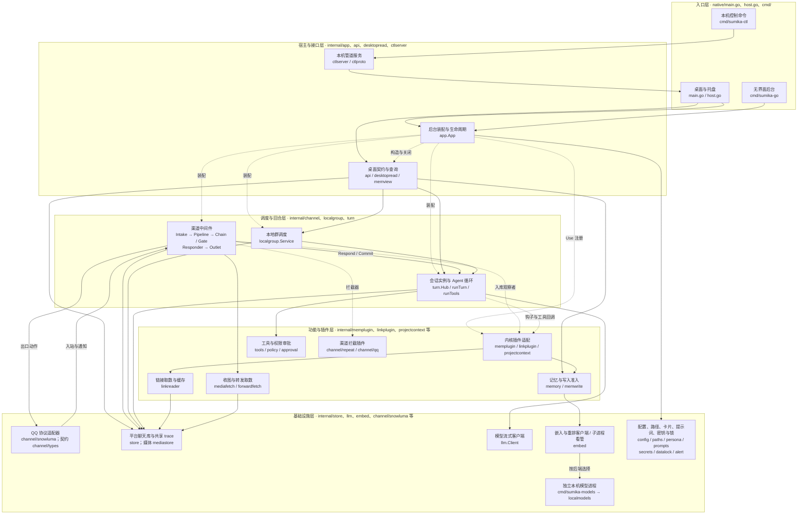

# 子系统参考

这里写每个模块**现在是怎么工作的**：职责和边界、事实来源、主要运行路径、状态变化、重要约束、验证命令。[架构总纲](../架构.md)写共同层级和约定，[设计](../设计.md)提供 Go 实现导航；参考页和源码不一致时，核对代码后同步修正文档。

Go 版的命令入口见 [Go 命令行工具](go-tools.md)，后台分层及源码导航见下方[现行 Go 后台分层](#现行-go-后台分层2026-11-04)。内核、记忆、渠道的详细契约仍见对应规格（规格-Go后台、规格-记忆-v2、规格-渠道中间件）；其余参考页的 Bun 历史段落不代表现行 Go 装配。Bun 的代码 2026-11-01 分到了 sumika-bun 仓库（从 main 的 切出，目录结构不变），页里链到的 `daemon/`、`web/` 文件在那边，这里的链接点不开。

| 子系统 | 参考 |
| --- | --- |
| Go 后台、评测压测、与开发自检命令 | [Go 命令行工具](go-tools.md) |
| 进程、配置、存储、模型、角色 | [运行时](runtime.md) |
| 回合循环、主窗口后端与前端 | [回合循环与主窗口](agent-and-console.md) |
| 角色记忆、检索、后台总结、嵌入子进程 | [记忆与嵌入](memory.md) |
| 从群聊学说法、回复时挑参考 | 表达学习（私有存档） |
| 工具分配、审批流程 | [工具与审批](tools.md) |
| 连 QQ 协议端（SnowLuma、NapCat） | 协议端适配器（私有存档） |
| QQ 渠道：收发、认人、补录、掉线提醒、自检、本机目录、`/api/qq/*` | [QQ 渠道](qq.md) |
| /goal 目标模式、斜杠命令表（核心包，未接线） | [/goal 与斜杠命令表](goal.md) |
| Bun 后台（`server/`，ADR-345 搬家中）：目录、依赖、对拍 | [Bun 后台](bun-server.md) |
| 各领域开发新东西前读的短规则 | [开发指导](../开发指导/README.md) |

## 现行 Go 后台分层（2026-11-04）

[读码] 基准为 main，本分支 `native/` 与其相同。图中实线表示主要调用或数据流，虚线表示装配、契约或注册关系；不是完整的 Go import 图，也不表示每个节点是独立进程。省略通用小工具包，主要包与源码入口列在图后。`internal/` 均相对 `native/`。

| 层 / 图中主要包 | 职责与源码位置 |
|---|---|
| 入口层 | [main.go](../../native/main.go)、[host.go](../../native/host.go) 是同进程桌面宿主；[cmd/sumika-go/main.go](../../native/cmd/sumika-go/main.go) 是无界面后台入口；[cmd/sumika-ctl/main.go](../../native/cmd/sumika-ctl/main.go) 只控制已开的桌面程序 |
| 宿主与接口层 | [app/app.go](../../native/internal/app/app.go) 的 `Open/Run/Close` 持有资源；[app/desktop.go](../../native/internal/app/desktop.go)、[app/desktop_chat.go](../../native/internal/app/desktop_chat.go) 适配桌面；[api/](../../native/internal/api/) 定义契约，[desktopread/service.go](../../native/internal/desktopread/service.go)、[memview/](../../native/internal/memview/) 实现查询；[ctlserver/server.go](../../native/internal/ctlserver/server.go)、[ctlproto/proto.go](../../native/internal/ctlproto/proto.go) 实现本机管道控制 |
| 渠道调度 | [app/channel.go](../../native/internal/app/channel.go) 的 `openChannel` 装配 [channel/](../../native/internal/channel/) 的 Intake、Pipeline、Chain、Gate、Responder、Outlet；[respond.go](../../native/internal/channel/respond.go) 的 `Kernel/Writer` 接内核与出口，[settle.go](../../native/internal/channel/settle.go) 做回合裁决；[repeat/](../../native/internal/channel/repeat/)、[qq/](../../native/internal/channel/qq/) 是复读、戳回去等拦截插件 |
| 本地调度与回合 | [localgroup/service.go](../../native/internal/localgroup/service.go) 调度本地群；[turn/hub.go](../../native/internal/turn/hub.go) 的 `Hub` 管实例、排队、插话、停止、`runTurn`；[turn/loop.go](../../native/internal/turn/loop.go) 的 `runTools` 执行工具，[turn/compact.go](../../native/internal/turn/compact.go) 管压缩 |
| 内核插件适配 | [turn/plugin.go](../../native/internal/turn/plugin.go) 定义 `Plugin/Registry` 与钩子；[turn/plugin_reconcile.go](../../native/internal/turn/plugin_reconcile.go) 做清单（`Manifest`：ID、名称、说明、`Requires/Provides` 依赖服务、`Essential`、`Settings`）、按依赖顺序启停的 `Reconcile` 和 `Reconfigure` 开关（实现了就当场调，没实现就停了再起），[turn/plugin_settings.go](../../native/internal/turn/plugin_settings.go) 把 `Settings` 结构体读成设置字段，开关和字段写在配置 `plugins.<id>.enabled`、`plugins.<id>.<字段>`（[config/plugins.go](../../native/internal/config/plugins.go)；`plugins.sessions` 是旧的会话开关，不能当插件 id；设置页还没按清单画）；[plugintrace](../../native/internal/plugintrace/trace.go) 是每个插件自己的日志（`Registry.Trace`，宿主记启停和工具调用，格式和 Bun 一样，[规格-插件两层 第二点五节](../规格-插件两层.md)）；[lifetools/plugin.go](../../native/internal/lifetools/plugin.go)（日历、天气、汇率三个只读工具，联网走 [freeapi](../../native/internal/freeapi/engine.go) 注册表）；[memplugin/plugin.go](../../native/internal/memplugin/plugin.go)、[schedule.go](../../native/internal/memplugin/schedule.go)、[compact.go](../../native/internal/memplugin/compact.go) 接召回、工具、Seen 整理与压缩前整理；[linkplugin/plugin.go](../../native/internal/linkplugin/plugin.go) 同时接渠道观察者和内核；[projectcontext/](../../native/internal/projectcontext/) 接受信工作区的项目说明 |
| 素材服务 | [assets/](../../native/internal/assets/) 是软件自带的图标、表情、字体：[icons/](../../native/internal/assets/icons/) MingCute 全套（`scripts/gen-mingcute.ts` 生成）、[emoji/](../../native/internal/assets/emoji/) 切表情序列和取 Twemoji 图、[fonts/](../../native/internal/assets/fonts/) 按用途给字体链（文渊圆体 → Maple → Windows 自带），找目录的一套办法在 [assets.go](../../native/internal/assets/assets.go)；界面（chatui）和推特卡片（linkcard）直接用，Go 插件经 [assetsvc/](../../native/internal/assetsvc/) 登记的插件服务 `assets`（`turn.AssetsOf`）取，不直接 import（archcheck 查），见 [规格-插件两层 第九节](../规格-插件两层.md) |
| 记忆与链接服务 | [memory/](../../native/internal/memory/)、[memwrite/](../../native/internal/memwrite/) 提供记忆读写、整理与写入准入，由 [app.openMemories](../../native/internal/app/app.go) 注入事件源、模型和嵌入；[store/memsource/](../../native/internal/store/memsource/) 是事件源适配；[linkreader/](../../native/internal/linkreader/) 负责链接识别、匿名取数、缓存 |
| 工具与媒体服务 | [tools/exec.go](../../native/internal/tools/exec.go) 分派工具，[policy/](../../native/internal/policy/) 集中声明权限，[approval/](../../native/internal/approval/) 执行检查与审批；[mediafetch/](../../native/internal/mediafetch/)、[forwardfetch/](../../native/internal/forwardfetch/) 由 [app/media.go](../../native/internal/app/media.go)、[app/forward.go](../../native/internal/app/forward.go) 接在入库后 |
| 协议基础设施 | [channel/types/adapter.go](../../native/internal/channel/types/adapter.go) 定义 `Adapter/Caps/Receipt`；[channel/snowluma/](../../native/internal/channel/snowluma/) 实现连接、收帧、动作及查询；发送权由 [channel/sendlock/](../../native/internal/channel/sendlock/) 管理；后台只连接外部协议端 |
| 存储基础设施 | [store/set.go](../../native/internal/store/set.go) 按平台取聊天库、共享 trace；[store/changes.go](../../native/internal/store/changes.go) 在提交后通知展示查询；[mediastore/](../../native/internal/mediastore/) 读写媒体；角色记忆库由 memory 包持有，不经 store.Set 充当聊天库 |
| 模型基础设施 | [llm/chat/](../../native/internal/llm/chat/) 是中立对话类型，[llm/openaichat/](../../native/internal/llm/openaichat/) 负责拼 OpenAI 兼容请求体和解析流式回复，[llm/llm.go](../../native/internal/llm/llm.go) 的 `Client.Stream` 只管发送、读流和计时；[embed/local.go](../../native/internal/embed/local.go)、[rerank.go](../../native/internal/embed/rerank.go) 看管本机服务与嵌入、重排调用；[cmd/sumika-models/main.go](../../native/cmd/sumika-models/main.go) 与 [localmodels/](../../native/internal/localmodels/) 是独立子进程里的分词器 / ORT / 服务端实现；是否用 Go 后端由配置决定 |
| 资源与生命周期基础设施 | [config/](../../native/internal/config/)、[paths/](../../native/internal/paths/)、[persona/](../../native/internal/persona/)、[prompts/](../../native/internal/prompts/)、[secrets/](../../native/internal/secrets/) 提供配置和输入资源；[datalock/](../../native/internal/datalock/) 在开业务库前取得进程锁；[safepath/](../../native/internal/safepath/) 校验路径边界；[alert/](../../native/internal/alert/) 保存当前提醒；装配顺序见 `app.Open` |

主要运行路径与边界：

- archive 在 `app.Open` 打开已有只读聊天库后返回；不构造 Hub、QQ 适配器或模型客户端。receive 才装配图中的执行路径。本地写入口与 QQ 接收共用 receive 宿主，模式切换由 `host.open` 管。
- 本地私聊经 `app.DesktopReader.SendLocal` → `Hub.SendLocal`；本地群聊经 `localgroup.Service` → `Hub.RespondContext`，两者不走 QQ 闸门。QQ 私聊、QQ 群经适配器 → Intake 落库 → Pipeline / 拦截链；私聊由装配分流，群经 Gate 放行后才交 Responder → Hub。
- Agent 循环是“拼上下文 → `llm.Client.Stream` → 有工具就经 `runTools` 过权限审批、执行并把结果追加回历史 → 再请求，直到无工具且无插话或被停止”。本地回复由内核入库；渠道回复在结算时依次改写、检查保险丝与守卫、拆条，经出口写库；同步 `Hub.Commit` 回填后才开始逐段发送，Commit 失败则重建下一轮实例，已写库的话照发。出处是 `hub.go`、`loop.go`、`channel/settle.go`，与各家循环对照（私有存档）的四步骨架对应；旧笔记中的 pi/Bun 现状不沿用。
- 内核插件通过 `Hub.Use` 注册上下文贡献、Seen、Settled、压缩前和工具钩子。turn 不 import memory，memory 不 import turn，由 memplugin 接起来；渠道的复读、戳回去插件只拿 types 出口契约，不拿适配器实现。实际 import 边界与常驻程序不链接一次性导入 / 评测 / 假服务的限制见 [archcheck/channel_test.go](../../native/internal/archcheck/channel_test.go)、[shipped_test.go](../../native/internal/archcheck/shipped_test.go)。

图中只列上述基准已接入的组件；不加入待办中的子代理、自改插件、第三方 Wasm 管理或 Go 识图节点。现有内核插件可撤销注册，不代表这些产品能力已实现。`cmd/memory-shadow` 等离线工具入口另见 [Go 命令行工具](go-tools.md)，不充当常驻后台的一层。本次为静态源码导航，未启动程序或验证运行性能。

## 维护规则

- 改动了某个模块的职责、接口、状态、运行路径或失败时的行为，就在同一个提交里更新它的参考页。内部重构没改这些，就不用改文档。
- 一个事实只写在一个地方，其他地方链接过来。链接到源码文件和具体函数名，不复制会经常变的实现细节。
- 现状和提议分开：提议写在设计文档或提交说明里，不写进参考页。

### 客户端自知（S1，分支实现，待共享注册表集成）

`internal/clientinfo` 沿用 `turn.Plugin` 的 `OnContext` 与 `OnTool`；`internal/app/clientinfo.go` 装配只读 `inspect_client`，从共享 `settingsreg.Read` 投影当前角色允许查看的设置。管理入口仅主人本地私聊和主人 QQ 私聊；两个群场合及非主人没有管理工具。自动上下文只包含能力摘要，不含设置值。插件注册不等于服务健康，工作区信任未核验时返回未知。详见[客户端自知与设置工具](../规格-客户端自知与设置工具.md)；设置写入走 `internal/settingtool`（预览、审批卡确认、写入、记录、回滚，装配在 `app/settingtool.go`，白名单在 `app/settingtool_keys.go`，见规格第十一节）；插件执行结果扩展尚未实现。

### 定期任务 /loop（后台核心，分支实现，尚未接线）

[`internal/loop`](../../native/internal/loop/) 只含任务表、调度器、`schedule_next` 的后台逻辑和 `/loop` 命令解析，不 import 回合内核和渠道：到点发起一轮、会话是否忙、会话是否有进行中的目标都由宿主以 `Options` 函数注入。任务表默认存成一个 JSON 文件（`FileStore`，先写临时文件再换名），接口 `Store` 可换。`ParseCommand` 是"文本进、命令出"，`Scheduler.Apply` 执行并返回给主人看的回复；`ScheduleNextDecl` / `ExecScheduleNext` 是工具声明和执行。`[无事]` 暗号的一轮只以 `Report.Kind == ResultQuiet` 交给宿主，宿主不得显示或通知。规格见[目标和循环](../规格-目标和循环.md)第三节，实现分步第 4 步；命令表登记、界面和 sumika-ctl 子命令另做。
