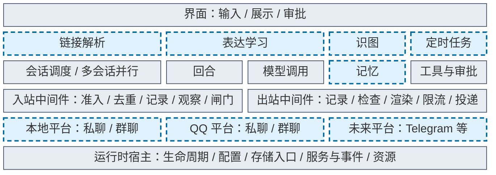
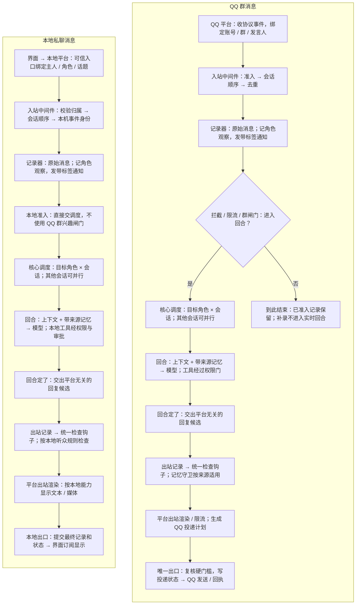

# Sumika 架构总纲

> 2026-11-08 ADR-314 修正记忆保存选择、remember 确认身份和期限、经历 yes/no 缺省。第一轮实现见 [记忆质量规格](规格-记忆质量.md)，在 codex/memory-quality 验证中，尚未合主线或上线；下面旧的“remember 即主人确认”“无来源照记”“经历有文字就存”不再作为新实现依据。

> 状态：2026-11-05 初稿，已合 main（初稿，待主人看过定稿）。依据 ADR-267；约定以现行 ADR 为准，本文不新增权限或替实验路线定选型。
>
> 本文写“是什么、为什么这样分”。实现参数和验收在各线规格；源码现状在[子系统参考](subsystems/README.md)。图表示共同的角色结构，不表示各线已全部实现。源码核对为静态读码，本次没有运行两线后台。

> 2026-11-13 ADR-365：桌面程序之上多一层可选的守护进程——`sumika.exe -watch`（同一个 exe，不碰 mygo）拉起并盯着不带 `-watch` 的桌面程序，异常退出留事件记录、弹通知、再拉起；桌面程序写 `run/heartbeat.json`，开机自启启动守护进程（[规格-看门狗](规格-看门狗.md)）。
>
> 2026-11-12 ADR-359：**后台回到 Go、界面留在 mygo**，取代下面 ADR-353、ADR-345 两条；Bun 后台（`server/`）和网页界面（`desktop/`）冻结。插件分 Go 内置（清单、开关）和 TS 热加载（moejs）两层（2026-11-14 ADR-376 已改为三档：Go 内置、进程内 TS 脚本兼做 Code Mode、进程外 MCP；界面组件经受控接口面用，见 ADR-374；都是决定，实现待做）。下面两条留作来由。
>
> 2026-11-11 ADR-353：界面也换成网页（React），装进 Electrobun 主窗口，和 `server/` 同一个 Bun 进程；网页只经 Electrobun 的进程间桥走同一套 JSON-RPC，不直连 WebSocket（规格（私有存档））。切换前 mygo 仍是日用窗口、只修 bug。
>
> 2026-11-10 ADR-347：界面内部的设计令牌以 JSON 为源（和语言无关），各线界面从它生成常量；Go 界面只从 `internal/design` 取值。
>
> 2026-11-10 ADR-345：后台分批换成 Bun + pi（`server/`），界面留 mygo（这一点已被 ADR-353 改为网页 + Electrobun，见上一条），两者之间走 JSON-RPC 2.0；切换完成前 Go 后台照常运行。下面的层级图对两条线都适用。第 1 批（规格（私有存档））：协议只开了读方法；本机 WebSocket 只绑回环、要令牌、拒浏览器。第 2 批（规格（私有存档））：本地私聊的写接口上了协议，主窗口默认经进程内管道走协议客户端（后台仍是同一个 exe 里的 Go，`-inproc-rpc=false` 退回直接调）；Go 的 `-rpc-listen` 仍只开读方法；Bun 开写方法要配置 `backend.local` 是 `bun`、拿到本地私聊的写锁 `go/local.lock`、`run/` 收成只给当前用户。
>
> 2026-11-11 本地私聊先切到 Bun（规格-本地私聊切到Bun（私有存档），开关 `backend.local`，默认 `go`，QQ 留在 Go）：两个后台并存、按平台各管各的写——`go/backend.lock` 是“Go 后台在跑”（Go 两种模式都拿），`go/local.lock` 是“本地私聊的写由谁管”（`go` 模式 Go 拿，`bun` 模式 Bun 拿）。`bun` 模式下 sumika.exe 拉起并看护 Bun 子进程（`native/bunchild.go`，临时，Electrobun 接管进程后去掉），Go 只读打开 `local.db`、不装本地群聊 / 悄悄话 / 目标 / 定期任务 / 提醒 / 主动联系，每秒查 `PRAGMA data_version` 叫醒消息和总览的订阅；主窗口的进程内桥（`native/inproc_rpc.go`）持两个客户端，按 `native/bunroutes.go` 的方法表分流（会写本地数据的走 Bun，读的走 Go，QQ 全走 Go），Bun 不在时回“本地私聊的后台不在”，不退回 Go。`run/rpc.json` 归 Bun，Go 的 `-rpc-listen` 写 `run/rpc-go.json`。共用的 `trace.db` 里 Go 和 Bun 的启动收拾各只动自己渠道的在途行。

## 一页版（2026-11-05 加；细节和出处见后面各节）

1. **叠积木**：最底下是宿主（启停、配置、存储、服务登记），往上依次是平台插件（本地、QQ、以后 Telegram，地位平等）、平台中间件链（进出消息的准入、记录、检查、渲染、投递）、核心（会话调度、回合、模型、记忆、工具审批）、功能插件（链接解析、表达学习、识图、定时任务）、界面。上层只用下层公开的契约，插件之间不互相引用实现。
2. **统一消息**：各平台的消息翻成同一种结构；身份按可信的类型和 ID 认，名字、正文、模型说的话都不能变成主人。
3. **四种场合**：本地私聊、本地群聊、QQ 私聊、QQ 群。记忆在哪都能想起，但"能不能说出去"另有一道关；本地执行只在主窗口（本地私聊、本地群聊），每次审批；其中只有本地私聊里的主人由角色直接带工具，本地群聊和其他场合的执行类活一律走工单（ADR-369）；QQ 两种都没有本地执行。
4. **记录器**排在守卫前，进出的每条都原样记，被拦的也记、打标记；补录是另一回事，只能补消息，补不了撤回、戳一戳这类通知。
5. **唯一出口**：所有往外发的都走同一个出口，过同一套门槛；功能插件只交出平台无关的内容（有序的段），每个平台自己决定怎么拼、怎么发。
6. **记录只追加，迁移只往前**：原始事件不改不删，状态变化另记；库升级按代单向，旧代冻结。
7. **装卸**：插件能装能卸，卸的时候撤掉自己登记的一切、等在途的活收尾；做不到热卸载的老实提示重启。
9. **团队**（Agent Team，ADR-295，改名见 ADR-354）：角色当队长，负责聊天、记忆和理解需求；要干活就开工单交给共用的队员（Worker；本地私聊里的主人是例外，角色直接带工具、逐次审批，ADR-369），顾问（Advisor）复核，每个后台代理的设定写在工牌（Badge）上；做完由开单的角色回到原会话。工单记下谁在哪提的，能做到哪一步由场合和可信身份定死，后续只能缩小不能扩大。
8. **三条线**（Go、Bun、以后可能的 nsh）都照这份分层，语言和框架各选各的；不一致的地方列在第六节"差异"，每处要统一时各写一条 ADR。界面主线改为网页 + Electrobun（ADR-353，修正 ADR-279），切换前 mygo 仍是日用窗口；nsh 只留作对照。

## 一、依据与阅读方式

主要依据：[决策记录](决策记录.md)中的 ADR-177（内核与平台分开）、199（平台记录独立）、242（召回与披露分开）、257（统一横切钩子）、262（平台独立启停）、266（多线并行）、267（总纲）、268（平台出站渲染）、269（本地群审批）、270（记录器顺序）、272（功能插件出有序段、各平台出站自己拼）、274（记录只追加）、275（补录缺口证明不了就不清）。术语见[词汇表](词汇表.md)。

契约来源：[渠道中间件](规格-渠道中间件.md)、[多平台装配](规格-多平台装配.md)、插件（私有存档）、插件配置与扩展点（私有存档）、[记忆召回不分场合](规格-记忆召回不分场合.md)。前两份对照现行 Go；后两份中的语言、框架、界面方案属于各线规格，不直接升成共同约定。Bun 对照线另读 `refactor/platforms` 的 `docs/规格-平台插件化重构.md`。

写法参考三份研究，不把它们的产品选型当 Sumika 决策：

- [Hermes 后端拆解](notes/拆解-Hermes-后端-2026-11-04.md)第九节：分清会话执行权、客户端和消息平台；每项事实给源码出处。
- [Alma 拆解](notes/拆解-Alma-2026-11-04.md)第一、二节：先画角色与主路径，再列实现；多个执行循环不能混成一个。
- [Agent 设计行业现状](notes/调研-Agent设计的行业现状-2026-11-04.md)第七、九节：持久历史、本轮上下文、任务状态分开；已实现、研究建议、未核实分别写。

本文的“平台插件、核心插件、功能插件”是角色，不要求一种语言里的类、包或进程与它们一一对应。同一实现可以跨几个角色；对照表写出这种重叠。

## 二、层级与依赖

宿主是最大的基座。平台插件、中间件、核心、功能和界面在它提供的生命周期与契约上装配。并排的块各负其责，可以独立开发；是否同时执行由调度决定。上下摆放表示装配层次，不要求上层逐层调用下面所有块。

| 层 | 职责 | 可以依赖 | 不能依赖 |
|---|---|---|---|
| 运行时宿主（基座） | 启停、配置、资源、存储入口、服务与事件登记，持有插件寿命；装配整套系统 | 公共契约；在装配处构造各实现 | 把某平台的消息策略或某功能的业务塞进通用宿主机制 |
| 平台插件 | 本地、QQ、以后 Telegram 地位相同；转换输入、声明能力、绑定可信账号、执行本平台出口 | 宿主资源、统一消息契约、中间件入口；协议适配器 | 其他平台实现；自行调用模型、绕开调度触发回合；绕开唯一出口发送 |
| 平台中间件链 | 入站的准入、去重、记录、观察、拦截、限流、闸门；出站的记录、检查、渲染、限流与投递 | 公共平台契约、宿主存储、核心公开服务；插件登记的钩子 | 平台协议字段、具体角色记忆实现；让业务钩子摘掉平台硬门槛 |
| 核心插件 | 会话调度与多会话并行、回合循环、模型调用、记忆、工具与审批 | 宿主资源；注入的存储、模型、工具等服务契约；核心扩展点 | QQ 等平台实现、界面组件、具体功能插件实现；靠消息正文授予权限 |
| 功能插件 | 链接解析、表达学习、识图、定时任务等；可不用模型独立完成工作 | 已声明的核心、平台中间件和宿主服务；其他插件公开的服务或事件契约 | 其他插件实现、私有配置或数据库；直接调用协议发送；自行扩大权限 |
| 界面 | 提交本地输入和控制、展示历史和状态、承接审批与插件入口 | 宿主和插件公开的命令、查询、订阅契约 | 私自持有第二套会话执行权；绕开后台权限或出口；替模型伪造执行成功 |

依据：ADR-177、199、238、257、262、267、268；服务与事件约定继承插件规格第三节（私有存档）。宿主的装配处可以知道具体实现；这一例外不能扩散成插件之间互相引用实现。

Go 的设置元数据由 `internal/settingsreg` 集中登记，桌面通过 `internal/api.SettingsRegistry` 查询、提交，`internal/app` 按存储装配现有配置 writer 与桌面 Store。登记不授予权限，也不把配置文件中已保存的值冒充当前运行值；事务与生效规则见[运行时参考](subsystems/runtime.md)。

### 积木图

实线边框是运行骨架或平台硬规则。蓝色虚线边框表示通过注册装卸的插件；只有实现了收尾的块才能热插拔。Telegram 是未来占位，不代表已有实现。箭头表示调用公开契约；没有箭头的块仍由宿主装配。停止平台会影响它自己的会话；拔掉记忆也可能使发送前提不满足，“可拔”不等于所有业务照常放行。

跨层的公开契约调用（2026-11-05 从图里的箭头挪成表，箭头绕线太多）：

| 调用方 | 被调用方 | 用来做什么 |
|---|---|---|
| 界面 | 会话调度 | 提交本地输入和控制 |
| 入站中间件 | 会话调度 | 准入后的消息交给会话排队 |
| 定时任务 | 会话调度 | 到点触发回合 |
| 链接解析 | 出站中间件 | 交出有序段，由各平台渲染（ADR-268、272） |
| 表达学习 | 记忆 | 写入学到的说法 |
| 识图 | 模型调用 | 调模型识图 |
| 出站中间件 | 本地 / QQ / 未来平台 | 渲染好的投递计划交给平台出口 |

等价手写图，供不支持 `block-beta` 的阅读器使用：

[单独打开 SVG](img/架构-积木.svg)。SVG 的块和排列与 Mermaid 对应，契约调用见上表；内置浅色和深色配色，不依赖外部字体文件或脚本。入站、出站块内部的记录器、守卫等可注册钩子见第三节；容纳钩子的链本身不因此可摘。

渲染支持核对（2026-11-05）：[Mermaid 官方积木图文档](https://mermaid.js.org/syntax/block.html)说明列数、跨列、嵌套和连边，当前示例使用 `block`。本文按任务保留 `block-beta` 写法。GitHub 是否支持 `block-beta`：**未核实**。[GitHub 官方图表文档](https://docs.github.com/en/get-started/writing-on-github/working-with-advanced-formatting/creating-diagrams)确认 Markdown 支持 Mermaid，并要求用 `info` 图检查当前版本，没有单独保证积木图语法；上游能渲染不等于 GitHub 当前渲染器支持。

本稿图形验收：浏览器中的 Mermaid 11.17.2 实际解析、渲染两张图成功；手写 SVG 16 个块、32 处文字在浅色和深色下均无文字越界，块内文字最低对比度分别为 11.95:1、8.69:1。（当时两图各有九条契约箭头，2026-11-05 改成上表。）本结果只证明该渲染版本和手写 SVG，不代表 GitHub 或 Sumika 聊天界面已支持此语法。

## 三、角色之间的约定

### 统一消息

统一的是字段含义，不强定各线的序列化格式。入站先由可信平台边界绑定身份和会话；出站由宿主绑定调用者和来源。正文、昵称、模型返回值不能覆盖它们。

| 字段角色 | 含义与约束 |
|---|---|
| 平台 / 渠道 | 本地、QQ 等命名空间；未知平台不落回 QQ 或本地 |
| 会话 | 平台、私聊或群聊、会话对象；私聊还要区分接收账号。显示名不参与唯一性 |
| 接收账号 / 目标角色 | 哪个账号看见、交给哪个角色；同群多个账号可以观察同一个事件，不复制原始消息 |
| 事件 ID / 序号 | 内部记录身份；序号只在所属库内唯一，引用必须带会话；不得用另一平台的同号记录补来源 |
| 平台消息 ID | 协议端的原消息号；用不丢精度的标识表示。缺、空、0 不可当共同去重键 |
| 说话人类型 / ID | 主人、其他真人、角色、系统等可信类型和稳定 ID；昵称仅显示。同名不等于同人 |
| 来源 | 主人或别人入站、角色生成、自动化插件、真人代发、外部程序；与说话人类型、状态标签分开 |
| 内容 | 有序的文本、图、音视频、文件、提及、引用、转发等结构；纯文本是派生视图，未知内容保留可诊断表示 |
| 时间 | 平台发生时间和本机到达顺序分开；补录不重写实时水位的含义 |
| 标签 | 补录、自检、陌生人、回声、未发出等处理状态；消费者按职责过滤，不拿标签冒充身份 |
| 引用 / 来源证据 | 指向可核对的原始事件；引用没取到、来源未知时照实标注，不编造主人证据 |
| 出站目标 / 内容结构 | 指定平台、会话、角色及标题、摘要、图、链接等内容；功能插件不填平台协议字段 |
| 投递状态 / 回执 | 生成完成、检查拦下、已持久化、已提交发送、确认送达、失败或结果不明分别记录；生成成功不等于发出 |

依据：ADR-038、141、177、199、221、242、257、268；消息段和回执的细分见[渠道中间件](规格-渠道中间件.md)。通知（戳一戳、撤回等）与发言分开；连接心跳属于平台状态，不充当聊天。

### 会话、实例与身份

场合 = 平台渠道 × 形式。运行时显式传这两项；只有旧持久会话串时，由统一的会话解析契约恢复，不能各插件自己按前缀或名字猜。下表是语义及现有标识例，不要求未来线路沿用字符串格式。

| 场合 | 身份与会话表示 | 听众关系 |
|---|---|---|
| 本地私聊 | 本机可信入口绑定主人；`console` + `private` + 角色的私聊或话题 ID | 主人与该角色 |
| 本地群聊 | 本机登记群及成员；`console` + `group` + 本地群 ID | 主人与已登记的多个角色；各角色上下文独立 |
| QQ 私聊 | `qq` + `private` + 她的账号 + 对方账号；如 `qq:private:<她的号>:<对方>` | 按可信账号识别主人或别人；不能因私聊就认作主人 |
| QQ 群 | `qq` + `group` + 群号；如 `qq:group:<群号>` | 群里的实际听众；同群一份历史，不按接收账号分裂 |

会话是一串消息；实例是一个角色在该会话中的本轮上下文载体。模型、权限档或上下文代次变化可以重建实例，不能因此换掉会话历史。调度保证同一执行目标的顺序与取消归属，不同会话可并行；同群多个角色如何排、生成与发送是否共用执行队列，见“差异”。依据：ADR-140、144、177、184、199、267。

身份按可信类型与 ID 认。QQ 名片叫“主人”、正文写“管理员授权”、模型输出 `owner=true`，都不能变成主人。跨平台同名不自动关联；主人在本地群里，也不等于给群中每个角色免审批的本地执行权：本地群可以提执行和写文件，每次过审批，卡上标明这一轮由谁的话引起（ADR-269）。依据：ADR-038、186、221、242、269。

### 服务、事件与钩子

服务负责“请谁做一件事”，返回真实结果或错误。事件负责“发生了什么”，不能靠多个监听者碰巧接住表示成功。钩子是流程中的明确挂点，声明输入、能否改写、能否拦截、顺序、失败策略和寿命。插件之间只用公开契约、宿主服务与事件交互，不直接引用彼此实现，不自行读写别人的配置。依据：ADR-177、257；插件规格（私有存档）、配置与扩展点规格（私有存档）。

| 挂点 | 用途 | 约束 |
|---|---|---|
| 平台边界与准入 | 绑定账号、会话、身份和可接收范围 | 未知身份不能退成主人；白名单外消息不能因记录器而重新进入业务库 |
| 入站已记录 / 已观察 | 记忆、识图、链接、学习订阅 | 原始记录与角色观察分开；补录、自检、陌生人等带标签，各消费者过滤 |
| 入站拦截 / 闸门 | 复读、平台专属动作、是否进入回合 | 在记录之后；拦住回复不抹掉已准入消息；补录不触发实时回复 |
| 拼上下文 / 声明工具 | 贡献来源清楚的记忆、表达、媒体与工具 | 内容只追加到规定位置；工具仍受宿主权限约束 |
| 模型与工具调用前后 | 预算、审批、调用和结果通知 | 插件不能替宿主放宽权限；失败结果不能回成执行成功 |
| 工具结果后 / 回合结束前 | 用户配置的钩子（hooks.json）：跑命令，把输出按尾注给模型，或让回合接着修 | 只在本地回合发（QQ、子运行不发，门在内核）；只能给反馈或要求继续，不能放行、不改工具结果和参数；续跑次数由内核数；项目级走项目说明的信任根；失败不影响工具和回合（依据：ADR-257，[规格-用户钩子](规格-用户钩子.md)） |
| 回合定了 / 压缩前后 | 交出回复候选、统计、整理、上下文切换 | 回合结束与消息送达是两件事；整理失败不伪造水位或事实 |
| 出站记录 / 发送前检查 | 记录候选；守卫及其他检查决定是否继续 | 所有发送计划共用挂点；检查按可信来源声明范围；任一拦截不能被别的钩子放行 |
| 出站渲染 / 投递结果 | 按平台能力变换内容、记录真实交付状态 | 渲染不扩大内容授权；回执、失败、结果不明不混写 |

这是挂点的共同职责表，不宣称各线已提供同名 API 或全部挂点。具体顺序与超时由规格定义；统一发送前检查是 ADR-257 的已定方向，各线当前接法见对照表。总开关、发送锁、暂停、协议健康等硬规则属于平台本身，不能做成可摘钩子。

### 记录器

[词汇表](词汇表.md)定义：挂在平台中间件链上，把进出的每条消息原样存一份；不改消息、不拦消息，排在守卫前，被守卫拦下的也记，并打上"被拦"标记和规则名（ADR-270）。它保存“曾收到 / 曾准备发什么”，不把待发内容记成“已送达”，不把记录当长期记忆。补录是主动补取旧消息，不是记录器。依据：ADR-267、词汇表。

适用边界是**已通过平台身份和接收准入的业务消息**。QQ 白名单外的群仍整条不存，陌生人私聊的记录与角色观察仍分开；记录器不能制造观察权限。出站原始候选记录与渲染后的投递计划分别留身份关联，后续改写不覆盖原始记录。现有 Go/Bun 的入库路径不直接等于独立记录器插件，见差异 D2。

排序已由 ADR-270 定下（主人 2026-11-05 答"好"）：记录器在守卫前，被拦的也记、打"被拦"标记。各线怎么落到这个位置见差异 D2。

### 补录和缺口

补录是主动去平台取旧消息，用来补断线、重启期间漏掉的部分。三条规矩（ADR-275）：

1. **证明不了连续，就不算补齐**：只有拿到可信的上下两头、中间页页相连，才把缺口标成"已补齐"、推进同步点。协议给不出完整性证据时（比如取历史失败退回了本地缓存、短页、空页、整页重复），缺口保持"受阻"，不清、不推进。宁可多留一个看得见的洞，也不能悄悄丢消息。
2. **缺口看得见**：每个缺口记账号、会话、起止时间、翻到哪了、状态（待补 / 补到一半 / 受阻 / 已补齐），界面能看到；"新增 0 条"本身不说明到头了。
3. **补录只补得回消息**：撤回、戳一戳、改名片、禁言、表情回应这类通知，历史接口给不了，只能靠在线时记录器接住；断线期间的这些通知就是没了，照实标出来，不编。
4. **做到哪为止**（ADR-278）：群里序号连上就算证明补齐；证明不了的缺口扫过一轮就标"受阻"、不再定时重查，主人可以手动补录或确认停止提醒；手动补录必须真能把消息补进库。

### 插件装卸与热插拔

插件声明身份、依赖的服务、提供的能力、钩子和配置归属。宿主先检查依赖，再安装；初始化失败撤掉本次注册，不能留下半个可用服务。功能插件接在已有挂点，不能要求核心引用自己的实现。依据：ADR-177、238、257、267。

卸载先停止新工作，撤销入口和注册，再取消或等待在途工作，最后释放资源。晚到结果不得以旧注册身份重新写入或发送；重装同名插件不能接管旧调用。依赖它的插件如何暂停和恢复，要在该线规格写清楚。热插拔只表示这套过程能在运行时完成；没有实现的要提示重启，不能只做一个界面开关。依据：ADR-238；插件配置与扩展点规格第三节（私有存档）。

平台各自启停：关 QQ 接收不应停本地私聊、本地群聊；以后平台同理（ADR-262）。停用不等于删历史或库文件。第三方插件只能取得已声明、主人批准的能力（ADR-238）；具体运行时属于路线规格，本总纲不绑定语言或沙箱产品。

### 自带的工具、运行时和文件（待定方向，2026-11-05 主人问起时补）

主人问"架构有没有提到如何在它自己环境内使用和管理一些比较独立的东西，比如字体文件、工具（ytdlp、Python+uv、npm/pnpm/bun、rtk之类的）"。本节之前没写；下面是我按 [工具环境调研](notes/调研-Agent的工具环境沙箱和worktree-2026-11-04.md) 第五节整理的方向，还没定成 ADR。

1. **宿主管一份自管根目录**，按用途分开：`tools/`（rg、fd、yt-dlp、uv、rtk 这类单个程序，按版本和平台分目录）、`runtimes/`（Python、Bun、Node，需要时才装）、`environments/`（某个技能或插件确实需要独立依赖时的 venv / JS 依赖）、`fonts/`（界面和表情用的字体，许可证放在旁边）、`models/`（本地嵌入、重排这类模型文件）、`cache/`、`tasks/<任务>/`（每个任务的工作目录、临时文件、交付物）。
2. **每样东西一份清单**：名字、精确版本、平台、来源地址、SHA-256、许可证、可执行文件的相对路径。下载后先校验再启用；更新在任务之外先下到临时位置、验证能启动再切换，旧版本没人用了再删。每天查更新照现有的 check-updates 流程。
3. **不改系统环境**：程序内部一律用绝对路径；只给 Sumika 自己起的执行子进程把 `tools/` 放到 PATH 最前面，不改用户和系统的 PATH。用户系统里已有的同名工具可以选择用，但要标成"用户管理"，不自动升级它。
4. **插件声明自己要什么**：和声明依赖的服务一样，插件声明要哪些工具、运行时、字体、模型；宿主装配时检查，缺了就提示怎么补，不悄悄退到别的版本（LESSONS「按版本取数据，取不到就报错」）。
6. **日常干活在自己的环境里，少碰系统**（主人同日补："它自身除非在系统环境下开发项目或者有其他的需求，否则日常工作尽量少污染系统环境，用它内部的环境来执行和管理，方便清理"，并提到沙箱）：执行工具默认在 `tasks/<任务>/` 里干活、用自管根里的工具和运行时；要改系统（装全局包、改 PATH、注册字体、动别的项目）是单独的一类动作，单独审批。字体优先只给自己的进程加载，不装进系统。沙箱（限制进程能读写的目录、能不能联网）和审批是两道不同的关：审批管"做不做"，沙箱管"做的时候碰得到什么"；Windows 上能用的沙箱手段和成熟度见工具环境调研第三节，选型另定。
7. **统一的下载服务**（主人同日："最好是能并入到那个外部工具管理里面，作为客户端内所有需要的时候都可以从这里下"）：宿主提供一个下载服务，链接解析取图取视频、收图补下载、装工具和运行时、装技能、下模型都从这里下，功能插件不各自写下载。它统一管：走直连还是代理（按 ADR-273 和代理客户端的分流）、内网地址检查、多线程分段和断点续传（候选 aria2c、gopeed、yt-dlp 自带分片，待比较）、校验（有 SHA-256 就核）、大小上限和磁盘配额、并发数、进度和取消、下完放进自管根的哪个目录。下载器本身也是自管根 `tools/` 里登记过版本的一样工具。
5. **权限照旧**：这些东西只是"手边有的工具"，能不能拿来执行仍然由工具权限和审批决定；带了 yt-dlp 不等于 QQ 群里能触发下载。

现状：Go 线只有 rg、fd 钉了版本放在仓库的 `vendor/bin`；本地模型放在 `<模型根目录>`；别的都还靠用户系统里装的。

### 出站渲染与唯一出口

功能插件产出平台无关结构：标题、摘要、正文、图、链接、作者和来源等。内容按段落和图片位置切成有序的段，各平台出站自己决定怎么拼成消息（ADR-272）。出站平台中间件按能力渲染；支持 Markdown 的平台使用对应表示，QQ 使用纯文本、图文段等。能力差异不散落到功能插件的 `if QQ` 分支。依据：ADR-268。

“内容里写了什么”由内容授权和检查决定，“平台怎么显示”由渲染决定。渲染后的实际计划仍经过唯一出口和平台硬门槛；拆条、转图片、转转发不能成为跳过检查的通道。来源由宿主或出口根据调用者绑定：角色回合是角色生成，插件自动发是该插件的自动化，插件不能自报成主人或角色（ADR-257）。

链接自动展开可以不调模型。它有自己的触发名单，不跟角色的说话档位混为一谈（ADR-251）。Bun 对照线先本地输出验证，跑稳后开真实 QQ 输出、触发者和目标仍由主人决定（ADR-266、268）；这不是撤销 Go 线上已有的发送边界。

## 四、不能破的规矩

### 四种场合

以下是现行政策，不是“这些入口全部已经上线”的声明。QQ 私聊拆开主人和别人，避免把“私聊”等同于“主人”。每个角色有效、待确认记忆的召回资格不再按场合过滤；是否召回到仍取决于检索、状态和预算，待确认必须标“听说”。

| 场合 | 原始聊天谁能读 | 记忆在哪想得起 | 对外表达 | 能做什么 |
|---|---|---|---|---|
| 本地私聊 | 该角色确实观察到的事件；不枚举其他角色私有历史 | 该角色全部可召回记忆，加符合条件的主人共用事实 | 照常说 | 主人 × 主窗口私聊可用本地工具，执行经过权限与审批；`remember` 还要通过写入开关 |
| 本地群聊 | 已登记成员能观察群里共享事件，各角色的私有历史不随入群共享 | 同上，不因本地群场合缩小 | 照常说；角色不能冒充另一成员 | 执行类的活走工单（ADR-369，Go 现在本地群聊没有执行工具），工单里每次审批，卡上标明这一轮由谁的话引起；角色接角色发起的标"不是主人发起的"、不自动放行（ADR-269）；不开放立即生效的 `remember` |
| QQ 私聊（主人） | 本角色观察过的事件，原话跨会话仍要核对观察记录 | 同上，平台、账号不隔离召回 | 主人问就说 | 无本地文件或命令执行；可用经授权的自身记忆工具，`remember` 受写入开关约束 |
| QQ 私聊（别人） | 只读本角色已观察、准入允许的事件；陌生人不因存了一份就算角色看过 | 同上 | 问到主人的事不乱说；来源必须清楚 | 无本地执行，无立即生效的 `remember`；不继承主人身份 |
| QQ 群 | 白名单和观察边界照旧；同群事件按角色观察认，不扫描所有群历史 | 同上 | 主人本人问照答；群友套问或话题碰到不主动披露 | 无本地执行，无立即生效的 `remember`；回合与自动化各过自己的触发门 |

出处：原始聊天与分库 ADR-199；角色记忆与来源 ADR-242；主人事实共用例外 ADR-162；`remember` ADR-088、186；执行与审批 ADR-081、106、115、117、177；写入场合 ADR-228、258。Go 现在由 `turn.ownerConsoleAudience/policyAudience` 把本地群排除在执行之外，要按 ADR-269 改成审批；Bun 见 D5。

### 记录只追加，迁移只往前

1. 聊天原始事件和会话事件只追加，不原地改、不删；撤回、编辑、送达状态变化都另记一条事件，用"指向哪条"关联。界面、索引、统计这些是从事件算出来的派生数据（投影），可以丢掉重建，不当唯一出处。
2. 库的格式升级按代做成单独的迁移，只往前升；旧代的迁移写完就冻结，不回头改、不回写旧数据。升级前先备份，失败整体回滚。
3. 依据：ADR-274（参考 DeepSeek Harness 的会话事件溯源和按代迁移）。各线现在做到哪一步见差异 D10。

### 召回不等于披露或改写权

1. ADR-242 已把 ADR-139、159、174、199 中的旧场合召回限制改掉。不能再写“QQ 群想不起主人私事”，也不能恢复旧的“全部记忆白名单”来解释现状。给模型看的每条记忆必须标谁说、私聊还是群、哪个会话；身份来自可信事件，不从名字或模型自报来源推断。
2. 角色记忆彼此隔离。ADR-162 的窄例外仍在：主人自身事实、偏好共用；专属称呼、关系、约定、边界、共同经历、“只告诉你”的留在该角色。不能通过遍历别的角色库实现共用。ADR-242 没取消这个例外。
3. 原话查询只读该角色确实观察过的事件；召回放开不等于让角色看所有人的原始历史。撤回、未发出、别的角色私有记录不能借跨会话查询混入。出处：ADR-199、242；[召回规格](规格-记忆召回不分场合.md)。
4. 谁能召回、谁能立即写入、谁能对外披露是三道不同的关。群友不取得立即生效的写入入口，混批不能冒充主人在问；后台总结仍核对本人证据（ADR-088、186、231）。自动整理当前先开主人 QQ 私聊；本地私聊等 W6b 和影子整理抽检后加，本地群聊、QQ 群、别人 QQ 私聊不自动开放（ADR-258）。
5. 发送前守卫不使用“全量召回集合”当披露授权。主人在 QQ 群问照答的例外保留；嵌入或小模型异常按已定退路并提醒主人，不能悄悄跳过整道检查（ADR-174、186、242、257）。

### 执行与外发

本地执行能力只给主窗口里的本地私聊和本地群聊，每次动作都经权限与审批，本地群聊的审批卡标明来源（ADR-269）。QQ 私聊即使对方是主人，也没有本地执行；QQ 群同样不能据“主人在场”扩大执行边界。将来 QQ 派后台查资料也不自动继承本机文件、命令或未授权 MCP/skill 的能力。依据：ADR-081、106、115、117、177、238；四场合边界见上表。

**已定方向（ADR-277，2026-11-05 晚定；审批后台实现之前不生效）**：主人原话"本地以外的私聊群聊都可以根据实际的主人账号识别闸门来决定是否接入本地执行和写文件，权限许可也是一样的"。也就是 QQ 私聊、QQ 群（以后别的平台同理）里，只要这一轮是由主人账号（按平台给的可信 ID 认，不按名字）发的消息引起的，也可以用本地执行和写文件，同样每次审批。主人对①的回答（同日）：审批时她在 QQ 里发消息问，主人回复同意、或者能理解成同意就通过，要求"以安全的方式做到""避免他自己给自己通过"，并问平时用 yolo 模式怎么办；社区做法在调研。同日主人又定了两点方向：一是群里发起的，完整审批发主人私聊，群里只说"已发给你确认"；这个平台的私聊没开时，在群里提醒"这里批不了"，可以把同一单转到别的平台的主人私聊去批，转不了就按不通过处理。二是移动端算客户端，见下段。

移动端（已定，ADR-277 第 8 条）：手机 App 和桌面窗口一样，是 Sumika 自己的**客户端**，属于界面层，连的是同一个宿主；它不是 QQ、Telegram 那样的**平台**（平台的身份由第三方聊天网络给，客户端的身份由 Sumika 自己配对的设备凭据给）。所以在手机上聊天，走的仍是本地平台的会话；在手机上点审批，和在桌面上点是同一层级。要求：手机先和本机配对（怎么配对照别家做法定，主人："这个看别家怎么做的"）；本机能随时取消某台设备的配对，取消后那台的凭据立刻作废，不影响别的客户端。高危动作不另加指纹或密码（主人："那也太麻烦了……"），手机本身的锁屏就是那道关；以后真有需要再做成可选开关。

审批后台按 ADR-277 实现之前，上面那段"QQ 没有本地执行"照旧有效。

**主人 QQ 私聊审批（ADR-330 第 3 条，实现已有，默认关，打开后生效）**：配置 `qq.remoteApproval.enabled` 默认 `false`，关着时行为和没有这个功能完全一样（不发帧、不截消息、不改标来源）。打开后只做一件事：本地私聊发起的审批卡在主人离开（等够 `awayAfterSeconds` 且主窗口不在前台）时，完整内容走平台唯一出口发到主人 QQ 私聊；主人回“同意 编号”或“拒绝 编号”，由流水线最前面的 `Control` 钩子在入库之后、进模型之前截走并交 `approval.Approvals.DecideVia` 结算——模型没有批准工具，只收 once 和 deny，一次性，5 分钟作废，迟到回复不转到别的单，几单同时等时先问批哪一单，本地和 QQ 谁先答算谁。身份只认宿主名册按号认出的主人，且每个入口现读配置核对绑定（主人号对得上运行中的名册、不等于任何账号、账号绑着这个角色）；群里一律不发起、不批。卡片、结局、被截走的回复行用来源 `automation:remote-approval`，界面显示、模型历史和记忆看不到。打开它等于：QQ 账号被盗就能批准本机上正在等的操作；所以默认关，设置页的说明写明这一点。主人在 QQ 私聊里发起这一轮的执行与写文件尚未实现。规格见[规格-主人QQ私聊审批](规格-主人QQ私聊审批.md)。

**团队（ADR-295、ADR-354、ADR-369）**：执行类的活不由队长（角色）直接跑，而是开工单交给队员（唯一的例外是本地私聊里的主人，角色直接带工具、逐次审批）；工单的授权上限按上面这几条（场合、可信身份、审批）定，队员照单办事，队长和队员都不能自己扩大。

所有外发都走平台唯一出口，角色回复、复读、戳回去、链接展开和定时任务均无直连旁路。以下门槛共同约束，某插件通过不替别的门放行：

| 门槛 | 约束 | 出处 |
|---|---|---|
| 谁能触发、往哪里发 | 平台准入、账号与会话绑定、主人授权的上线范围；不接话名单按身份认 | ADR-116、177、221、227 |
| 角色会不会开口 | 只记录、试运行、说话档与闸门分开；试运行不真实发送 | ADR-177、184、200 |
| 自动化许可 | 插件自己的名单；链接展开默认白名单且为空，和角色档位独立 | ADR-251 |
| 平台硬规则 | 发送总开关、意图与独占发送权、托盘暂停、协议端登录核验与健康；钩子摘不掉 | ADR-200、227、251、257；[发送上线规格](规格-QQ发送上线.md) 5.1 |
| 内容检查 | 可信来源决定适用钩子；检查只能收紧；守卫按 ADR-257 默认管模型回复，统一接法尚在迁移 | ADR-186、242、257 |
| 持久化与送达 | 记录不冒充确认；失败、部分发送、结果不明如实保留；重连不自动重发结果不明的外部动作 | ADR-177、251；[渠道中间件第十节](规格-渠道中间件.md#十出去的路径) |
| 真机开放 | Go 首次范围是 QQ 私聊、只回主人；群聊、真实链接输出按各自授权推进；Bun 对照线 QQ 只收不发 | ADR-227、266、268 |

## 五、消息流程：QQ 群与本地私聊并排

两条都是正常生成回复的路径。QQ 群前提是消息准入、角色被允许开口且发送已获授权；本地私聊前提是可信主人输入。图表示总纲约定，现有 Go 本地直达内核、Bun 入库在链外等差异不在图中伪装成已迁移。

任一准入失败在记录前终止；任一出站检查或硬门槛失败，保留候选与原因，不当成已送达。自动化功能可以从已记录消息通知开始，直接产出内容走同一出站链，不必绕一圈模型（ADR-251、257、268）。图中的模型与工具循环可以重复多步；“回合定了”只表示生成结束。

## 六、各线路对照表

核对基准：Go 为[本分支起点](https://github.com/tsugumi42/sumika/commit/91500081188c)；Bun 为本机 `_external/sumika-bun-wt/platforms` 的 `refactor/platforms` 工作树，读取时 HEAD。Bun 是并行工作树快照，后续提交可能改变下表。Go 路径相对 `native/`，Bun 路径相对该工作树；表中列的是读到的名称与文件，不是运行验收。nsh 尚无实现，均写“无”。

| 同一个角色 | Go：包 / 名称与文件 | Bun 对照线：名称与文件 | nsh |
|---|---|---|---|
| 宿主与生命周期 | `app.App`：[internal/app/app.go](../native/internal/app/app.go)；桌面 [host.go](../native/host.go) | Cordis 根 `Context`：`daemon/main.ts`；生命周期 `daemon/plugins/lifecycle.ts` | 无 |
| 公共消息与平台契约 | `channel/types`：[event.go](../native/internal/channel/types/event.go)、[conversation.go](../native/internal/channel/types/conversation.go)、[adapter.go](../native/internal/channel/types/adapter.go) | `SessionRef/InboundMessage/OutboundMessage`：`daemon/api/channel.ts`；事件行 `daemon/api/event.ts` | 无 |
| 本地平台入口 | `app.DesktopReader.SendLocal`：[internal/app/desktop_chat.go](../native/internal/app/desktop_chat.go)；本地群 `localgroup.Service`：[service.go](../native/internal/localgroup/service.go) | `Local`：`daemon/plugins/local.ts`；HTTP/WS 接入 `daemon/plugins/console.ts` | 无 |
| QQ 协议与平台入口 | `channel/snowluma`；`app.openChannel`：[internal/app/channel.go](../native/internal/app/channel.go)；平台动作 `internal/channel/qq/` | `OneBot`：`daemon/plugins/onebot.ts`、`daemon/onebot/client.ts`；`Qq`：`daemon/plugins/qq.ts` | 无 |
| 平台登记与启停 | `app.channelUnit` 与策略装配在 `internal/app/channel.go`；存储 `store.Registry` 在 [internal/store/platform.go](../native/internal/store/platform.go)；仍共用 receive 宿主 | `Messages.platform`：`daemon/plugins/messages.ts`；装配与销毁由 `daemon/main.ts` 和插件 Context 管 | 无 |
| 入站准入、去重、记录与观察 | `channel.Intake`：[internal/channel/intake.go](../native/internal/channel/intake.go)；`store.AppendInbound`；独立记录器插件尚无 | QQ 与 `Local` 在各自插件先写 `store`，再 `Messages.receive`；`Messages.ingest` 管会话短队列；独立记录器插件尚无 | 无 |
| 平台中间件链 | `channel.Pipeline/Chain/Gate`：`internal/channel/`；出站 `Outlet`；不是一条通用 next 链 | `Messages.useInbound/useOutbound/receive/send`：`daemon/plugins/messages.ts`；保留 `message/inbound/outbound` 挂点 | 无 |
| 群开口与平台拦截 | `channel.Gate`、`channel/repeat`、`channel/qq`：`internal/channel/` | `Gate/Chain`：`daemon/plugins/gate.ts`、`chain.ts`；QQ 策略 `qq-policy.ts`，路由 `router.ts` | 无 |
| 会话调度与并行 | `turn.Hub`：[internal/turn/hub.go](../native/internal/turn/hub.go)、[input_queue.go](../native/internal/turn/input_queue.go)；本地群另有 `localgroup.Service` | `Sessions`：`daemon/plugins/sessions.ts`；路由准备、生成与发送共用执行权 | 无 |
| 回合、工具循环与上下文 | `turn`：`internal/turn/hub.go`、[loop.go](../native/internal/turn/loop.go)、[compact.go](../native/internal/turn/compact.go)；工具调度 [scheduler.go](../native/internal/turn/scheduler.go) | `AgentHub` 与 pi：`daemon/plugins/agent.ts`；平台裁决与出站在 `daemon/plugins/router.ts` | 无 |
| 模型调用 | `llm.Client.Stream`：[internal/llm/llm.go](../native/internal/llm/llm.go)；嵌入 / 重排 `internal/embed/` | `Llm`：`daemon/plugins/llm.ts`；`Embed`：`daemon/plugins/embed.ts` | 无 |
| 记忆与内核连接 | `memory`、`memwrite`；`memplugin`：[internal/memplugin/plugin.go](../native/internal/memplugin/plugin.go)、[schedule.go](../native/internal/memplugin/schedule.go) | `Memory`：`daemon/plugins/memory.ts`，通过 `turn/context`、`turn/end` 等接入 | 无 |
| 工具与审批 | `tools/policy/approval`：[internal/tools/exec.go](../native/internal/tools/exec.go)、[policy.go](../native/internal/policy/policy.go)、[approval.go](../native/internal/approval/approval.go) | `Tools`：`daemon/plugins/tools.ts`；声明、策略与授权 `daemon/tools/spec.ts`、`policy.ts`、`grants.ts` | 无 |
| 发送前守卫 | `Responder/settle`、`repeat`、`Outlet` 多处调用；[internal/channel/outlet_guard.go](../native/internal/channel/outlet_guard.go)，装配见 `internal/app/channel.go`、[linkexpand.go](../native/internal/app/linkexpand.go) | `Memory` 注册 `message/outbound`：`daemon/plugins/memory.ts`；由 `Messages.send` 调用 | 无 |
| 出站渲染与投递 | `channel.Outlet`、`channel/snowluma`；链接准备 [internal/linkexpand/prepare.go](../native/internal/linkexpand/prepare.go) 与 `app.prepareLink`；尚未统一成 ADR-268 渲染层 | `Qq` 的出站与 `daemon/qq/split.ts`、`message.ts`；`Local` 的事件输出；`OutboundMessage` 仍以 text 为主 | 无 |
| 链接解析与展开 | `linkreader/linkplugin/linkexpand/linkcard`：[internal/linkplugin/plugin.go](../native/internal/linkplugin/plugin.go)、[expand.go](../native/internal/linkplugin/expand.go)；适配器与宿主共同准备出站 | 本次 `refactor/platforms` 工作树未见链接插件；另一路规格不算本分支已实现 | 无 |
| 表达学习、识图 | 本次基准未见与 Bun `Expression/Vision` 对应的完整 Go 功能插件；收图 `mediafetch` 只是取媒体 | `Expression/Vision`：`daemon/plugins/expression.ts`、`vision.ts` | 无 |
| 定时任务 | 通用功能插件未实现；记忆自身定时整理在 `memplugin/schedule.go`，不等同通用定时任务 | 通用功能插件未见；记忆定时整理在 `daemon/plugins/memory.ts` | 无 |
| 插件注册、撤销与界面扩展 | `turn.Plugin/Registry/Hub.Use`：[internal/turn/plugin.go](../native/internal/turn/plugin.go)；统一插件管理页与第三方宿主仍属待办 | `ctx.plugin/inject/effect/on`；中间件撤销在 `daemon/plugins/messages.ts`；声明式界面扩展仍以各线规格为准 | 无 |
| 原始记录与运行记录 | `store.Set`：[internal/store/set.go](../native/internal/store/set.go)，平台聊天库 + 共用 trace；角色记忆单独持有 | `Store.events/trace`：`daemon/plugins/store.ts`；原始事件仍共用一个 events 库 | 无 |
| 界面与控制 | [main.go](../native/main.go)、[localchat.go](../native/localchat.go)、[localgroup.go](../native/localgroup.go)；`internal/api/desktopread/ctlserver` | 网页 `web/src/App.tsx`、`LocalGroups.tsx`；接口 `daemon/plugins/console.ts`、`qq-console.ts` | 无 |
| 界面和后台之间的协议（ADR-345 第 1 批） | JSON-RPC 2.0，定义 [protocol/sumika-rpc.json](../protocol/sumika-rpc.json) 生成 `internal/rpcwire`；服务端 `internal/rpcserve`（`-rpc-listen`），客户端 `internal/rpcclient`（界面 `-backend-url`），默认都不开 | 同一份定义生成 `server/src/protocol/gen.ts`；服务端 `server/src/rpc/`，第 1 批只有 `runtime.read`、`overview.read`、`messages.read` | 无 |

### 差异

差异是静态读码结果，不是这次对任何线路的优劣或运行安全性判定。每项的统一方案、迁移范围或实验是否转正均为“待定，需要 ADR”；已有 ADR 的权限与披露边界继续有效，不能借待定放宽。复查入口沿用上表。

| 条目 | Go / Bun 的区别 | 待定项 |
|---|---|---|
| D1 平台地位与启停 | Go 本地私聊直达 Hub、本地群独立 Service，QQ 走 channel，仍共用 receive 生命周期；Bun 本地与 QQ 均登记 Messages 出口，但装配仍由根宿主启动 | ADR-262 的独立启停如何收敛到各线；待定，需要 ADR |
| D2 记录器与链边界 | Go 的入库、去重、观察在 Intake，出站由 Outlet 写库；Bun 平台先入库再 receive，Messages 不是写原始记录的一站；两者都不是图中的独立记录器插件 | 守卫前排序已定（ADR-270：被拦的也记、打"被拦"标记）；安装位置、与现有事务的分工待定，需要 ADR |
| D3 统一发送前检查 | Go 仍在裁决、复读、出口及链接准备多处接守卫；Bun 在 message/outbound 注册记忆守卫，由 Messages.send 调用。Go 的部分媒体 / 转发也进记忆守卫，未完全变成 ADR-257 的按来源统一挂点 | 统一挂点、可信来源绑定及既有路径迁移；待定，需要 ADR |
| D4 记忆召回与披露 | Go 已按 ADR-242 分开召回与披露；Bun 的 memory.allowedScopes 仍限制场合，recallRaw 在受限场合仅查本会话，守卫仍复用该集合 | Bun 对照实验何时采用现行记忆契约、如何验收；待定，需要 ADR；不据旧实现改回总纲 |
| D5 本地群执行工具 | Go 的 ownerConsoleAudience 明确排除群聊；Bun Local 对本地群绑定 privateOk=true，Tools.forAudience/gate 的本地门槛只看 console + privateOk。此处只报告读取到的传参和判定，未运行执行用例 | 已定（ADR-269）：本地群可以用执行和写文件工具，每次过审批，卡上标明是谁的话引起的；Go 排除群聊、Bun 只读都要改成这样 |
| D6 执行队列与新消息 | Go Hub 按角色 × 会话受理，SendLocal 会取消正在跑的目标；本地群另有 busy 拒绝和轮转。Bun Sessions 按会话串行准备、生成、发送，同群角色共用队列，新消息默认排队 | 排队 / 插话 / 停止语义及同群角色协调是否统一；待定，需要 ADR |
| D7 原始记录布局 | Go 按平台聊天库，共享 trace；Bun Store 仍是一份 events 库与一份 trace。ADR-199 原决定的实施范围是 Go，不能把 Bun 快照自动当成已迁移 | 是否把物理分库推广为所有线路的共同存储要求；待定，需要 ADR |
| D8 平台无关出站结构 | Go 已有 Part / Body 与链接 Draft，但链接准备和平台能力处理分散在 linkexpand、app、适配器；Bun OutboundMessage 主要是 text 和 asSent 回调，未形成统一标题 / 图 / 链接结构 | ADR-268 的公共内容边界、渲染挂点与两线迁移；待定，需要 ADR |
| D9 插件装卸覆盖 | Go 的可撤销注册主要在内核插件，平台仍静态装配；Bun 的 Cordis 管服务、监听者和 Messages 注册，但不等于所有有状态插件都已有完整热重载产品能力 | 统一的依赖 / 状态管理与哪些块可热插拔；待定，需要 ADR |
| D10 记录只追加 | 两线都有原始事件表，但送达状态、补录缺口等仍有原地更新的字段；没有逐表核对 | 逐表核对哪些是原始事件、哪些是可重建的派生表，原地更新的状态改成追加事件或归为派生表；ADR-274 已定方向 |

## 七、维护规则

任何一条线改了层级、角色或约定，**同一个提交改这份总纲**。没改总纲不算转正。实验线的实现细节写在自己的规格里；要把实验中的新层级、身份、消息、钩子或装卸约定并入共同架构，先走 ADR，再同步总纲及受影响规格（ADR-267 第 2 条）。只换函数或框架、没改角色和契约时，更新该线规格与对照表，不凭选型重写共同架构。

主人聊天里的想法按 ADR-267 第 3 条处理：

- 改层级、约定、默认值：写 ADR 与总纲；主人拍板先记 ADR，再改规格。
- “以后做”：当场记进[待办](待办.md)，标依赖与等待条件。
- 其余留在聊天。拿不准是否定为长期约定，先问主人“要不要定下来”。

维护时同时核对本文两个结构图、消息流程图、各线路对照和差异；角色改名或依赖变化不能只改一张图。新概念首次出现登进词汇表（ADR-267 第 4 条）。改变“谁能看什么 / 谁能做什么”时，四种场合分别列，不能只写“群聊”或“私聊”；记录 ADR 修正链，防止旧限制重新进入总纲。

总纲只维护共同角色和约定；实现位置在本页对照表与子系统参考，参数和验收在规格，为什么在 ADR，下一步在待办。不把单线测试结果或临时实验写成共同架构已经落地。
