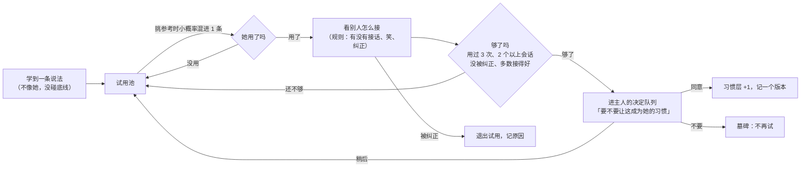

# 规格：人设成长（习惯传染）

> 状态：候选，未排期（2026-11-16 整理）。
> 原状态：主人看过（ADR-061 第 5 条），按意见改过；还没开始做，依赖通知中心和回放样本。起因：主人发现表达审核太看重"符合现在的人设"，会把她随时间长出新习惯的路堵死，希望像人之间那样，在可控范围内慢慢被身边的人"传染"说话方式。依据：[设计.md 人设成长](设计.md)的三条护栏、ADR-057（决定型界面）、ADR-058（判断要看得出来）。1.0 只做"说法"这一块；兴趣、对人的态度沿用同一套框架，之后再做。

## 一、依据

人和人聊久了会互相靠拢，这在语言学里有两个成熟的说法：

- **沟通适应理论**（Communication Accommodation Theory，Giles）：人会向想亲近的人靠拢（趋同），也会故意和别人拉开距离来表明自己是谁（趋异）。所以"被带偏"要有，"保持自己"也要有。
- **词汇趋同**（lexical entrainment，Brennan & Clark）：一起聊天的人会慢慢用同一套词，而且是从具体的对话里一个词一个词学来的，不是整体换性格。

落到她身上：新说法从具体的对话里一条条来，先试着用，别人接得好才留下；碰到和她本性冲突的，就不学。

## 二、三层

| 层 | 是什么 | 谁能改 | 回复时 |
|---|---|---|---|
| **底线** | 角色卡的"身份"块、"不像你的说法""内在矛盾"两节，加上不安全的话 | 只有主人 | 碰到的说法永远不用 |
| **习惯** | 她现在会说的话：判成"像她"的说法，加上已经长成的新习惯 | 她试、主人批 | 优先给她参考 |
| **试用** | 不像现在的她、但没碰底线的说法 | 她自己试 | 小概率混进来一条 |

现在的代码只有"像 / 不像"一道门（`expression.ts` 挑说法时 fit = bad 就不给），"不像"里混着"碰了底线"和"只是不熟"两种。要拆开：

- 审核提示词多一项：对照底线那两节，写 `boundary: true / false` 和一句理由。
- 碰底线的进"永远不用"，界面上标出是碰了哪一条。
- 没碰底线、只是不像的进试用。

## 三、一条说法怎么长成她的习惯

### 3.1 试用

- **试用是可用候选里的一栏**（ADR-061）：挑参考说法时，先照常按情境相似度从"习惯"里挑；同时从"试用"里按同样的情境挑出相关的，再以一定概率（默认 8%）放一条进去，一次最多一条。和情境不相关的试用说法根本进不了候选，所以池子大也没关系。
- 池子不设小上限：不像她、但没碰底线的说法都在试用里，靠情境筛。
- 同一条说法每天最多试一次。
- 只在主人允许的场合试（默认：群聊和私聊可以，本地不试）。
- 每次"放了哪条试用、概率多少、她用没用、别人怎么接"都记下来，给事后分析。

### 3.2 看反应（先用规则，不调模型）

- **接得好**：她说完 5 分钟内有人接着她的话说、回了笑或表情、给她点了表情回应。
- **被纠正**：有人说"你怎么这么说话""好怪""不像你"之类，或者主人在主窗口对那一句点了"不像她"。
- **没反应**：既没人接，也没人纠正，不算好也不算坏。

以后可以加 MaiBot 那种"回复效果观察"（让模型给回复打标签），等隐私规则定了再说：要把群聊内容发给模型。

### 3.3 进决定队列

够了以后生成一张卡，进通知里的"待我决定"（滑卡片，ADR-057）：

- 说法本身，和她用过的 2～3 次原话、每次别人怎么接的。
- AI 写的一句理由："她最近常在群里聊游戏，跟着群友用起了'欧皇'，三次都有人接"。
- 按钮说清结果："同意后，她会把这句当成自己的说法"。

## 四、节奏和护栏

| 护栏 | 默认 | 为什么 |
|---|---|---|
| 每个角色每周最多长一个新习惯 | 1 | 变化慢到主人察觉得到、来得及撤回 |
| 习惯层每次改动记一个版本，能退回 | — | 设计.md 的护栏 |
| 不从另一个角色那里学 | 开 | 防两个人越来越像（设计.md："互相模仿"） |
| 两个角色的习惯层太像时提醒 | 相似度 0.8 | 同上 |
| 每周用固定的情境例句跑一遍，和上周比 | — | 发现慢慢漂移（"讨好漂移"），见第七节 |
| 很久不用的习惯淡出 | 60 天没用 | 只提醒主人，不自动删 |

## 五、界面

- **决定**（ADR-057）：通知里的"她想养成的新习惯"，一次一张卡。
- **阅览**："她的资料"里加"成长记录"：时间线，每个版本加了什么、从哪学来的、什么时候批的，每条都能撤回。
- **看得出来**（ADR-058）：
  - 回复里用了试用中的说法时，在那条消息上标一个小记号"试用中"，悬停看是哪一条。
  - "学习"页每条说法标它在哪一层：底线 / 习惯 / 试用 / 墓碑。

## 六、数据

- `learning.db` 加一张试用表：说法、角色、开始时间、试了几次、用了几次、接得好几次、被纠正几次、状态（试用中 / 等主人 / 已成习惯 / 墓碑）、最后一次试的时间。
- 习惯层存在 `characters/<id>/card/growth.md`（[数据目录规格](规格-数据目录与备份.md)），每次改动在 `card/history/` 留旧版。提示词按"成长层快照每天刷新一次"拼进去，不每轮变，不打断缓存（设计.md"提示词顺序与缓存"）。

## 七、漂移检查

- 从回放样本里挑 10 个固定情境，每周让她各回一次，存下来。
- 和上周、和第一周比：用词的相似度、句子长度、语气词的分布。变化超过阈值时提醒主人看一眼，不自动回滚。
- 这一步要等回放样本核对完（路线图"测试和模型"那块）。

## 八、要主人定的

1. **试用的概率**：默认 8%（大约每 12 次回复试一次）。高了变得快，低了几乎看不出来。
2. **在哪些场合试**：推荐群聊和私聊可以，本地不试（本地是她和你说话、干活的地方，稳定一点）。（主人 2026-10-16：池子不设小上限、试用做成候选里的一栏，已改进 3.1）
3. **主人自己的说法算不算传染源**：她跟你学说话很有"住在一起"的感觉，但也容易变成只学你爱听的（讨好漂移）。推荐算，但从你那里学来的也要过一样的门槛。
4. **两个角色之间能不能互相学**：推荐默认不行，主人可以单独打开某一对。
5. **每周的上限**：默认一个。

## 九、验收

全用临时目录和替身模型。

- 碰底线的说法：试用池里永远没有它，回复参考里永远不出现。
- 试用概率：模拟 1000 次挑参考，试用出现的比例在 8% ± 2% 内；同一条一天只出现一次。
- 反应规则：造"接得好 / 被纠正 / 没反应"三种后续消息，计数对得上；被纠正一次就退出试用。
- 够门槛才进队列；同意后习惯层多一条、版本 +1；撤回后恢复到上一版，提示词快照第二天跟着变。
- 每周上限：同一周够格的有三条，只放一条进队列，其余排到下周。
- 两个角色的习惯层相似度超过 0.8 时出提醒。
